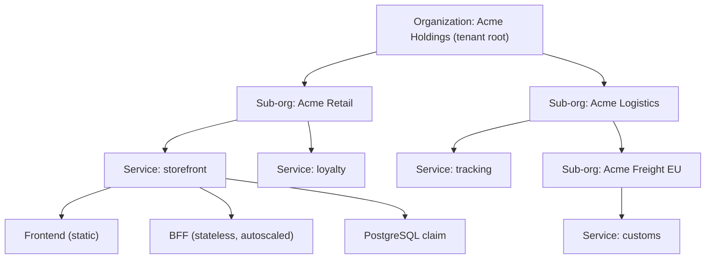
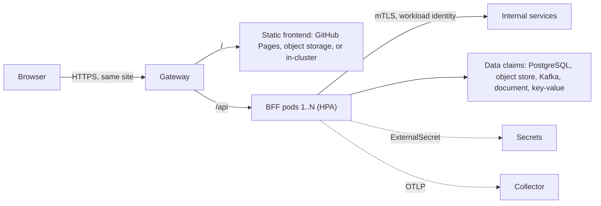

# Platform Vision Board

This is where Kore is going and why. It is not a plan: it sets direction for the
plans in [`infra/plans`](../infra/plans) and names the decisions they still need
to make. [`AGENTS.md`](../AGENTS.md) still sets the rules, and a decision
counts only once an ADR in [`docs/decisions`](decisions) records it.

An HTML rendering of this board lives in [`vision.html`](vision.html). This
Markdown file is the source; update both together.

## North Star

> **Kore is the one place an organization goes to run its software.** Register
> a service and get an HTTPS address, a backend that keeps secrets, the data stores
> it needs, identity, telemetry, a developer portal, delivery from git, and a clear view of its health, all scoped to the
> organization, with no need to know Kubernetes or a cloud provider.

## The Board

| Pillar                                           | What it means                                                                                                                                                           | Builds on                                                                                                                                                                                                            |
| ------------------------------------------------ | ----------------------------------------------------------------------------------------------------------------------------------------------------------------------- | -------------------------------------------------------------------------------------------------------------------------------------------------------------------------------------------------------------------- |
| **One home for every app**                       | Every app, the operator's own or a tenant's, runs on the same platform under the same contracts. Nothing is a one-off.                                                  | [Plan 1](../infra/plans/1-initialize.md), [ADR 0002](decisions/0002-tool-responsibility-boundaries.md)                                                                                                               |
| **Static frontends, small backends**             | Frontends are static builds hosted anywhere static. Each one gets a small, stateless backend for frontend (BFF) that holds its secrets and scales horizontally.         | [ADR 0009](decisions/0009-encrypted-secrets-through-external-secrets.md), [ADR 0006](decisions/0006-istio-ambient-gateway-api.md)                                                                                    |
| **Organizations are tenants**                    | An organization is one tenant. It can hold sub-organizations (an umbrella of companies), and each one hosts its own services under its own domains.                     | New: tenancy API                                                                                                                                                                                                     |
| **Every dependency, scoped to the organization** | Object storage, a durable message bus, document, relational, and key-value stores are claims against platform APIs, isolated by organization.                           | [ADR 0008](decisions/0008-crossplane-postgresql-platform-api.md), [ADR 0003](decisions/0003-separate-claims-and-retain-data.md)                                                                                      |
| **A developer portal out of the box**            | Every tenant gets its own Backstage, Argo CD, and Keycloak, wired to the tenancy model: each organization sees its own catalog and delivers its services from git.      | New: portal, GitOps delivery                                                                                                                                                                                         |
| **Business and developer platform**              | Business users manage companies, members, domains, and usage. Developers ship, observe, and operate services. Both views read the same model.                           | New: human identity, usage                                                                                                                                                                                           |
| **Observed from the first request**              | Logs, metrics, and traces from every service, data store, and platform component reach org-scoped backends with no setup. Dashboards and alerts come with each service. | [ADR 0010](decisions/0010-opentelemetry-collector-ingestion.md), [ADR 0019](decisions/0019-telemetry-pipeline-wiring.md)                                                                                             |
| **Secure and verified by default**               | Signed digests only, mesh identity, mutual TLS, policy, and encrypted secrets come with every service. A tenant cannot opt out.                                         | [ADR 0005](decisions/0005-release-automation-signed-image-trust.md), [ADR 0007](decisions/0007-workload-identity-and-layered-authorization.md), [ADR 0017](decisions/0017-gatekeeper-policy-families-audit-first.md) |
| **Provider-neutral, local first**                | A service moves from Minikube to a managed cloud by changing environment configuration, never service code.                                                             | [ADR 0012](decisions/0012-environment-overlays-hold-provider-specifics.md)                                                                                                                                           |

## Who It Serves

| Persona                | Wants                                                                    | Sees                                                         |
| ---------------------- | ------------------------------------------------------------------------ | ------------------------------------------------------------ |
| **Platform operator**  | One platform for everything, upgraded deliberately, safe to rebuild.     | Every tenant, platform health, capacity, pinned versions.    |
| **Organization admin** | Create companies, invite people, own domains, see what everything costs. | Their organization tree, members, services, usage, audit.    |
| **Developer**          | Go from code to an HTTPS address in minutes, then observe and fix it.    | The services they own: deploys, logs, traces, secrets, data. |
| **End user**           | A fast site that keeps their data safe.                                  | A static frontend and the BFF behind it.                     |

## Tenancy Model

An **organization** is a tenant. Organizations nest: a root organization (the
tenant) holds sub-organizations, such as the companies under an umbrella, and
sub-organizations may hold their own. A **service** is a hosted app owned by
exactly one organization. A service runs in one or more **environments**.

Rules the model keeps:

- **The tenant root is the isolation boundary.** Tenants share one cluster and
  are isolated per service environment namespace by mesh, network policy,
  quotas, and admission
  ([ADR 0037](decisions/0037-tenant-isolation-by-namespace.md)).
- **Sharing is an owner's grant.** Within a tenant, a service is shared only
  when its owner grants it, and a parent can block grants in its subtree. Only
  an operator grants across tenants
  ([ADR 0039](decisions/0039-service-sharing-by-owner-grant.md)).
- **Policy flows down and only tightens.** A sub-organization inherits members,
  quotas, allowed domains, and policy from its parent, and can narrow them but
  never widen them.
- **One owner per service.** Each service belongs to exactly one organization,
  and moving it is an explicit operation, which matches the one-owner rule in
  AGENTS.md.
- **The hierarchy is data, not cluster topology.** Organizations nest at most
  four levels below the tenant root. Kubernetes stays flat: each service
  environment gets its own namespace with a tenant label and an organization
  label, and the controller resolves ancestry from the model, so reorganizing
  companies never means moving workloads
  ([ADR 0038](decisions/0038-organization-hierarchy-depth-and-labels.md)).

How it maps onto what Kore already does:

| Concept      | Platform API (proposed)                                                                                            | Composes into                                                                                                                                                                                                                                                              |
| ------------ | ------------------------------------------------------------------------------------------------------------------ | -------------------------------------------------------------------------------------------------------------------------------------------------------------------------------------------------------------------------------------------------------------------------- |
| Organization | `Organization.platform.kore.dev`, with a `parent` field and its domains                                            | RBAC groups, ResourceQuota and LimitRange defaults, verified domains and a service base, Gatekeeper parameters                                                                                                                                                             |
| Service      | `Service.platform.kore.dev`, owned by one organization, with its hostnames                                         | A namespace per environment with ambient enrollment and image admission ([ADR 0025](decisions/0025-application-namespace-ambient-enrollment.md), [ADR 0032](decisions/0032-application-namespace-image-admission.md)); routes, certificates, and DNS records for its hosts |
| Capability   | Data claims such as `PostgreSQLInstance`, and the other [data services](#data-services-scoped-to-the-organization) | Unchanged: services claim capabilities, and environments choose the implementation                                                                                                                                                                                         |

These follow the pattern of the PostgreSQL API ([ADR
0008](decisions/0008-crossplane-postgresql-platform-api.md)): a portable
Crossplane API that controllers reconcile. Kore coordinates it and never
reconciles it itself.

## Domains and Hosts

An organization owns its domains, and its services live under them. With
`corekraft.ca` as the organization's domain and `apps.corekraft.ca` as its
service base, a service named `auth` is served at `auth.apps.corekraft.ca`.

| Host                     | Owner                  | Comes from                            |
| ------------------------ | ---------------------- | ------------------------------------- |
| `corekraft.ca`           | Organization Corekraft | A verified domain                     |
| `apps.corekraft.ca`      | Organization Corekraft | The service base it chose             |
| `auth.apps.corekraft.ca` | Service `auth`         | Default host: service name, then base |
| `login.corekraft.ca`     | Service `auth`         | An extra host under a verified domain |

- **Organizations hold domains.** An organization registers the domains it
  owns, such as `corekraft.ca`, and proves ownership with a DNS TXT record
  before any service can use them. It also names a base for its services, such
  as `apps.corekraft.ca`.
- **Services are subdomains.** A service gets `<service>.<base>` by default. It
  can ask for other hosts under any domain its organization owns, such as
  `login.corekraft.ca`, or the apex `corekraft.ca` for a marketing site.
- **Sub-organizations get a slice.** A sub-organization uses its parent's
  domains or is given a subdomain of its own, such as `retail.acme.com`, as the
  base for its services. Like other policy, a sub-organization's domains only
  narrow what its parent allows.
- **One owner per hostname.** A hostname belongs to exactly one service, and
  only under a verified domain that the service's organization or one of its
  ancestors owns. Admission rejects a route for any other host, so one tenant
  can never claim another tenant's name.
- **A platform default until a domain is added.** An organization that has not
  added a domain gets hosts under a platform-owned domain, such as
  `auth.corekraft.<platform domain>`. That domain belongs on the Public Suffix
  List, as `github.io` does, so browsers treat each organization as its own
  site and cookies cannot cross between tenants.
- **Host-only cookies.** Every service under `corekraft.ca` shares one site. A
  BFF sets host-only cookies and never `Domain=corekraft.ca`, which would send
  its session to every other service under the domain.

Upstream controllers deliver it, and Kore coordinates them:

- **Routing.** Each service's `HTTPRoute` lists its hostnames, and the Gateway
  accepts them ([ADR 0006](decisions/0006-istio-ambient-gateway-api.md)).
- **Certificates.** cert-manager issues a certificate for each host through
  ACME, and locally from the local issuer
  ([ADR 0013](decisions/0013-local-tls-before-gateway.md)). A wildcard such as
  `*.apps.corekraft.ca` covers one label only, so `api.auth.apps.corekraft.ca`
  needs its own certificate.
- **DNS records.** A DNS controller, with ExternalDNS as the candidate, writes
  records to the DNS provider the environment names. The provider is an
  environment setting ([ADR
  0012](decisions/0012-environment-overlays-hold-provider-specifics.md));
  locally, hosts resolve the way `kore.local` does today.
- **Ownership policy.** A Gatekeeper constraint checks every hostname against
  the organization's verified domains, starting in audit mode
  ([ADR 0017](decisions/0017-gatekeeper-policy-families-audit-first.md)).

## The Golden Path: Frontend, BFF, Data

Every service starts from the same shape. Teams can leave it, but the escape
hatch has to be recorded.

### Static Frontend

- A frontend is a static build artifact plus a domain. Where it is hosted is an
  environment choice: GitHub Pages, any static host or object store, or a small
  in-cluster static server running from a signed image.
- **Same site as its BFF.** The browser should reach the frontend and its BFF
  on one site, for example `auth.apps.corekraft.ca` and
  `auth.apps.corekraft.ca/api` through the Gateway, or
  `api.auth.apps.corekraft.ca` when the frontend is hosted elsewhere, such as
  GitHub Pages pointed at the service host by a CNAME record. The BFF can then
  hold the session in an `HttpOnly`, `SameSite` cookie and keep tokens out of
  the browser. Splitting across unrelated sites, such as `*.github.io` and a
  platform domain, turns that cookie into a third-party cookie and breaks it.
- No secrets in the frontend, ever. Anything secret goes through the BFF.

### Backend for Frontend

- **Small and stateless.** The BFF keeps no local state: sessions live in an
  encrypted cookie or a shared store, so any replica can serve any request and
  the HorizontalPodAutoscaler can add and remove pods freely.
- **Hides secrets and upstreams.** It holds API keys and client credentials
  (delivered as ExternalSecrets), handles the OAuth token exchange so the
  browser never sees tokens, and gathers downstream calls into the shape the
  page needs.
- **Fast to start, cheap to run.** Scale-out only helps if a new pod is ready
  in seconds. Target budgets, to confirm with measurements:

  | Budget               | Target         |
  | -------------------- | -------------- |
  | Startup to readiness | under 1 second |
  | Memory per replica   | under 256 MiB  |
  | Image size           | under 150 MB   |

  The JVM build below is expected to miss the 1-second startup target.
  Measurements decide whether a class data cache closes the gap, or whether a
  service switches to a native image or keeps more warm replicas.

- **Kotlin on Spring Boot, built with Jib.** The template builds its image with
  Jib: no Dockerfile and no Docker daemon, reproducible layers, and the image
  digest written to a file that the sign and deploy-by-digest steps use
  directly. `kore` runs the template's Jib task instead of a Docker build for
  these services, which refines
  [ADR 0015](decisions/0015-local-signed-image-delivery.md). The base image is
  pinned by digest.
- **The OpenTelemetry Java agent is baked in.** Jib adds the agent jar to the
  image and starts the JVM with `-javaagent`, so instrumentation is part of the
  signed digest rather than injected at admission. The agent is pinned by exact
  version and checksum, like every other dependency.
- **Runs on GraalVM.** The default image runs on the GraalVM JDK as a regular
  JVM, where the Java agent works. It starts faster with Spring's
  ahead-of-time processing and the JDK's class data cache, checked against the
  agent before it becomes the default.
- **Native image when the budget demands it.** A service that must start in
  under a second can build a GraalVM native image instead, packaged by Jib's
  native-image extension. The Java agent cannot run inside a native image, so
  that build exports telemetry through the OpenTelemetry Spring Boot starter,
  which supports native images, and keeps the same OTLP contract.
- **The contract stays language-neutral.** The platform asks only for a signed
  image, health and readiness endpoints, OTLP telemetry, resource requests,
  and a dedicated ServiceAccount. The existing Node reference app keeps
  satisfying the same contract.
- **Autoscaling needs its prerequisites.** HPA needs resource requests and a
  metrics source; the catalog has no metrics-server or equivalent yet. Scaling
  on request rate, or to zero, is a later step (KEDA is a candidate).

### Data and Capabilities

A service claims what it needs through stable platform APIs, as the next
section describes. It keeps those claims as a release separate from its
workload, and its data is retained by default
([ADR 0003](decisions/0003-separate-claims-and-retain-data.md)).

## Data Services, Scoped to the Organization

Every dependency a service needs is a claim against a platform API, owned by
the service and scoped to its organization. The service receives a connection
Secret and speaks the standard protocol; the environment picks the
implementation, as the PostgreSQL API already does
([ADR 0008](decisions/0008-crossplane-postgresql-platform-api.md)).

| Capability          | Contract the app sees                     | Local implementation (candidates)              | Managed substitutes                                        | Default tenancy                                               |
| ------------------- | ----------------------------------------- | ---------------------------------------------- | ---------------------------------------------------------- | ------------------------------------------------------------- |
| Relational store    | PostgreSQL protocol, `PostgreSQLInstance` | CloudNativePG (exists)                         | Amazon RDS, Cloud SQL, Azure Database for PostgreSQL       | One instance per claim                                        |
| Object store        | S3 API, a bucket claim                    | Rook Ceph object gateway, SeaweedFS, or Garage | Amazon S3, Google Cloud Storage, Cloudflare R2             | A bucket per claim in a shared store, with a service policy   |
| Durable message bus | Kafka protocol, topic and user claims     | Strimzi                                        | Amazon MSK, Confluent Cloud                                | A shared cluster; topics and ACLs prefixed by org and service |
| Document store      | MongoDB wire protocol, a database claim   | FerretDB, or the Percona Operator for MongoDB  | MongoDB Atlas, Amazon DocumentDB                           | One instance per claim                                        |
| Key-value store     | Redis protocol, a cache or store claim    | Valkey                                         | Amazon ElastiCache, Google Memorystore (both offer Valkey) | One instance per claim                                        |

Rules every data service keeps:

- **Scoped by organization.** Every claim names its service, and through it its
  organization. Credentials are per service, arrive as a Secret in the
  service's namespace, and reach only that service's resources.
- **Sharing is a grant.** Another service in the same organization can read a
  topic or bucket once its owner grants it. Another tenant never can unless an
  operator grants it.
- **Quotas per organization.** The number of claims, storage, and throughput
  are limited per organization, inherited down the tree, and only tightened.
- **Shared and dedicated tiers.** The shared tier partitions one store with its
  own access control, such as Kafka prefix ACLs and quotas or bucket policies.
  The dedicated tier gives an organization its own instance or cluster for
  isolation or performance.
- **Retained and recoverable.** Data is retained by default, and each
  capability gets export and restore, as PostgreSQL has
  ([ADR 0029](decisions/0029-local-export-and-restore.md)).
- **Open source locally.** The MongoDB server is licensed under the SSPL and
  Redis under RSALv2, SSPL, or AGPLv3, so the local candidates are open
  implementations of the same protocols, FerretDB and Valkey. Using upstream
  MongoDB or Redis instead is an exception that needs an ADR, as Plan 1
  requires.

## Observability Out of the Box

Telemetry is part of the platform, not a step each team adds. Plan 2 Step 11
installs the pipeline: services send OTLP to the Collector, which exports to
Prometheus, Loki, and Tempo, with Grafana in front
([ADR 0010](decisions/0010-opentelemetry-collector-ingestion.md),
[ADR 0019](decisions/0019-telemetry-pipeline-wiring.md)). The vision makes it
automatic for every service and scopes it to the organization.

What a service gets without writing any instrumentation:

| Signal          | Where it comes from                                                                    |
| --------------- | -------------------------------------------------------------------------------------- |
| Request metrics | Gateway and mesh telemetry: request rate, errors, and latency for every route          |
| Logs            | The node agent collects container output and enriches it with service and organization |
| Traces          | Mesh spans at the Gateway and between services, joined to the service's own spans      |
| Resource use    | Kubelet and cluster metrics per service, plus HPA replica counts                       |
| Data health     | Metrics from each data service operator, such as CloudNativePG and Strimzi             |

- **The OTLP endpoint is injected.** Every service receives the Collector
  endpoint and standard resource attributes in its environment, so the Kotlin
  BFF template exports from its first deploy. On the JVM, the OpenTelemetry
  Java agent that Jib bakes into the image traces Spring, HTTP clients, JDBC,
  Kafka, and Redis clients with no code. A native-image build uses the
  OpenTelemetry Spring Boot starter instead, because the agent cannot run
  there.
- **The platform stamps the organization.** The Collector adds tenant,
  organization, service, and environment attributes from namespace labels.
  It never trusts an organization a service reports about itself, so one tenant
  cannot write into another's telemetry.
- **Queries are scoped to the organization.** Each organization sees only its
  own logs, metrics, and traces. Loki and Tempo separate tenants natively;
  metrics need a label-enforcing proxy in front of Prometheus or a store that
  separates tenants, such as Mimir.
- **Dashboards and alerts come with each service.** Every service gets a
  dashboard for request rate, errors, latency, saturation, replicas, and its
  data claims, plus default alerts routed to its organization's contacts.
  Alerting needs Alertmanager, which ADR 0019 keeps disabled until routing is
  designed.
- **Bounded per organization.** Cardinality stays bounded by the attribute
  allowlist in ADR 0019, retention is set per organization, and telemetry
  volume counts toward usage.
- **Platform components too.** Backstage, Argo CD, the data operators, and the
  Collectors themselves report into the platform organization's view, so
  operators watch the platform with the same tools tenants use.

## The Portal: Backstage and Argo CD Out of the Box

Every tenant root gets its own Backstage and its own Argo CD, composed by the
`Organization` API, and the platform organization gets a pair for operators
([ADR 0041](decisions/0041-backstage-and-argo-cd-per-tenant.md)). Each tenant
root also gets its own Keycloak, whose groups mirror the organization tree
([ADR 0040](decisions/0040-keycloak-human-identity.md)). Organizations use Kore
through them without a terminal, and each user sees only their own
organizations.

### Backstage

- **The catalog comes from Kore's model.** Organizations become Backstage
  groups, services become components, and data claims become resources, so the
  catalog is always the org tree, never a second copy someone maintains by
  hand.
- **Software Templates are the golden path.** A template creates the
  repository from the static frontend and Kotlin BFF templates, registers the
  `Service`, and gives it its host, as a reviewed change.
- **Plugins show the running service.** The Kubernetes and Argo CD plugins show
  rollout and sync per environment, TechDocs publishes each service's docs, and
  links lead to its dashboards.
- **One per tenant, scoped by organization.** Each tenant's Backstage shows
  only that tenant, and permission policies key on the sub-organization groups
  in the token, so each user sees their part of the tree.
- **Reads clusters as the user.** The Kubernetes plugin uses the user's own
  token so Kubernetes RBAC applies. A plugin that calls another system with
  shared credentials is enabled only once it is scoped to the tenant.
- **The business view is a Kore plugin.** Organizations, members, domains, and
  usage are pages Backstage does not ship, built as a plugin on the same model.

### Argo CD

- **Delivers tenant services from git.** Tenant code and charts live in the
  tenant's own repositories. An ApplicationSet creates an Application for each
  service environment from the registrations in Kore's desired state.
- **One per tenant, namespace-scoped.** Each tenant's Argo CD can deploy only
  into that tenant's service namespaces, never into another tenant or
  cluster-scoped resources.
- **An AppProject per organization.** Each project limits which repositories
  an organization deploys from, which namespaces it deploys to, and which kinds
  of resources it may create, with RBAC keyed to the organization's group.
- **Still deploys only what was verified.** Argo CD syncs digest references,
  and image admission still rejects anything not signed by release automation
  ([ADR 0005](decisions/0005-release-automation-signed-image-trust.md)).
- **Owns tenant workloads, not the platform.** Argo CD owns each tenant
  service's workload release, refining ADR 0002 and ADR 0011 for tenant
  workloads only. Platform components stay with bootstrap, Helm, and the
  catalog.

### What Each View Shows

| Area           | Business view                                    | Developer view                                                   |
| -------------- | ------------------------------------------------ | ---------------------------------------------------------------- |
| Organizations  | Create and arrange companies; invite members     | See which organization owns what                                 |
| Services       | Catalog of every service, its owner, and its URL | Create from a Software Template; follow the Argo CD sync         |
| Environments   | Which services are live where                    | Readiness, rollout, image digest, and signer per environment     |
| Data           | What data is retained, and for whom              | Every data claim, its connection status, export and restore      |
| Secrets        | Who can manage which secrets                     | Secret names and sync status, never values                       |
| Observability  | Uptime and service-level summaries               | Dashboards, alerts, logs, metrics, and traces for their services |
| Domains        | Add and verify domains; choose the service base  | Hostnames per service, routes, certificates, and DNS status      |
| Usage and cost | Usage against quotas, per organization           | Resource and data use per service and environment                |
| Audit          | Who changed what, and when                       | Operation and sync history for their services                    |

Principles for the portal:

- **A view and a proposer, never a second source of truth.** Desired state lives
  in the repository. Backstage reads cluster and repository state, and each
  change it makes becomes a reviewed change to desired state that Argo CD or
  `kore` then applies, never a direct edit to the cluster.
- **Run like any other service.** Each tenant's Backstage and Argo CD get hosts
  under the tenant's service base, such as `backstage.apps.corekraft.ca`, a
  PostgreSQL claim, quotas, identity, policy, and telemetry like every other
  service.
- **Same model as the CLI.** `kore` and Backstage read and propose the same
  objects, so both report the same thing.

## Capability Map

What exists or is in flight today, and what the vision adds.

| Capability                                                                            | Status                                                                               |
| ------------------------------------------------------------------------------------- | ------------------------------------------------------------------------------------ |
| Networking, TLS, Gateway API                                                          | In [Plan 2](../infra/plans/2-implementation.md), Step 8                              |
| Workload identity, mTLS, authorization                                                | In Plan 2, Step 9                                                                    |
| Signed image trust and registry                                                       | In Plan 2, Step 7                                                                    |
| Encrypted secrets via External Secrets                                                | In Plan 2, Step 8                                                                    |
| PostgreSQL platform API with retention                                                | In Plan 2, Step 10                                                                   |
| Logs, metrics, traces via OpenTelemetry                                               | In Plan 2, Step 11                                                                   |
| Org-scoped telemetry: organization attributes, per-org queries, retention             | New                                                                                  |
| Default dashboards and alerts per service, routed to the organization                 | New                                                                                  |
| Tenancy API (`Organization`, `Service`)                                               | New                                                                                  |
| Quotas and per-organization limits                                                    | New                                                                                  |
| Golden-path templates (static frontend, Kotlin BFF built with Jib)                    | New                                                                                  |
| Static frontend hosting contract                                                      | New                                                                                  |
| Horizontal autoscaling (metrics source, HPA defaults)                                 | New                                                                                  |
| Human identity and single sign-on: a Keycloak per tenant with groups per organization | New                                                                                  |
| Developer portal: a Backstage per tenant with Kore plugins                            | New                                                                                  |
| GitOps delivery of tenant services: an Argo CD per tenant                             | New, deferred in [Plan 1](../infra/plans/1-initialize.md#deferred-tooling) until now |
| Object storage (S3 API)                                                               | New                                                                                  |
| Durable message bus (Kafka)                                                           | New, deferred in Plan 1 until now                                                    |
| Document store (MongoDB protocol)                                                     | New                                                                                  |
| Key-value store (Redis protocol)                                                      | New                                                                                  |
| Organization scoping and quotas for every data service                                | New                                                                                  |
| Organization domains, service hostnames, and DNS automation                           | New                                                                                  |
| Usage metering                                                                        | New                                                                                  |
| Multi-cluster mesh and management                                                     | Deferred in Plan 1                                                                   |

## Horizons

| Horizon     | Goal                                                                  | Done when                                                                                                                                                                                           |
| ----------- | --------------------------------------------------------------------- | --------------------------------------------------------------------------------------------------------------------------------------------------------------------------------------------------- |
| **Now**     | Finish the single-tenant platform in Plan 2.                          | The reference app runs end to end on a fresh profile and passes the portability checks.                                                                                                             |
| **Next**    | A service is a first-class object, delivered from git, and it scales. | `Organization` and `Service` exist as platform APIs; Argo CD delivers a Kotlin BFF and a static frontend that reach HTTPS and scale 1→N; Backstage shows them.                                      |
| **Then**    | Many tenants, each with its own data.                                 | Two tenants with nested sub-orgs share a cluster and cannot see or reach each other's services or data; object store, Kafka, document, and key-value claims work alongside PostgreSQL; quotas hold. |
| **Later**   | The one stop shop.                                                    | An organization admin and a developer do their whole job in Backstage, signed in through single sign-on, from template to running service.                                                          |
| **Someday** | Stronger isolation and a business layer.                              | A tenant can choose a dedicated virtual or physical cluster; usage turns into reports per organization.                                                                                             |

## How We Will Know

- From a Backstage template to a working HTTPS address takes under 15 minutes,
  with no hand edits to the cluster.
- A service gets a bucket, a Kafka topic, a document store, a key-value store,
  and a PostgreSQL database by claim, and a service in another organization
  cannot reach any of them.
- Under load, a BFF scales out and back in by itself, and no request fails
  because a pod started cold.
- An organization admin sees their own tree and nothing else, and a negative
  test proves it.
- A new service shows request rate, errors, latency, logs, and traces in its
  organization's dashboards before anyone writes instrumentation code, and
  another organization cannot query them.
- Every running workload in every tenant is deployed by signed digest, and no
  secret exists in plaintext on disk or in git.
- Moving a service between local and a managed environment changes only
  environment configuration.

## Not Goals

- **Not a CI system.** Tenants bring their own build pipeline; Kore defines the
  release contract (a signed digest) it accepts.
- **Not a cloud console.** Kore exposes a small set of platform APIs, not every
  upstream knob. Operators can still reach upstream tools directly.
- **Not hiding Kubernetes from operators.** The portal hides it from tenants;
  operators keep the full toolchain.
- **Not reimplementing controllers.** Tenancy, scaling, hosting, delivery, and
  data services are composed from upstream controllers, as the rest of Kore is.
- **Not forking Backstage or Argo CD.** Kore configures them and adds plugins;
  it does not carry patches to them.

## Open Questions

Each one becomes an ADR before the work that depends on it starts. Decided
questions keep their numbers and link to their ADR.

1. **Isolation tier.** Decided: one shared cluster, a namespace per service
   environment, no Capsule, and vCluster as a later dedicated tier
   ([ADR 0037](decisions/0037-tenant-isolation-by-namespace.md)).
2. **Hierarchy depth.** Decided: at most four levels below the tenant root,
   with tenant and organization labels on namespaces
   ([ADR 0038](decisions/0038-organization-hierarchy-depth-and-labels.md)).
3. **Sharing.** Decided: owner grants within a tenant, parents can block, and
   only operators grant across tenants
   ([ADR 0039](decisions/0039-service-sharing-by-owner-grant.md)).
4. **Argo CD for platform components.** Each tenant's Argo CD owns its tenant
   workloads ([ADR 0041](decisions/0041-backstage-and-argo-cd-per-tenant.md)).
   Should a platform Argo CD also take over platform components after
   bootstrap, replacing Helm and the catalog for them?
5. **Human identity.** Decided: a Keycloak per tenant root with one realm and
   nested groups per sub-organization, owned by the `Organization` API
   ([ADR 0040](decisions/0040-keycloak-human-identity.md)).
6. **Backstage tenancy.** Decided: one Backstage and one namespace-scoped Argo
   CD per tenant root, scoped inside by organization
   ([ADR 0041](decisions/0041-backstage-and-argo-cd-per-tenant.md)).
7. **Default static host.** GitHub Pages, object storage behind the Gateway, or
   an in-cluster static server, and which is the default per environment?
8. **BFF runtime.** Measure the Jib JVM image on GraalVM, with the Java agent
   and a class data cache, against the budgets above, and decide when a service
   should build a native image instead.
9. **Autoscaling source.** metrics-server for CPU-based HPA first, or straight
   to KEDA for request-based scaling and scale to zero?
10. **Usage and cost.** What is metered per organization, and is it for
    visibility only or also enforced?
11. **Domain verification and DNS.** Which controller checks the TXT record
    and writes DNS records (ExternalDNS is the candidate), and what happens to
    a service's hosts when a domain stops verifying or is removed?
12. **Platform default domain.** Which domain hosts organizations that have not
    added their own, and is it registered on the Public Suffix List?
13. **Data isolation tiers.** For each data service, what does the shared tier
    share, when does an organization get a dedicated instance, and who
    decides?
14. **Data store implementations.** Rook Ceph, SeaweedFS, or Garage for the
    local object store, and FerretDB and Valkey or upstream MongoDB and Redis
    recorded as license exceptions?
15. **Telemetry isolation.** A label-enforcing proxy in front of Prometheus, or
    a multi-tenant metrics store such as Mimir? And does each Kore tenant map
    to a Grafana organization?
16. **Telemetry retention and alert routing.** How long is each signal kept
    per organization, does volume count against quotas, and where do an
    organization's alerts go?
