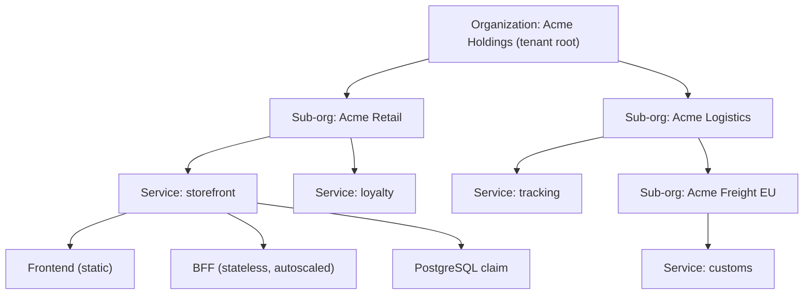
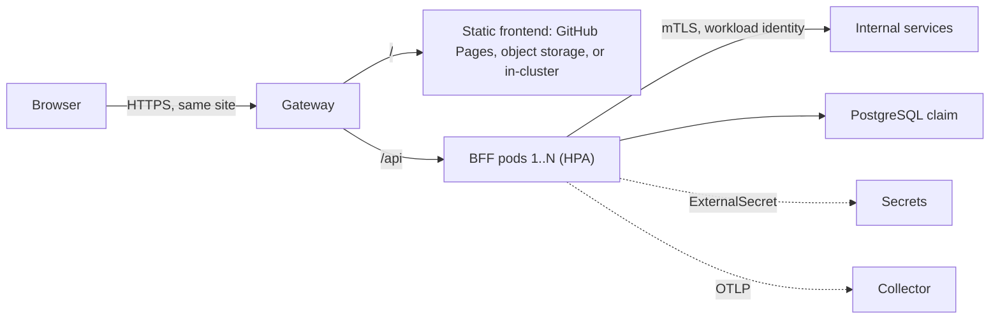

# Platform Vision Board

This is where Kore is going and why. It is not a plan: it sets direction for the
plans in [`infra/plans`](../infra/plans) and names the decisions they still need
to make. [`AGENTS.md`](../AGENTS.md) still sets the rules, and a decision
counts only once an ADR in [`docs/decisions`](decisions) records it.

## North Star

> **Kore is the one place an organization goes to run its software.** Register
> a service and get an HTTPS address, a backend that keeps secrets, a database,
> identity, telemetry, and a clear view of its health, all scoped to the
> organization, with no need to know Kubernetes or a cloud provider.

## The Board

| Pillar                               | What it means                                                                                                                                                          | Builds on                                                                                                                                                                                                            |
| ------------------------------------ | ---------------------------------------------------------------------------------------------------------------------------------------------------------------------- | -------------------------------------------------------------------------------------------------------------------------------------------------------------------------------------------------------------------- |
| **One home for every app**           | Every app, the operator's own or a tenant's, runs on the same platform under the same contracts. Nothing is a one-off.                                                 | [Plan 1](../infra/plans/1-initialize.md), [ADR 0002](decisions/0002-tool-responsibility-boundaries.md)                                                                                                               |
| **Static frontends, small backends** | Frontends are static builds hosted anywhere static. Each one gets a small, stateless backend for frontend (BFF) that holds its secrets and scales horizontally.        | [ADR 0009](decisions/0009-encrypted-secrets-through-external-secrets.md), [ADR 0006](decisions/0006-istio-ambient-gateway-api.md)                                                                                    |
| **Organizations are tenants**        | An organization is one tenant. It can hold sub-organizations (an umbrella of companies), and each one hosts its own services.                                          | New: tenancy API                                                                                                                                                                                                     |
| **An org-scoped portal**             | Each organization sees its own tree of sub-orgs, services, environments, and health, and nothing outside it. One stop for everything needed to ship and run a service. | New: portal                                                                                                                                                                                                          |
| **Business and developer platform**  | Business users manage companies, members, domains, and usage. Developers ship, observe, and operate services. Both views read the same model.                          | New: human identity, usage                                                                                                                                                                                           |
| **Secure and verified by default**   | Signed digests only, mesh identity, mutual TLS, policy, and encrypted secrets come with every service. A tenant cannot opt out.                                        | [ADR 0005](decisions/0005-release-automation-signed-image-trust.md), [ADR 0007](decisions/0007-workload-identity-and-layered-authorization.md), [ADR 0017](decisions/0017-gatekeeper-policy-families-audit-first.md) |
| **Provider-neutral, local first**    | A service moves from Minikube to a managed cloud by changing environment configuration, never service code.                                                            | [ADR 0012](decisions/0012-environment-overlays-hold-provider-specifics.md)                                                                                                                                           |

## Who It Serves

| Persona                | Wants                                                                    | Sees                                                         |
| ---------------------- | ------------------------------------------------------------------------ | ------------------------------------------------------------ |
| **Platform operator**  | One platform for everything, upgraded deliberately, safe to rebuild.     | Every tenant, platform health, capacity, pinned versions.    |
| **Organization admin** | Create companies, invite people, own domains, see what everything costs. | Their organization tree, members, services, usage, audit.    |
| **Developer**          | Go from code to an HTTPS address in minutes, then observe and fix it.    | The services they own: deploys, logs, traces, secrets, data. |
| **End user**           | A fast site that keeps their data safe.                                  | A static frontend and the BFF behind it.                     |

## Tenancy Model

An **organization** is a tenant. Organizations nest: a root organization (the
tenant) holds sub-organizations, such as the companies under an umbrella, and
sub-organizations may hold their own. A **service** is a hosted app owned by
exactly one organization. A service runs in one or more **environments**.

Rules the model keeps:

- **The tenant root is the isolation boundary.** Nothing crosses between tenants
  unless an operator grants it explicitly. Within a tenant, sharing between
  sibling organizations is opt-in.
- **Policy flows down and only tightens.** A sub-organization inherits members,
  quotas, allowed domains, and policy from its parent, and can narrow them but
  never widen them.
- **One owner per service.** Each service belongs to exactly one organization,
  and moving it is an explicit operation, which matches the one-owner rule in
  AGENTS.md.
- **The hierarchy is data, not cluster topology.** Kubernetes stays flat: each
  service environment gets its own namespace, labeled with its tenant and
  organization path. The tree lives in the model, so reorganizing companies
  never means moving workloads.

How it maps onto what Kore already does:

| Concept      | Platform API (proposed)                                 | Composes into                                                                                                                                                                                                         |
| ------------ | ------------------------------------------------------- | --------------------------------------------------------------------------------------------------------------------------------------------------------------------------------------------------------------------- |
| Organization | `Organization.platform.kore.dev`, with a `parent` field | RBAC groups, ResourceQuota and LimitRange defaults, allowed domains, Gatekeeper parameters                                                                                                                            |
| Service      | `Service.platform.kore.dev`, owned by one organization  | A namespace per environment with ambient enrollment and image admission ([ADR 0025](decisions/0025-application-namespace-ambient-enrollment.md), [ADR 0032](decisions/0032-application-namespace-image-admission.md)) |
| Capability   | Existing claims such as `PostgreSQLInstance`            | Unchanged: services claim capabilities, and environments choose the implementation                                                                                                                                    |

These follow the pattern of the PostgreSQL API ([ADR
0008](decisions/0008-crossplane-postgresql-platform-api.md)): a portable
Crossplane API that controllers reconcile. Kore coordinates it and never
reconciles it itself.

## The Golden Path: Frontend, BFF, Data

Every service starts from the same shape. Teams can leave it, but the escape
hatch has to be recorded.

### Static Frontend

- A frontend is a static build artifact plus a domain. Where it is hosted is an
  environment choice: GitHub Pages, any static host or object store, or a small
  in-cluster static server running from a signed image.
- **Same site as its BFF.** The browser should reach the frontend and its BFF
  on one site, for example `app.example.com` and `app.example.com/api` through
  the Gateway, or `app.example.com` and `api.app.example.com`. The BFF can then
  hold the session in an `HttpOnly`, `SameSite` cookie and keep tokens out of
  the browser. Splitting across unrelated sites, such as `*.github.io` and a
  platform domain, turns that cookie into a third-party cookie and breaks it.
- No secrets in the frontend, ever. Anything secret goes through the BFF.

### Backend for Frontend

- **Small and stateless.** The BFF keeps no local state: sessions live in an
  encrypted cookie or a shared store, so any replica can serve any request and
  the HorizontalPodAutoscaler can add and remove pods freely.
- **Hides secrets and upstreams.** It holds API keys and client credentials
  (delivered as ExternalSecrets), handles the OAuth token exchange so the
  browser never sees tokens, and gathers downstream calls into the shape the
  page needs.
- **Fast to start, cheap to run.** Scale-out only helps if a new pod is ready
  in seconds. Target budgets, to confirm with measurements:

  | Budget               | Target         |
  | -------------------- | -------------- |
  | Startup to readiness | under 1 second |
  | Memory per replica   | under 256 MiB  |
  | Image size           | under 150 MB   |

- **Runtime: Kotlin on Spring Boot, compiled ahead of time.** Kotlin with
  Spring Boot is the proposed default template, built as a GraalVM native image
  so it starts and scales like a small service rather than a JVM monolith. Ktor
  is the lighter alternative if native images prove awkward. Language stays a
  template choice, not a platform contract: the platform asks only for a signed
  image, health and readiness endpoints, OTLP telemetry, resource requests, and
  a dedicated ServiceAccount. The existing Node reference app keeps satisfying
  the same contract.
- **Autoscaling needs its prerequisites.** HPA needs resource requests and a
  metrics source; the catalog has no metrics-server or equivalent yet. Scaling
  on request rate, or to zero, is a later step (KEDA is a candidate).

### Data and Capabilities

A service claims what it needs (database, storage, secrets, telemetry, and
later queues and object storage) through stable platform APIs. It keeps those
claims as a release separate from its workload, and its data is retained by
default ([ADR 0003](decisions/0003-separate-claims-and-retain-data.md)).

## The Portal: One Stop Shop

The portal is how organizations use Kore without a terminal. It is scoped to the
signed-in user's organizations and shows only what they may see.

| Area           | Business view                                    | Developer view                                                |
| -------------- | ------------------------------------------------ | ------------------------------------------------------------- |
| Organizations  | Create and arrange companies; invite members     | See which organization owns what                              |
| Services       | Catalog of every service, its owner, and its URL | Create from the golden-path template; deploy a signed release |
| Environments   | Which services are live where                    | Readiness, rollout, image digest, and signer per environment  |
| Data           | What data is retained, and for whom              | Database claims, connection status, export and restore        |
| Secrets        | Who can manage which secrets                     | Secret names and sync status, never values                    |
| Observability  | Uptime and service-level summaries               | Logs, metrics, and traces, filtered to their services         |
| Domains        | Owned domains and certificates                   | Routes and TLS status                                         |
| Usage and cost | Usage against quotas, per organization           | Resource use per service and environment                      |
| Audit          | Who changed what, and when                       | Operation history for their services                          |

Principles for the portal:

- **A view and a proposer, never a second source of truth.** Desired state lives
  in the repository. The portal reads cluster status and repository state, and
  each change it makes becomes a reviewed change to desired state, never a
  direct edit to the cluster.
- **Dogfooded.** The portal is a Kore service like any other: a static frontend
  and a BFF, owned by the platform's own organization, which is the first
  tenant.
- **Same model as the CLI.** `kore` and the portal read and propose the same
  objects, so both report the same thing.

## Capability Map

What exists or is in flight today, and what the vision adds.

| Capability                                                   | Status                                                                                   |
| ------------------------------------------------------------ | ---------------------------------------------------------------------------------------- |
| Networking, TLS, Gateway API                                 | In [Plan 2](../infra/plans/2-implementation.md), Step 8                                  |
| Workload identity, mTLS, authorization                       | In Plan 2, Step 9                                                                        |
| Signed image trust and registry                              | In Plan 2, Step 7                                                                        |
| Encrypted secrets via External Secrets                       | In Plan 2, Step 8                                                                        |
| PostgreSQL platform API with retention                       | In Plan 2, Step 10                                                                       |
| Logs, metrics, traces via OpenTelemetry                      | In Plan 2, Step 11                                                                       |
| Tenancy API (`Organization`, `Service`)                      | New                                                                                      |
| Quotas and per-organization limits                           | New                                                                                      |
| Golden-path templates (static frontend, Kotlin BFF)          | New                                                                                      |
| Static frontend hosting contract                             | New                                                                                      |
| Horizontal autoscaling (metrics source, HPA defaults)        | New                                                                                      |
| Human identity and single sign-on, with organizations        | New                                                                                      |
| Portal                                                       | New                                                                                      |
| Custom domains and DNS                                       | New                                                                                      |
| Usage metering                                               | New                                                                                      |
| GitOps reconciliation, queues, object storage, multi-cluster | Deferred in [Plan 1](../infra/plans/1-initialize.md#deferred-tooling); revisit as needed |

## Horizons

| Horizon     | Goal                                              | Done when                                                                                                                        |
| ----------- | ------------------------------------------------- | -------------------------------------------------------------------------------------------------------------------------------- |
| **Now**     | Finish the single-tenant platform in Plan 2.      | The reference app runs end to end on a fresh profile and passes the portability checks.                                          |
| **Next**    | A service is a first-class object, and it scales. | An `Organization` and a `Service` exist as platform APIs; a Kotlin BFF template and a static frontend reach HTTPS and scale 1→N. |
| **Then**    | Many tenants, each in its own lane.               | Two tenants with nested sub-orgs share a cluster and cannot see or reach each other; quotas hold.                                |
| **Later**   | The one stop shop.                                | An organization admin and a developer can do their whole job in the portal, signed in through single sign-on.                    |
| **Someday** | Stronger isolation and a business layer.          | A tenant can choose a dedicated virtual or physical cluster; usage turns into reports per organization.                          |

## How We Will Know

- From a new service to a working HTTPS address on the golden path takes under
  15 minutes, with no hand edits to the cluster.
- Under load, a BFF scales out and back in by itself, and no request fails
  because a pod started cold.
- An organization admin sees their own tree and nothing else, and a negative
  test proves it.
- Every running workload in every tenant is deployed by signed digest, and no
  secret exists in plaintext on disk or in git.
- Moving a service between local and a managed environment changes only
  environment configuration.

## Not Goals

- **Not a CI system.** Tenants bring their own build pipeline; Kore defines the
  release contract (a signed digest) it accepts.
- **Not a cloud console.** Kore exposes a small set of platform APIs, not every
  upstream knob. Operators can still reach upstream tools directly.
- **Not hiding Kubernetes from operators.** The portal hides it from tenants;
  operators keep the full toolchain.
- **Not reimplementing controllers.** Tenancy, scaling, and hosting are composed
  from upstream controllers, as the rest of Kore is.

## Open Questions

Each one becomes an ADR before the work that depends on it starts.

1. **Isolation tier.** Is a namespace per service environment, with mesh and
   policy, enough between tenants, or do some tenants need a virtual cluster
   (for example vCluster) or a dedicated cluster? Candidates for grouping
   namespaces into tenants include Capsule.
2. **Hierarchy depth.** Are sub-organizations nested to any depth, or limited
   to tenant → company → service?
3. **Sharing.** Can a service be shared between sibling organizations, and is
   that a grant from the owner or a policy from the parent?
4. **Where tenant code lives.** Tenant source lives in the tenant's own
   repositories. How does a tenant service's registration and signed release
   reach Kore's desired state, and does this need the deferred GitOps
   reconciliation?
5. **Human identity.** Which identity provider holds people and their
   organizations? Candidates include Zitadel, which models organizations
   natively, and Keycloak with its organizations feature.
6. **Portal.** Build a small portal on the golden path, or adopt Backstage and
   key its permissions to organizations?
7. **Default static host.** GitHub Pages, object storage behind the Gateway, or
   an in-cluster static server, and which is the default per environment?
8. **BFF runtime.** Confirm Kotlin with Spring Boot native image against the
   startup and memory budgets above, with Ktor as the fallback.
9. **Autoscaling source.** metrics-server for CPU-based HPA first, or straight
   to KEDA for request-based scaling and scale to zero?
10. **Usage and cost.** What is metered per organization, and is it for
    visibility only or also enforced?
