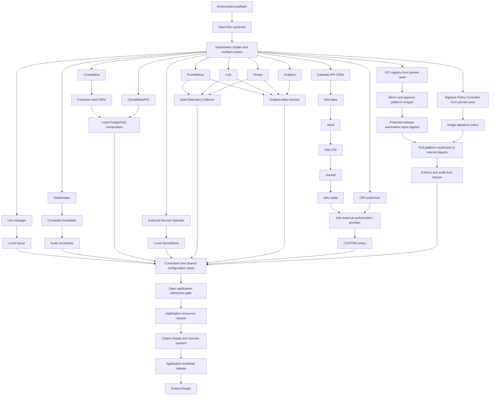

# Local Kubernetes Platform Initialization Plan

## Goal

Create a provider-neutral Kubernetes platform that is pleasant to use locally
with Minikube and can later move to managed Kubernetes providers with minimal
application changes.

The platform hosts frontend, backend, internal developer platform, identity and
access management, and other application workloads. It provides the foundational
services those workloads require and establishes OpenTelemetry as the standard
interface for logs, metrics, and traces.

## Definitions

- **Infrastructure** is any foundational capability required for applications to
  run, including clusters, ingress, certificates, telemetry, secrets, persistence,
  databases, queues, service identity, policy enforcement, and the controllers
  that provide those capabilities.
- **Application** is a business-facing or developer-facing workload running in
  Kubernetes and consuming infrastructure capabilities.
- **Infrastructure claim** describes an application's need for a capability. The
  claim belongs to the application's requirements, while its implementation and
  operation belong to infrastructure.
- **Tool** is an open-source tool configuration or a custom CLI used to perform a
  focused, automated operation.
- **Platform-signed image** is an OCI image whose immutable digest has a valid
  Cosign signature from an environment-authorized platform release automation
  identity. Registry location, repository ownership, or a mutable tag does not
  establish trust.
- **Bootstrap seed image** is a digest-pinned image required to start the internal
  registry, signature verifier, or another prerequisite before the platform trust
  boundary exists. Seed use is temporary, explicitly allowlisted, and closed before
  bootstrap reports success.
- **Application admission gate** is the platform-owned readiness state that remains
  closed until every infrastructure tool and capability required by applications is
  installed, configured, healthy, and enforcing. While closed, ordinary developer
  and deployment identities cannot create or update application claims or workloads.

## Responsibility Boundaries

### OpenTofu

OpenTofu provisions infrastructure that exists outside of or must exist before
Kubernetes. This includes cloud accounts and projects, networks, managed clusters,
node pools, foundational identity and access management, key management, external
secret stores, registries, DNS zones, and state storage.

OpenTofu does not manage application releases or ordinary in-cluster Kubernetes
resources. This keeps infrastructure state independent from Helm release state and
from the continuous reconciliation performed by Kubernetes controllers.

### Helm

Helm installs and upgrades software and resources inside Kubernetes. Helm charts
contain reusable application packaging and provider-neutral Kubernetes resources.
Application charts must not contain Minikube-specific or cloud-provider-specific
logic.

Controllers and Custom Resource Definitions (CRDs) belong to dedicated
infrastructure charts. Their lifecycle is managed separately from application
charts because they are cluster-wide platform APIs.

### Kubernetes Controllers

Applications request infrastructure through stable Kubernetes custom resources
installed by their Helm charts. Infrastructure controllers reconcile those claims
into environment-specific implementations.

For example, the same database claim may create a PostgreSQL workload in the local
cluster or a managed database in a cloud environment. Both implementations must
expose the same application-facing connection contract, normally through a
Kubernetes Secret.

### Local and Provider-Specific Tooling

Minikube-specific behavior remains in local scripts and environment configuration.
Provider-specific behavior is isolated in infrastructure modules, variables, and
environment overlays.

## Principles

- Kubernetes is the runtime and application-facing control plane.
- OpenTofu provisions the infrastructure substrate.
- Helm installs and upgrades in-cluster software.
- Applications request infrastructure through stable Kubernetes custom resources.
- Infrastructure implementations may vary by environment, but their
  application-facing contracts remain stable.
- Local implementations prefer Kubernetes workloads, while other environments may
  substitute managed services without requiring application code changes.
- OpenTelemetry is the standard application interface for logs, metrics, and traces.
- Kubernetes ServiceAccounts and Istio identities are the standard workload
  identity boundary.
- OPA validates workload identity configuration at admission time and provides
  contextual authorization decisions at runtime where native Istio policy is not
  sufficient.
- Application and platform workload images are trusted only after their immutable
  digests are verified as signed by an environment-authorized platform release
  automation identity.
- Developers and developer credentials cannot sign trusted images. Build automation
  may publish candidate images, while protected release automation alone may sign
  and promote them.
- The platform OCI registry is the source of deployable images and signatures after
  bootstrap trust closure; registry membership alone never implies trust.
- Image verification fails closed. Unsigned images, invalid signatures,
  unauthorized signer identities, mutable-only references, and verification errors
  are rejected.
- Secrets and persistent services have explicit ownership, lifecycle, and retention
  boundaries rather than hidden defaults.
- Local development has a small number of predictable commands.
- Every required operation is automated and repeatable. Each tool has one clear
  responsibility, performs it well, and composes through stable interfaces.
- Open-source tools and open standards are preferred. Exceptions are recorded as
  architectural decisions.
- No workflow requires undocumented, ad hoc cluster patching.

## Repository Boundaries

This is a monorepo with the following top-level ownership:

- `/infra` contains cluster definitions, platform services, infrastructure APIs,
  environment configuration, and infrastructure lifecycle automation.
- `/apps` contains application source code, application charts, and
  application-owned infrastructure claims.
- `/tools` contains shared tool configuration and custom developer tooling.

## Initialization Lifecycle

The platform is initialized before applications are installed. Cloud networking,
identity, and other substrate dependencies may need to exist before the cluster,
so their exact provisioning order is determined by the selected environment and
the OpenTofu dependency graph.

1. Validate the environment and required tools.
2. Provision the environment substrate.
3. Create or connect to the Kubernetes cluster.
4. Select and verify the intended Kubernetes context.
5. Install infrastructure APIs and controllers.
6. Install foundational services.
7. Wait for every required infrastructure capability to become ready.
8. Report platform readiness and endpoints.

For Minikube, provisioning the environment substrate means preparing the local
environment before creating the cluster. For a cloud environment, it may include
networking, identity, and other dependencies required by a managed cluster.

Platform initialization does not install applications. The complete initialization
lifecycle is the platform bootstrap; individual controller-installation operations
are internal phases and must never publish platform readiness on their own.

### Infrastructure Installation Phases

Infrastructure is installed in dependency-aware phases:

1. **Bootstrap seed** installs namespaces, the internal OCI registry, signature
   admission controller, CRDs, and infrastructure controllers from an explicit set
   of digest-pinned seed artifacts. OPA Gatekeeper constraints begin in audit mode
   so that bootstrap cannot block its own dependencies.
2. **Trust closure and core capabilities** mirror every required platform image
   into the internal registry, verify its recorded upstream digest and provenance,
   sign its digest through protected platform release automation, roll platform
   workloads to internal digest-qualified references, and install workload
   identity, the service mesh, ingress, certificates, secret delivery, storage,
   database or messaging operators, and the OPA runtime authorizer.
3. **Observability** installs the OpenTelemetry collection path and the required
   metrics, logs, and traces services.
4. **Policy enforcement** enables fail-closed image signature admission, promotes
   validated Gatekeeper constraints and runtime authorization policies from audit
   to enforcement, and audits all running platform workloads for internal,
   digest-qualified, authorized signatures.

Bootstrap is not complete until the internal registry is ready, all seed artifacts
have been replaced by their mirrored and platform-signed equivalents, image
admission is enforcing, and an inventory proves that no managed platform workload
uses an external, tag-only, unsigned, or unauthorized image. Seed exceptions are
not part of the steady state. Bootstrap must also install, configure, and verify
every infrastructure tool required by the declared application contracts before it
opens the application admission gate.

The gate is represented by platform-owned, generation-specific readiness state and
is opened only by bootstrap automation after all required release and capability
checks pass. Application namespaces are created or activated only after that point.
Admission policy and RBAC reject application claims and workload resources while
the gate is absent, stale, or closed. Developers cannot set or modify the readiness
state, namespace activation metadata, admission policy, or deployment identity.

The specific components used to implement these capabilities are selected
separately from this lifecycle contract.

## Application Lifecycle

Applications are installable only after bootstrap has opened the application
admission gate:

1. Verify the current bootstrap generation is ready and the application admission
   gate is open.
2. Install or upgrade the application's infrastructure claims.
3. Wait for every claim to report that it is ready.
4. Verify that required Secrets and endpoints exist.
5. Obtain the release-automation-produced, digest-qualified, Cosign-signed image
   reference and verify its signer identity.
6. Install or upgrade the application workload using only that reference.
7. Wait for signature admission and the workload rollout to complete.
8. Report application readiness, image digest, signer identity, and endpoints.

Infrastructure claims and application workloads use separate Helm releases. For
an application named `example`, those releases are:

- `example-resources` for infrastructure claims.
- `example` for Deployments, Services, ConfigMaps, and other workload resources.

This lifecycle boundary allows workloads to be replaced or removed without
implicitly deleting their persistent infrastructure.

Stateful infrastructure claims must define an explicit retention policy. Removing
an application or stopping a local platform retains persistent resources by
default. Permanent data deletion requires a separate, explicit purge operation.

## Command Contract

`kore` is the stable developer-facing command namespace. Its initial command
surface is:

| Command                                       | Responsibility                                                                                          |
| --------------------------------------------- | ------------------------------------------------------------------------------------------------------- |
| `kore doctor`                                 | Validate required tools, versions, credentials, and host capacity.                                      |
| `kore platform up --environment <name>`       | Bootstrap all required infrastructure and open the application gate only after complete readiness.      |
| `kore platform status --environment <name>`   | Report bootstrap generation, prerequisite readiness, and application-gate state without making changes. |
| `kore app up <name> --environment <name>`     | Reconcile one application's claims and workload.                                                        |
| `kore app status <name> --environment <name>` | Report application and claim readiness without making changes.                                          |
| `kore app down <name> --environment <name>`   | Remove an application workload while retaining stateful resources.                                      |
| `kore platform stop --environment <name>`     | Stop a local platform while retaining its cluster profile and data.                                     |
| `kore platform destroy --environment <name>`  | Destroy a platform after explicit confirmation.                                                         |

The `--environment` argument is required for every mutating command. Commands must
not silently use the current `kubectl` context.

The `kore` command composes focused tools without taking over their concerns:

- Minikube creates and removes the local cluster.
- OpenTofu provisions external infrastructure.
- Helm installs and upgrades in-cluster resources.
- `kubectl` observes resources and waits for readiness.
- Cosign signs and verifies immutable image digests when invoked by authorized
  release automation.
- The OCI registry stores promoted images and their signatures.

### Command Behavior

Every mutating command must:

- Resolve and verify its intended Kubernetes context before changing resources.
- Be idempotent and safe to run repeatedly.
- Resume safely after a partial failure.
- Use pinned tool, chart, and provider versions.
- Wait for readiness with a bounded timeout.
- Return a nonzero exit code when convergence fails.
- Identify the failed component without requiring undocumented manual patching.
- Support non-interactive execution in CI.

Application mutation commands must additionally refuse to render or apply claims or
workloads until the current environment reports a complete bootstrap generation and
an open application admission gate. This CLI check supplements, but does not
replace, cluster-side RBAC and admission enforcement against direct Helm or
Kubernetes API use.

Destructive commands must:

- Require confirmation during interactive use.
- Require an explicit confirmation flag during non-interactive use.
- Retain persistent resources by default.
- Require an explicit `--purge-data` operation to delete persistent data.
- Refuse to destroy a local cluster containing retained data unless that data is
  explicitly purged or a verified export exists.

## Lifecycle Acceptance Criteria

- A new local platform can be created with one developer-facing command.
- Platform creation does not install applications.
- One application can be installed with one developer-facing command.
- Repeating platform or application reconciliation produces no unintended changes.
- An interrupted operation can be rerun safely.
- A command refuses to operate against an unexpected cluster.
- Application installation stops when an infrastructure claim is not ready.
- Application claims and workloads cannot be applied before all required platform
  tools are ready and the platform-owned application admission gate is open.
- Application removal and local platform stop retain stateful data by default.
- Local platform destruction is blocked while retained data exists unless an
  explicit purge or verified export permits it.
- Status commands are read-only.

## Minimum Viable Platform Capabilities

The first platform increment is a thin vertical slice driven by one reference
application. Capabilities are defined by their application-facing contracts before
specific implementations are selected.

| Capability        | Application-facing contract                                                     | Local behavior                                                    | Portability requirement                                                     |
| ----------------- | ------------------------------------------------------------------------------- | ----------------------------------------------------------------- | --------------------------------------------------------------------------- |
| Networking        | Kubernetes `Gateway` and `HTTPRoute` resources                                  | Route traffic through an Istio-managed gateway                    | Replace the gateway or load balancer without changing application manifests |
| Certificates      | A TLS endpoint and trusted certificate contract                                 | Issue certificates from a local issuer                            | Substitute a public or provider-managed issuer                              |
| Secrets           | A Kubernetes Secret reference                                                   | Materialize secrets from a local source                           | Substitute an external secret manager without changing the workload         |
| Database          | A database claim and connection Secret                                          | Run PostgreSQL as a Kubernetes workload                           | Substitute managed PostgreSQL while preserving the claim and Secret schema  |
| Persistence       | A PersistentVolumeClaim and storage class contract                              | Provision storage backed by the local environment                 | Substitute a cloud storage class while preserving claim semantics           |
| Observability     | An OTLP endpoint and standard telemetry attributes                              | Collect logs, metrics, and traces locally                         | Substitute telemetry backends without changing application instrumentation  |
| Workload identity | A dedicated Kubernetes ServiceAccount represented as an Istio SPIFFE principal  | Issue short-lived mesh identities and enforce mutual TLS          | Preserve the principal contract across Kubernetes environments              |
| Policy            | Gatekeeper constraints, Sigstore image policy, and Istio authorization policy   | Audit configuration and enforce admission and runtime decisions   | Keep policy inputs stable and policy bundles versioned                      |
| OCI registry      | A platform registry endpoint and digest-qualified repository contract           | Run a persistent OCI Distribution-compatible registry             | Substitute a managed registry without changing workload charts              |
| Container images  | An internal, digest-qualified OCI reference with an authorized Cosign signature | Build candidates locally; protected automation promotes and signs | Preserve digest and signer verification across environment registries       |

### Reference Application

The first reference application validates the platform through all capability
layers. It requires:

- An HTTP endpoint with TLS.
- A PostgreSQL database.
- A persistent resource with an explicit retention policy.
- Secret injection through a Kubernetes Secret reference.
- OpenTelemetry logs, metrics, and traces.
- A dedicated Kubernetes ServiceAccount and Istio workload identity.
- Mutual TLS for service-to-service traffic.
- Native Istio authorization and one OPA-backed contextual authorization decision.
- OPA Gatekeeper admission and audit validation.
- Admission rejection of unsigned images and images signed by unauthorized
  identities.
- Kubernetes health and readiness reporting.

### Capability Requirements

Each capability must define:

- Its stable application-facing API and version.
- Its owning infrastructure component.
- Its readiness conditions and bounded wait behavior.
- Its local implementation and permitted environment substitutions.
- Its Secret, endpoint, and status output schemas where applicable.
- Its upgrade, removal, retention, and recovery behavior.

The reference application is complete only when it can move between local and
managed implementations by changing environment configuration rather than
application code or provider-specific application templates.

## Initial Tool Selection

Every selected tool must be version-pinned and tested against the selected
Kubernetes version. Applications depend on the stable contracts described above,
not on implementation-specific APIs unless a reviewed exception is recorded.

| Concern                  | Selected tool or standard                            | Responsibility                                                                                   |
| ------------------------ | ---------------------------------------------------- | ------------------------------------------------------------------------------------------------ |
| Local Kubernetes         | Minikube with containerd                             | Create, stop, and inspect the local cluster profile.                                             |
| External infrastructure  | OpenTofu                                             | Provision resources outside of or required before Kubernetes.                                    |
| Kubernetes packaging     | Helm                                                 | Install and upgrade infrastructure and application releases.                                     |
| Platform APIs            | Crossplane v2                                        | Define namespaced application-facing APIs and environment-specific compositions.                 |
| Edge and mesh API        | Kubernetes Gateway API                               | Provide portable `Gateway` and route resources.                                                  |
| Gateway and service mesh | Istio in ambient mode                                | Implement Gateway API, workload identity, mutual TLS, runtime authorization, and mesh telemetry. |
| Admission policy         | OPA Gatekeeper                                       | Validate resources during admission and continuously audit existing resources.                   |
| Image signing            | Cosign                                               | Sign immutable OCI image digests using protected platform release automation identities.         |
| Image admission          | Sigstore Policy Controller                           | Resolve and verify workload images and reject unauthorized signatures at admission.              |
| Local OCI registry       | OCI Distribution-compatible registry                 | Persist platform images, application images, signatures, and attestations inside the platform.   |
| Runtime policy decisions | OPA with the OPA-Envoy plugin                        | Evaluate contextual Layer 7 authorization requests delegated by Istio.                           |
| Certificates             | cert-manager                                         | Issue, renew, and materialize certificates from environment-selected issuers.                    |
| Local certificate trust  | mkcert-backed local CA                               | Establish host-trusted local development certificates.                                           |
| Secret synchronization   | External Secrets Operator                            | Materialize external values into Kubernetes Secrets.                                             |
| Local secrets at rest    | SOPS with age                                        | Store encrypted development secrets in version control.                                          |
| Local PostgreSQL         | CloudNativePG                                        | Operate PostgreSQL as a Kubernetes workload.                                                     |
| Persistent storage       | Kubernetes StorageClasses and PersistentVolumeClaims | Express provider-neutral storage and retention requirements.                                     |
| Telemetry collection     | OpenTelemetry Collector                              | Receive OTLP, enrich telemetry, and export it to selected backends.                              |
| Metrics                  | Prometheus                                           | Store and query platform and application metrics.                                                |
| Logs                     | Loki                                                 | Store and query OpenTelemetry logs.                                                              |
| Traces                   | Tempo                                                | Store and query OpenTelemetry traces.                                                            |
| Observability UI         | Grafana                                              | Query and correlate metrics, logs, and traces.                                                   |
| Tool versions            | mise                                                 | Install and pin repository development tool versions.                                            |
| Kubernetes inspection    | `kubectl`                                            | Observe resources and wait for readiness without owning desired state.                           |
| Local image delivery     | OCI registry push and pull                           | Publish candidate images and consume promoted, signed, digest-qualified images.                  |

Envoy Gateway is not part of the initial stack. Istio is the Gateway API
implementation so that the platform has one control plane for ingress, ambient
mesh networking, workload identity, runtime authorization, and mesh telemetry.
Application charts use standard Gateway API resources for ingress. Istio-specific
networking resources remain infrastructure-owned and are used only when the
standard API cannot express a required capability.

### Platform API and PostgreSQL

Crossplane defines a namespaced `PostgreSQLInstance.platform.kore.dev` API rather
than a generic database API. A local composition creates a CloudNativePG cluster;
a provider composition may create managed PostgreSQL. Both compositions publish
the same connection Secret schema and readiness contract.

The initial API exposes only portable requirements such as service class, storage
size, connection Secret name, PostgreSQL compatibility version, and retention
policy. Provider-specific settings remain in environment compositions.

### Workload Identity and Authorization

Every application workload uses a dedicated Kubernetes ServiceAccount. Istio uses
that ServiceAccount to establish a short-lived, mutually authenticated workload
identity with this principal format:

```text
spiffe://<trust-domain>/ns/<namespace>/sa/<service-account>
```

Responsibility is divided as follows:

- Kubernetes ServiceAccounts establish the workload identity input.
- Istio issues and validates the cryptographic identity, provides mutual TLS, and
  enforces native `AuthorizationPolicy` rules.
- OPA Gatekeeper rejects or audits workload definitions that violate identity and
  authorization requirements.
- The OPA-Envoy plugin acts as an external policy decision point for contextual
  Layer 7 decisions delegated through Istio `AuthorizationPolicy` resources with
  the `CUSTOM` action.

Native Istio `ALLOW` and `DENY` policies handle common service-to-service rules.
OPA is used when a decision needs richer context or shared Rego policy. Protected
routes fail closed if the OPA authorizer is unavailable. The initial deployment
uses a platform-operated OPA authorization service rather than injecting OPA
sidecars, preserving the ambient data-plane model. OPA policies are delivered as
versioned bundles and tested independently of application releases.

Initial Gatekeeper identity constraints require:

- A dedicated ServiceAccount rather than the namespace default.
- Explicit service account token mounting behavior.
- No wildcard RBAC permissions or unauthorized role bindings.
- Explicit enrollment in the ambient mesh for participating application namespaces.
- Required ownership, application, and workload identity labels.
- Resource requests, limits, and health probes.
- No privileged containers or unapproved host namespace access.
- No plaintext Secret resources in application releases.
- Explicit retention policy for stateful infrastructure claims.

Constraints start in audit mode. Each constraint moves to enforcement only after
the platform and reference application comply and its failure behavior is tested.
System namespace exemptions must be explicit, minimal, and documented.

### Image Provenance and Registry Trust

The platform operates an OCI Distribution-compatible registry as a foundational
infrastructure application. Workloads consume images from the environment's
platform registry by immutable digest. Images and their Cosign signatures remain
OCI artifacts so that a managed environment may substitute a provider registry
without changing application charts.

Sigstore Policy Controller performs cryptographic image verification during
admission. Gatekeeper remains responsible for workload shape, identity, and other
declarative constraints; it does not duplicate signature verification in Rego.
Every namespace containing Kore-managed platform or application workloads is
enrolled after its bootstrap prerequisites are ready. Policy covers containers,
init containers, and ephemeral containers, rejects references that do not match a
policy, and fails closed when the image, signature, registry, or verifier cannot be
validated.

Only protected release automation is an authorized signer. The authorization
policy binds verification to an exact workload identity, such as an OIDC issuer
and protected workflow subject, or to a KMS/HSM key whose sign permission is
granted only to that workload identity. Developers, pull-request workflows,
ordinary build jobs, cluster workloads, and registry administrators receive no
sign permission. Build automation may push candidates to a staging repository;
release automation verifies the candidate digest and required checks, promotes it
to a trusted repository, signs that digest, verifies the result, and emits the
digest-qualified release reference. Admission trusts the signer, not the registry
path alone.

Local development exercises the same promotion and admission flow with a distinct
local automation identity that is never trusted by managed environments. A user
with administrator access to a local machine or Minikube cluster cannot be treated
as cryptographically isolated from that local environment; local proves workflow
behavior, while managed KMS/IAM and protected CI establish the developer/signing
boundary.

The registry and verifier create a bootstrap trust loop. The seed phase may use
only repository-recorded upstream digests needed to start that loop. Once the
registry and verifier are ready, automation mirrors those artifacts, validates
their upstream digest and provenance, signs the approved internal digests, updates
all platform releases to the internal digest-qualified references, enables
fail-closed admission, and performs a complete workload inventory. Bootstrap fails
and rolls back if any seed, external, tag-only, unsigned, or unauthorized image
remains. Signing keys and credentials are never stored in the registry, cluster,
repository, Helm values, or developer workstations.

### Networking and Certificates

Istio implements Kubernetes Gateway API for ingress and ambient mesh traffic.
Minikube-specific tunnel management remains behind the `kore` command. Application
charts do not invoke Minikube or depend on an Istio `GatewayClass` name directly;
environment configuration supplies infrastructure-owned parent references.

cert-manager provides the `Certificate` contract in every environment. Local
development uses a CA established with mkcert. Managed environments substitute an
ACME or provider-supported issuer without changing application workloads.

### Secrets

Application resource charts create `ExternalSecret` resources that reference a
consistently named platform `SecretStore` or `ClusterSecretStore`.

Locally, SOPS and age decrypt version-controlled values into a protected source
namespace, and External Secrets Operator materializes application-scoped Secrets.
Managed environments replace the store implementation with a provider secret
manager. Plaintext secret values are never committed to the repository or passed
through Helm values.

### Storage and Retention

The platform initially exposes two storage profiles:

- `kore-standard` for disposable data using the environment's standard storage.
- `kore-retained` for persistent data using a `Retain` reclaim policy.

Minikube provides the initial local storage implementation. Stopping its profile
preserves local data. Destroying a profile containing retained data requires an
explicit purge or a verified export. Retention is not a backup; backup and restore
requirements are defined before the platform is considered production-ready.

### Observability

Applications send OTLP logs, metrics, and traces only to the OpenTelemetry
Collector. The Collector enriches signals with Kubernetes and workload identity
attributes and exports them to Prometheus, Loki, and Tempo. Grafana provides the
initial correlated query interface.

Istio telemetry also flows through the platform's OpenTelemetry path where the
supported signal permits it. Applications do not send telemetry directly to a
backend, which allows managed backends to replace the local stack without changing
application instrumentation.

## Repository and Release Topology

The repository structure makes resource ownership, environment differences, and
release ordering explicit. Orchestration logic reads repository-owned definitions;
it does not hide component lists or versions inside imperative scripts.

### Planned Repository Layout

```text
/
├── apps/
│   └── reference/
│       ├── src/
│       └── charts/
│           ├── resources/
│           └── workload/
├── infra/
│   ├── plans/
│   ├── catalog/
│   │   ├── components.yaml
│   │   └── versions.yaml
│   ├── environments/
│   │   ├── common/
│   │   └── local/
│   │       ├── environment.yaml
│   │       └── values/
│   ├── tofu/
│   │   ├── modules/
│   │   └── stacks/
│   ├── charts/
│   │   ├── platform-config/
│   │   ├── opa-authorizer/
│   │   └── oci-registry/
│   ├── apis/
│   │   └── postgresql/
│   │       ├── definitions/
│   │       ├── compositions/
│   │       └── tests/
│   ├── policies/
│   │   ├── gatekeeper/
│   │   │   ├── templates/
│   │   │   ├── constraints/
│   │   │   └── tests/
│   │   ├── opa/
│   │       ├── bundles/
│   │       └── tests/
│   │   └── sigstore/
│   │       ├── cluster-image-policies/
│   │       ├── trust-roots/
│   │       └── tests/
│   └── observability/
│       ├── collector/
│       ├── dashboards/
│       └── alerts/
└── tools/
    └── kore/
        ├── commands/
        └── tests/
```

The layout follows these ownership rules:

- `infra/catalog` is the source of truth for components, versions, namespaces,
  release names, dependencies, readiness checks, and upstream chart locations.
- `infra/environments/common` contains provider-neutral defaults.
- `infra/environments/<name>` contains only environment-specific inputs and Helm
  values. Application directories never import these files directly.
- `infra/tofu/modules` contains reusable infrastructure modules, while
  `infra/tofu/stacks` contains environment entry points and state boundaries.
- `infra/charts` contains only Kore-owned charts. Upstream charts remain external,
  pinned dependencies rather than copied or modified source trees.
- `infra/apis` owns platform custom APIs and their environment compositions.
- `infra/policies/gatekeeper` owns admission and audit policy.
- `infra/policies/opa` owns versioned runtime authorization bundles.
- `infra/policies/sigstore` owns image-signature trust roots, signer identities,
  admission policy, and policy tests; it never owns signing credentials.
- `infra/observability` owns Collector pipelines, dashboards, and alert rules.
- `apps/<name>/charts/resources` owns application infrastructure claims.
- `apps/<name>/charts/workload` owns application workloads.
- `tools/kore` owns orchestration only and delegates desired-state operations to
  Minikube, OpenTofu, Helm, and Kubernetes controllers.

### Release Catalog

The initial logical releases and namespaces are:

| Release                  | Namespace                       | Owns                                                                                                                        |
| ------------------------ | ------------------------------- | --------------------------------------------------------------------------------------------------------------------------- |
| `kore-gateway-api`       | `kore-system`                   | Gateway API CRDs.                                                                                                           |
| `cert-manager`           | `cert-manager`                  | cert-manager controller and its CRDs.                                                                                       |
| `gatekeeper`             | `gatekeeper-system`             | OPA Gatekeeper controllers and CRDs.                                                                                        |
| `oci-registry`           | `registry-system`               | Persistent OCI registry used for platform and application images, signatures, and attestations.                             |
| `policy-controller`      | `cosign-system`                 | Sigstore signature admission controller, webhook, and CRDs.                                                                 |
| `istio-base`             | `istio-system`                  | Istio cluster-scoped base resources and CRDs.                                                                               |
| `istiod`                 | `istio-system`                  | Istio control plane.                                                                                                        |
| `istio-cni`              | `istio-system`                  | Istio ambient networking integration.                                                                                       |
| `ztunnel`                | `istio-system`                  | Istio ambient Layer 4 data plane.                                                                                           |
| `crossplane`             | `crossplane-system`             | Crossplane control plane and CRDs.                                                                                          |
| `external-secrets`       | `external-secrets`              | External Secrets Operator and CRDs.                                                                                         |
| `cloudnative-pg`         | `cnpg-system`                   | CloudNativePG operator and CRDs.                                                                                            |
| `opentelemetry-operator` | `opentelemetry-operator-system` | OpenTelemetry Operator and CRDs.                                                                                            |
| `prometheus`             | `observability`                 | Metrics storage and query service.                                                                                          |
| `loki`                   | `observability`                 | Log storage and query service.                                                                                              |
| `tempo`                  | `observability`                 | Trace storage and query service.                                                                                            |
| `grafana`                | `observability`                 | Correlated observability interface.                                                                                         |
| `otel-collector`         | `observability`                 | Application, platform, and mesh telemetry pipelines.                                                                        |
| `opa-authorizer`         | `opa-system`                    | OPA-Envoy runtime authorization service and policy bundle loader.                                                           |
| `kore-platform-config`   | `kore-system`                   | Platform-owned issuers, gateways, storage profiles, secret stores, Crossplane APIs and compositions, and policy activation. |
| `kore-image-policy`      | `kore-system`                   | Verification trust roots, authorized automation identities, `ClusterImagePolicy` resources, and namespace enrollment.       |

Logical releases may map to multiple upstream charts when required by a project's
supported installation model. The catalog records that mapping without changing
the logical owner.

Each application adds exactly two releases:

- `<application>-resources` for infrastructure claims and their retention policy.
- `<application>` for its ServiceAccount, workload, Service, routes, telemetry
  configuration, and authorization policy references.

### Resource Ownership

Every cluster-scoped resource, CRD, and namespaced object has exactly one declared
owner in the release catalog.

- A controller's infrastructure release owns its CRDs unless the upstream project
  requires a distinct CRD release. That distinction is recorded in the catalog.
- `kore-gateway-api` is the sole owner of Gateway API CRDs.
- Controller releases own controller Deployments, Services, ServiceAccounts, and
  webhook infrastructure.
- `kore-platform-config` owns instances that configure shared platform behavior; it
  does not own controller CRDs or Deployments.
- Application resource releases own only their claims, never the resources composed
  or reconciled from those claims.
- Kubernetes controllers own resources they reconcile from claims or platform APIs.
- No resource may be rendered by more than one Helm release or by both Helm and
  OpenTofu.

CRD installation, upgrade, conversion, and removal behavior must be declared per
component. CRD removal is never an implicit consequence of an ordinary Helm
uninstall.

### Release Dependency Graph

The catalog expresses dependencies as an acyclic graph. Independent branches may
run in parallel after their prerequisites are ready.



Istio identity and native authorization are ready before OPA-backed runtime policy
is enforced. Gatekeeper constraints begin in audit mode, pass offline and
pre-admission fixtures, and promote to enforcement before the application admission
gate opens; the reference application then provides post-gate end-to-end evidence.
Image policy is enforced before bootstrap reports completion, after the seed images
have been mirrored, automation-signed, and replaced by internal digest references.

### Environment Overlay Rules

- Common configuration defines portable contracts and safe defaults.
- An environment overlay may select implementations, sizes, endpoints, issuers,
  storage classes, compositions, and platform-owned parent references.
- An overlay must not fork an application chart or change application source code.
- Minikube commands, profile names, tunnel behavior, local mounts, and local
  registry bootstrap behavior exist only in the local environment and `kore`
  adapters.
- Cloud provider names, regions, identities, and managed-resource settings exist
  only in their OpenTofu stack and environment overlay.
- Secrets are referenced by stable logical keys; plaintext values are not overlay
  inputs or Helm values.
- Registry endpoints, repository prefixes, trusted signing identities, and public
  verification material are environment inputs. Private signing credentials are
  never environment, overlay, cluster, or developer inputs.

### Version Catalog

`infra/catalog/versions.yaml` records every Kubernetes version, CLI, OpenTofu
provider, Helm chart, controller image, composition function, and policy bundle
version used by the platform.

- Floating versions such as `latest` are prohibited.
- OCI image digests and artifact checksums are recorded where supported.
- Helm dependencies and OpenTofu providers retain their native lock files.
- A version change updates the compatibility matrix and passes the reference
  application before promotion.
- Component configuration reads a version from one catalog entry rather than
  duplicating version strings across scripts and environment files.

### Topology Acceptance Criteria

- No resource has multiple desired-state owners.
- CRDs are established before their custom resources are submitted.
- The release dependency graph has no cycles.
- Every external dependency is version-pinned.
- Local differences exist only in the local environment definition or adapter.
- Application directories contain no Minikube or cloud-provider logic.
- Infrastructure claims and workloads remain separate releases.
- Workload identity is derived from a dedicated ServiceAccount and is available to
  native Istio and OPA authorization decisions.
- Admission policy cannot block bootstrap before its constraints are validated.
- Bootstrap cannot report success while any managed workload uses a seed, external,
  tag-only, unsigned, or unauthorized image.
- Only protected release automation can produce a signature accepted by image
  admission; developer and pull-request identities are rejected.
- A platform-owned readiness gate prevents application claims and workloads from
  being applied until every required infrastructure tool is installed, configured,
  healthy, and enforcing for the current bootstrap generation.
- `kore platform up` can derive its complete execution order and readiness checks
  from repository-owned configuration.

## Deferred Tooling

The following components remain outside the first vertical slice:

- OpenBao or another locally operated external secret server.
- Messaging operators and managed queue compositions.
- GitOps reconciliation.
- Progressive delivery controllers.
- Multi-cluster service mesh and management.
- Production high-availability topology.
- Cloud-specific Crossplane providers and compositions.
- A dedicated Envoy Gateway control plane. It is reconsidered if edge ownership,
  release isolation, or advanced API-gateway requirements justify operating both
  Envoy Gateway and Istio.
