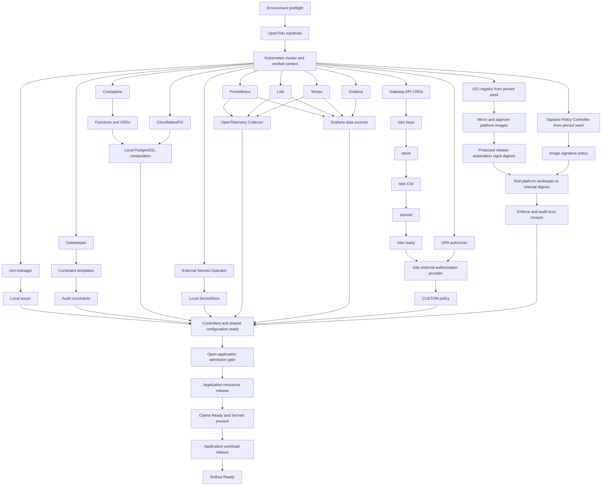

# Local Kubernetes Platform Initialization Plan

## Goal

Create a provider-neutral Kubernetes platform that is pleasant to use locally
with Minikube and can later move to managed Kubernetes providers with minimal
application changes.

The platform hosts frontend, backend, internal developer platform, identity and
access management, and other application workloads. It provides the foundational
services those workloads require and establishes OpenTelemetry as the standard
interface for logs, metrics, and traces.

## Definitions

- **Infrastructure** is any foundational capability required for applications to
  run, including clusters, ingress, certificates, telemetry, secrets, persistence,
  databases, queues, service identity, policy enforcement, and the controllers
  that provide those capabilities.
- **Application** is a business-facing or developer-facing workload running in
  Kubernetes and consuming infrastructure capabilities.
- **Infrastructure claim** describes an application's need for a capability. The
  claim belongs to the application's requirements, while its implementation and
  operation belong to infrastructure.
- **Tool** is an open-source tool configuration or a custom CLI used to perform a
  focused, automated operation.
- **Platform-signed image** is an OCI image whose immutable digest has a valid
  Cosign signature from an environment-authorized platform release automation
  identity. Registry location, repository ownership, or a mutable tag does not
  establish trust.
- **Bootstrap seed image** is a digest-pinned image required to start the internal
  registry, signature verifier, or another prerequisite before the platform trust
  boundary exists. Seed use is temporary, explicitly allowlisted, and closed before
  bootstrap reports success.
- **Application admission gate** is the platform-owned readiness state that remains
  closed until every infrastructure tool and capability required by applications is
  installed, configured, healthy, and enforcing. While closed, ordinary developer
  and deployment identities cannot create or update application claims or workloads.

## Responsibility Boundaries

Decided in [ADR 0002: Give each upstream tool one responsibility](../../docs/decisions/0002-tool-responsibility-boundaries.md).

### OpenTofu

OpenTofu provisions the substrate outside of or before Kubernetes.

### Helm

Helm installs in-cluster software; controllers and CRDs use dedicated charts.

### Kubernetes Controllers

Controllers reconcile application claims into environment-specific implementations.

### Local and Provider-Specific Tooling

Minikube and provider specifics stay in adapters, modules, and overlays.

## Principles

- Kubernetes is the runtime and application-facing control plane.
- OpenTofu provisions the infrastructure substrate.
- Helm installs and upgrades in-cluster software.
- Applications request infrastructure through stable Kubernetes custom resources.
- Infrastructure implementations may vary by environment, but their
  application-facing contracts remain stable.
- Local implementations prefer Kubernetes workloads, while other environments may
  substitute managed services without requiring application code changes.
- OpenTelemetry is the standard application interface for logs, metrics, and traces.
- Kubernetes ServiceAccounts and Istio identities are the standard workload
  identity boundary.
- OPA validates workload identity configuration at admission time and provides
  contextual authorization decisions at runtime where native Istio policy is not
  sufficient.
- Application and platform workload images are trusted only after their immutable
  digests are verified as signed by an environment-authorized platform release
  automation identity.
- Developers and developer credentials cannot sign trusted images. Build automation
  may publish candidate images, while protected release automation alone may sign
  and promote them.
- The platform OCI registry is the source of deployable images and signatures after
  bootstrap trust closure; registry membership alone never implies trust.
- Image verification fails closed. Unsigned images, invalid signatures,
  unauthorized signer identities, mutable-only references, and verification errors
  are rejected.
- Secrets and persistent services have explicit ownership, lifecycle, and retention
  boundaries rather than hidden defaults.
- Local development has a small number of predictable commands.
- Every required operation is automated and repeatable. Each tool has one clear
  responsibility, performs it well, and composes through stable interfaces.
- Open-source tools and open standards are preferred. Exceptions are recorded as
  architectural decisions.
- No workflow requires undocumented, ad hoc cluster patching.

## Repository Boundaries

This is a monorepo with the following top-level ownership:

- `/infra` contains cluster definitions, platform services, infrastructure APIs,
  environment configuration, and infrastructure lifecycle automation.
- `/apps` contains application source code, application charts, and
  application-owned infrastructure claims.
- `/tools` contains shared tool configuration and custom developer tooling.

## Initialization Lifecycle

The platform is initialized before applications are installed. Cloud networking,
identity, and other substrate dependencies may need to exist before the cluster,
so their exact provisioning order is determined by the selected environment and
the OpenTofu dependency graph.

1. Validate the environment and required tools.
2. Provision the environment substrate.
3. Create or connect to the Kubernetes cluster.
4. Select and verify the intended Kubernetes context.
5. Install infrastructure APIs and controllers.
6. Install foundational services.
7. Wait for every required infrastructure capability to become ready.
8. Report platform readiness and endpoints.

For Minikube, provisioning the environment substrate means preparing the local
environment before creating the cluster. For a cloud environment, it may include
networking, identity, and other dependencies required by a managed cluster.

Decided in [ADR 0004: Gate application admission on complete, fail-closed bootstrap](../../docs/decisions/0004-fail-closed-application-admission-gate.md).

### Infrastructure Installation Phases

Infrastructure is installed in dependency-aware phases:

1. **Bootstrap seed** installs namespaces, the internal OCI registry, signature
   admission controller, CRDs, and infrastructure controllers from an explicit set
   of digest-pinned seed artifacts. OPA Gatekeeper constraints begin in audit mode
   so that bootstrap cannot block its own dependencies.
2. **Trust closure and core capabilities** mirror every required platform image
   into the internal registry, verify its recorded upstream digest and provenance,
   sign its digest through protected platform release automation, roll platform
   workloads to internal digest-qualified references, and install workload
   identity, the service mesh, ingress, certificates, secret delivery, storage,
   database or messaging operators, and the OPA runtime authorizer.
3. **Observability** installs the OpenTelemetry collection path and the required
   metrics, logs, and traces services.
4. **Policy enforcement** enables fail-closed image signature admission, promotes
   validated Gatekeeper constraints and runtime authorization policies from audit
   to enforcement, and audits all running platform workloads for internal,
   digest-qualified, authorized signatures.

Completion and gate rules: decided in [ADR 0004: Gate application admission on complete, fail-closed bootstrap](../../docs/decisions/0004-fail-closed-application-admission-gate.md).

## Application Lifecycle

Applications are installable only after bootstrap has opened the application
admission gate:

1. Verify the current bootstrap generation is ready and the application admission
   gate is open.
2. Install or upgrade the application's infrastructure claims.
3. Wait for every claim to report that it is ready.
4. Verify that required Secrets and endpoints exist.
5. Obtain the release-automation-produced, digest-qualified, Cosign-signed image
   reference and verify its signer identity.
6. Install or upgrade the application workload using only that reference.
7. Wait for signature admission and the workload rollout to complete.
8. Report application readiness, image digest, signer identity, and endpoints.

Release split and retention: decided in [ADR 0003: Separate claims from workloads and retain data by default](../../docs/decisions/0003-separate-claims-and-retain-data.md).

## Command Contract

`kore` is the stable developer-facing command namespace. Its initial command
surface is:

| Command                                       | Responsibility                                                                                          |
| --------------------------------------------- | ------------------------------------------------------------------------------------------------------- |
| `kore doctor`                                 | Validate required tools, versions, credentials, and host capacity.                                      |
| `kore platform up --environment <name>`       | Bootstrap all required infrastructure and open the application gate only after complete readiness.      |
| `kore platform status --environment <name>`   | Report bootstrap generation, prerequisite readiness, and application-gate state without making changes. |
| `kore app up <name> --environment <name>`     | Reconcile one application's claims and workload.                                                        |
| `kore app status <name> --environment <name>` | Report application and claim readiness without making changes.                                          |
| `kore app down <name> --environment <name>`   | Remove an application workload while retaining stateful resources.                                      |
| `kore platform stop --environment <name>`     | Stop a local platform while retaining its cluster profile and data.                                     |
| `kore platform destroy --environment <name>`  | Destroy a platform after explicit confirmation.                                                         |

The `--environment` argument is required for every mutating command. Commands must
not silently use the current `kubectl` context.

Tool responsibilities: decided in [ADR 0002: Give each upstream tool one responsibility](../../docs/decisions/0002-tool-responsibility-boundaries.md).

### Command Behavior

Every mutating command must:

- Resolve and verify its intended Kubernetes context before changing resources.
- Be idempotent and safe to run repeatedly.
- Resume safely after a partial failure.
- Use pinned tool, chart, and provider versions.
- Wait for readiness with a bounded timeout.
- Return a nonzero exit code when convergence fails.
- Identify the failed component without requiring undocumented manual patching.
- Support non-interactive execution in CI.

Application mutation commands also check the admission gate; decided in [ADR 0004: Gate application admission on complete, fail-closed bootstrap](../../docs/decisions/0004-fail-closed-application-admission-gate.md).

Destructive commands follow [ADR 0003: Separate claims from workloads and retain data by default](../../docs/decisions/0003-separate-claims-and-retain-data.md).

## Lifecycle Acceptance Criteria

- A new local platform can be created with one developer-facing command.
- Platform creation does not install applications.
- One application can be installed with one developer-facing command.
- Repeating platform or application reconciliation produces no unintended changes.
- An interrupted operation can be rerun safely.
- A command refuses to operate against an unexpected cluster.
- Application installation stops when an infrastructure claim is not ready.
- Application claims and workloads cannot be applied before all required platform
  tools are ready and the platform-owned application admission gate is open.
- Application removal and local platform stop retain stateful data by default.
- Local platform destruction is blocked while retained data exists unless an
  explicit purge or verified export permits it.
- Status commands are read-only.

## Minimum Viable Platform Capabilities

The first platform increment is a thin vertical slice driven by one reference
application. Capabilities are defined by their application-facing contracts before
specific implementations are selected.

| Capability        | Application-facing contract                                                     | Local behavior                                                    | Portability requirement                                                     |
| ----------------- | ------------------------------------------------------------------------------- | ----------------------------------------------------------------- | --------------------------------------------------------------------------- |
| Networking        | Kubernetes `Gateway` and `HTTPRoute` resources                                  | Route traffic through an Istio-managed gateway                    | Replace the gateway or load balancer without changing application manifests |
| Certificates      | A TLS endpoint and trusted certificate contract                                 | Issue certificates from a local issuer                            | Substitute a public or provider-managed issuer                              |
| Secrets           | A Kubernetes Secret reference                                                   | Materialize secrets from a local source                           | Substitute an external secret manager without changing the workload         |
| Database          | A database claim and connection Secret                                          | Run PostgreSQL as a Kubernetes workload                           | Substitute managed PostgreSQL while preserving the claim and Secret schema  |
| Persistence       | A PersistentVolumeClaim and storage class contract                              | Provision storage backed by the local environment                 | Substitute a cloud storage class while preserving claim semantics           |
| Observability     | An OTLP endpoint and standard telemetry attributes                              | Collect logs, metrics, and traces locally                         | Substitute telemetry backends without changing application instrumentation  |
| Workload identity | A dedicated Kubernetes ServiceAccount represented as an Istio SPIFFE principal  | Issue short-lived mesh identities and enforce mutual TLS          | Preserve the principal contract across Kubernetes environments              |
| Policy            | Gatekeeper constraints, Sigstore image policy, and Istio authorization policy   | Audit configuration and enforce admission and runtime decisions   | Keep policy inputs stable and policy bundles versioned                      |
| OCI registry      | A platform registry endpoint and digest-qualified repository contract           | Run a persistent OCI Distribution-compatible registry             | Substitute a managed registry without changing workload charts              |
| Container images  | An internal, digest-qualified OCI reference with an authorized Cosign signature | Build candidates locally; protected automation promotes and signs | Preserve digest and signer verification across environment registries       |

### Reference Application

The first reference application validates the platform through all capability
layers. It requires:

- An HTTP endpoint with TLS.
- A PostgreSQL database.
- A persistent resource with an explicit retention policy.
- Secret injection through a Kubernetes Secret reference.
- OpenTelemetry logs, metrics, and traces.
- A dedicated Kubernetes ServiceAccount and Istio workload identity.
- Mutual TLS for service-to-service traffic.
- Native Istio authorization and one OPA-backed contextual authorization decision.
- OPA Gatekeeper admission and audit validation.
- Admission rejection of unsigned images and images signed by unauthorized
  identities.
- Kubernetes health and readiness reporting.

### Capability Requirements

Each capability must define:

- Its stable application-facing API and version.
- Its owning infrastructure component.
- Its readiness conditions and bounded wait behavior.
- Its local implementation and permitted environment substitutions.
- Its Secret, endpoint, and status output schemas where applicable.
- Its upgrade, removal, retention, and recovery behavior.

The reference application is complete only when it can move between local and
managed implementations by changing environment configuration rather than
application code or provider-specific application templates.

## Initial Tool Selection

Every selected tool must be version-pinned and tested against the selected
Kubernetes version. Applications depend on the stable contracts described above,
not on implementation-specific APIs unless a reviewed exception is recorded.

| Concern                  | Selected tool or standard                            | Responsibility                                                                                   |
| ------------------------ | ---------------------------------------------------- | ------------------------------------------------------------------------------------------------ |
| Local Kubernetes         | Minikube with containerd                             | Create, stop, and inspect the local cluster profile.                                             |
| External infrastructure  | OpenTofu                                             | Provision resources outside of or required before Kubernetes.                                    |
| Kubernetes packaging     | Helm                                                 | Install and upgrade infrastructure and application releases.                                     |
| Platform APIs            | Crossplane v2                                        | Define namespaced application-facing APIs and environment-specific compositions.                 |
| Edge and mesh API        | Kubernetes Gateway API                               | Provide portable `Gateway` and route resources.                                                  |
| Gateway and service mesh | Istio in ambient mode                                | Implement Gateway API, workload identity, mutual TLS, runtime authorization, and mesh telemetry. |
| Admission policy         | OPA Gatekeeper                                       | Validate resources during admission and continuously audit existing resources.                   |
| Image signing            | Cosign                                               | Sign immutable OCI image digests using protected platform release automation identities.         |
| Image admission          | Sigstore Policy Controller                           | Resolve and verify workload images and reject unauthorized signatures at admission.              |
| Local OCI registry       | OCI Distribution-compatible registry                 | Persist platform images, application images, signatures, and attestations inside the platform.   |
| Runtime policy decisions | OPA with the OPA-Envoy plugin                        | Evaluate contextual Layer 7 authorization requests delegated by Istio.                           |
| Certificates             | cert-manager                                         | Issue, renew, and materialize certificates from environment-selected issuers.                    |
| Local certificate trust  | mkcert-backed local CA                               | Establish host-trusted local development certificates.                                           |
| Secret synchronization   | External Secrets Operator                            | Materialize external values into Kubernetes Secrets.                                             |
| Local secrets at rest    | SOPS with age                                        | Store encrypted development secrets in version control.                                          |
| Local PostgreSQL         | CloudNativePG                                        | Operate PostgreSQL as a Kubernetes workload.                                                     |
| Persistent storage       | Kubernetes StorageClasses and PersistentVolumeClaims | Express provider-neutral storage and retention requirements.                                     |
| Telemetry collection     | OpenTelemetry Collector                              | Receive OTLP, enrich telemetry, and export it to selected backends.                              |
| Metrics                  | Prometheus                                           | Store and query platform and application metrics.                                                |
| Logs                     | Loki                                                 | Store and query OpenTelemetry logs.                                                              |
| Traces                   | Tempo                                                | Store and query OpenTelemetry traces.                                                            |
| Observability UI         | Grafana                                              | Query and correlate metrics, logs, and traces.                                                   |
| Tool versions            | mise                                                 | Install and pin repository development tool versions.                                            |
| Kubernetes inspection    | `kubectl`                                            | Observe resources and wait for readiness without owning desired state.                           |
| Local image delivery     | OCI registry push and pull                           | Publish candidate images and consume promoted, signed, digest-qualified images.                  |

Istio instead of Envoy Gateway: decided in [ADR 0006: Use Istio ambient as the Gateway API implementation](../../docs/decisions/0006-istio-ambient-gateway-api.md).

### Platform API and PostgreSQL

Decided in [ADR 0008: Expose PostgreSQL as a namespaced Crossplane platform API](../../docs/decisions/0008-crossplane-postgresql-platform-api.md).

### Workload Identity and Authorization

Decided in [ADR 0007: Derive identity from ServiceAccounts and layer authorization](../../docs/decisions/0007-workload-identity-and-layered-authorization.md).

### Image Provenance and Registry Trust

Decided in [ADR 0005: Trust images by release-automation signature, not by registry](../../docs/decisions/0005-release-automation-signed-image-trust.md).

### Networking and Certificates

Decided in [ADR 0006: Use Istio ambient as the Gateway API implementation](../../docs/decisions/0006-istio-ambient-gateway-api.md).

### Secrets

Decided in [ADR 0009: Deliver secrets through External Secrets from encrypted sources](../../docs/decisions/0009-encrypted-secrets-through-external-secrets.md).

### Storage and Retention

Decided in [ADR 0003: Separate claims from workloads and retain data by default](../../docs/decisions/0003-separate-claims-and-retain-data.md).

### Observability

Decided in [ADR 0010: Make the OpenTelemetry Collector the only telemetry ingress](../../docs/decisions/0010-opentelemetry-collector-ingestion.md).

## Repository and Release Topology

The repository structure makes resource ownership, environment differences, and
release ordering explicit. Orchestration logic reads repository-owned definitions;
it does not hide component lists or versions inside imperative scripts.

### Planned Repository Layout

```text
/
├── apps/
│   └── reference/
│       ├── src/
│       └── charts/
│           ├── resources/
│           └── workload/
├── infra/
│   ├── plans/
│   ├── catalog/
│   │   ├── components.yaml
│   │   └── versions.yaml
│   ├── environments/
│   │   ├── common/
│   │   └── local/
│   │       ├── environment.yaml
│   │       └── values/
│   ├── tofu/
│   │   ├── modules/
│   │   └── stacks/
│   ├── charts/
│   │   ├── platform-config/
│   │   ├── opa-authorizer/
│   │   └── oci-registry/
│   ├── apis/
│   │   └── postgresql/
│   │       ├── definitions/
│   │       ├── compositions/
│   │       └── tests/
│   ├── policies/
│   │   ├── gatekeeper/
│   │   │   ├── templates/
│   │   │   ├── constraints/
│   │   │   └── tests/
│   │   ├── opa/
│   │       ├── bundles/
│   │       └── tests/
│   │   └── sigstore/
│   │       ├── cluster-image-policies/
│   │       ├── trust-roots/
│   │       └── tests/
│   └── observability/
│       ├── collector/
│       ├── dashboards/
│       └── alerts/
└── tools/
    └── kore/
        ├── commands/
        └── tests/
```

The layout follows these ownership rules:

- `infra/catalog` is the source of truth for releases and versions; see
  [ADR 0011](../../docs/decisions/0011-catalog-owned-releases-and-versions.md).
- `infra/environments` holds common defaults and per-environment inputs; see
  [ADR 0012](../../docs/decisions/0012-environment-overlays-hold-provider-specifics.md).
- `infra/tofu/modules` contains reusable infrastructure modules, while
  `infra/tofu/stacks` contains environment entry points and state boundaries.
- `infra/charts` contains only Kore-owned charts. Upstream charts remain external,
  pinned dependencies rather than copied or modified source trees.
- `infra/apis` owns platform custom APIs and their environment compositions.
- `infra/policies/gatekeeper` owns admission and audit policy.
- `infra/policies/opa` owns versioned runtime authorization bundles.
- `infra/policies/sigstore` owns image-signature trust roots, signer identities,
  admission policy, and policy tests; it never owns signing credentials.
- `infra/observability` owns Collector pipelines, dashboards, and alert rules.
- `apps/<name>/charts/resources` owns application infrastructure claims.
- `apps/<name>/charts/workload` owns application workloads.
- `tools/kore` owns orchestration only and delegates desired-state operations to
  Minikube, OpenTofu, Helm, and Kubernetes controllers.

### Release Catalog

The initial logical releases and namespaces are:

| Release                  | Namespace                       | Owns                                                                                                                        |
| ------------------------ | ------------------------------- | --------------------------------------------------------------------------------------------------------------------------- |
| `kore-gateway-api`       | `kore-system`                   | Gateway API CRDs.                                                                                                           |
| `cert-manager`           | `cert-manager`                  | cert-manager controller and its CRDs.                                                                                       |
| `gatekeeper`             | `gatekeeper-system`             | OPA Gatekeeper controllers and CRDs.                                                                                        |
| `oci-registry`           | `registry-system`               | Persistent OCI registry used for platform and application images, signatures, and attestations.                             |
| `policy-controller`      | `cosign-system`                 | Sigstore signature admission controller, webhook, and CRDs.                                                                 |
| `istio-base`             | `istio-system`                  | Istio cluster-scoped base resources and CRDs.                                                                               |
| `istiod`                 | `istio-system`                  | Istio control plane.                                                                                                        |
| `istio-cni`              | `istio-system`                  | Istio ambient networking integration.                                                                                       |
| `ztunnel`                | `istio-system`                  | Istio ambient Layer 4 data plane.                                                                                           |
| `crossplane`             | `crossplane-system`             | Crossplane control plane and CRDs.                                                                                          |
| `external-secrets`       | `external-secrets`              | External Secrets Operator and CRDs.                                                                                         |
| `cloudnative-pg`         | `cnpg-system`                   | CloudNativePG operator and CRDs.                                                                                            |
| `opentelemetry-operator` | `opentelemetry-operator-system` | OpenTelemetry Operator and CRDs.                                                                                            |
| `prometheus`             | `observability`                 | Metrics storage and query service.                                                                                          |
| `loki`                   | `observability`                 | Log storage and query service.                                                                                              |
| `tempo`                  | `observability`                 | Trace storage and query service.                                                                                            |
| `grafana`                | `observability`                 | Correlated observability interface.                                                                                         |
| `otel-collector`         | `observability`                 | Application, platform, and mesh telemetry pipelines.                                                                        |
| `opa-authorizer`         | `opa-system`                    | OPA-Envoy runtime authorization service and policy bundle loader.                                                           |
| `kore-platform-config`   | `kore-system`                   | Platform-owned issuers, gateways, storage profiles, secret stores, Crossplane APIs and compositions, and policy activation. |
| `kore-image-policy`      | `kore-system`                   | Verification trust roots, authorized automation identities, `ClusterImagePolicy` resources, and namespace enrollment.       |

Logical releases may map to multiple upstream charts when required by a project's
supported installation model. The catalog records that mapping without changing
the logical owner.

Each application adds exactly two releases; decided in [ADR 0003: Separate claims from workloads and retain data by default](../../docs/decisions/0003-separate-claims-and-retain-data.md).

### Resource Ownership

Decided in [ADR 0011: Declare releases, ownership, and versions in the catalog](../../docs/decisions/0011-catalog-owned-releases-and-versions.md).

### Release Dependency Graph

The catalog expresses dependencies as an acyclic graph. Independent branches may
run in parallel after their prerequisites are ready.



Istio identity and native authorization are ready before OPA-backed runtime policy
is enforced. Gatekeeper constraints begin in audit mode, pass offline and
pre-admission fixtures, and promote to enforcement before the application admission
gate opens; the reference application then provides post-gate end-to-end evidence.
Image policy is enforced before bootstrap reports completion, after the seed images
have been mirrored, automation-signed, and replaced by internal digest references.

### Environment Overlay Rules

Decided in [ADR 0012: Keep provider specifics in environment overlays](../../docs/decisions/0012-environment-overlays-hold-provider-specifics.md).

### Version Catalog

Decided in [ADR 0011: Declare releases, ownership, and versions in the catalog](../../docs/decisions/0011-catalog-owned-releases-and-versions.md).

### Topology Acceptance Criteria

- No resource has multiple desired-state owners.
- CRDs are established before their custom resources are submitted.
- The release dependency graph has no cycles.
- Every external dependency is version-pinned.
- Local differences exist only in the local environment definition or adapter.
- Application directories contain no Minikube or cloud-provider logic.
- Infrastructure claims and workloads remain separate releases.
- Workload identity is derived from a dedicated ServiceAccount and is available to
  native Istio and OPA authorization decisions.
- Admission policy cannot block bootstrap before its constraints are validated.
- Bootstrap cannot report success while any managed workload uses a seed, external,
  tag-only, unsigned, or unauthorized image.
- Only protected release automation can produce a signature accepted by image
  admission; developer and pull-request identities are rejected.
- A platform-owned readiness gate prevents application claims and workloads from
  being applied until every required infrastructure tool is installed, configured,
  healthy, and enforcing for the current bootstrap generation.
- `kore platform up` can derive its complete execution order and readiness checks
  from repository-owned configuration.

## Deferred Tooling

The following components remain outside the first vertical slice:

- OpenBao or another locally operated external secret server.
- Messaging operators and managed queue compositions.
- GitOps reconciliation.
- Progressive delivery controllers.
- Multi-cluster service mesh and management.
- Production high-availability topology.
- Cloud-specific Crossplane providers and compositions.
- A dedicated Envoy Gateway control plane. It is reconsidered if edge ownership,
  release isolation, or advanced API-gateway requirements justify operating both
  Envoy Gateway and Istio.
