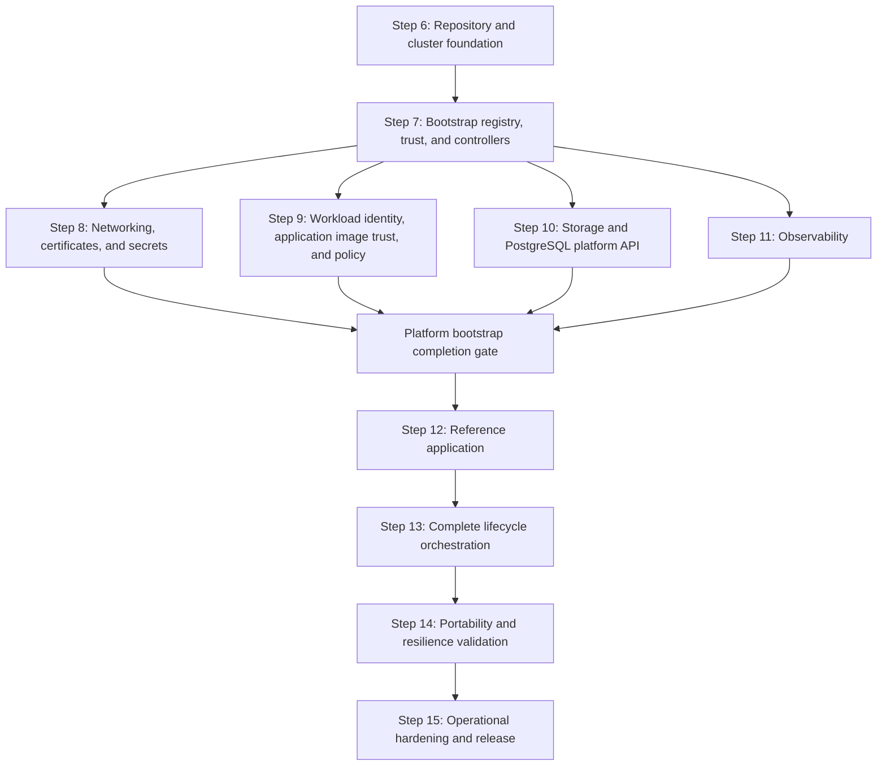

# Local Kubernetes Platform Implementation Plan

## Purpose

This plan implements the architecture and tool decisions in
[`1-initialize.md`](./1-initialize.md). It begins after the architecture, lifecycle,
capability, tool-selection, and repository-topology decisions completed in Steps 1
through 5.

Work proceeds one step at a time. A step is complete only after its deliverables
exist, its exit criteria pass, and the results are recorded in this plan. A later
step may refine an earlier decision, but must record the reason and update the
affected acceptance criteria.

## Delivery Principles

- Preserve one desired-state owner for every resource.
- Keep applications independent of Minikube and cloud-provider implementation
  details.
- Prefer small commands that compose through explicit inputs, outputs, and exit
  codes.
- Pin every tool, chart, image, provider, and policy-bundle version.
- Make every reconciliation idempotent and safe to resume after partial failure.
- Introduce policy in audit mode before enforcing it.
- Treat the internal OCI registry and image-signature verifier as bootstrap
  dependencies, and do not report bootstrap complete until the seed trust loop is
  closed and fail-closed admission is active.
- Permit only protected release automation identities to sign trusted images;
  developers and untrusted pipeline contexts may build candidates but cannot sign
  or promote them.
- Keep application admission closed throughout all internal bootstrap phases and
  open it only after every required infrastructure tool and capability passes its
  current-generation readiness checks.
- Validate destructive behavior with retained data before exposing destructive
  commands.
- Do not present `kore platform up` as complete until it converges the full MVP
  platform.

## Implementation Sequence



Steps 8 through 11 may be implemented in parallel only after Step 7 is complete.
Each must pass independently before Step 12 begins.

## Where each open item can be done

Every unchecked item sits in exactly one class, by what its completion needs.
Where an item is partly local, the note says which part is. The handoff updates
this section when items are ticked (as of 2026-11-09: 21 local, 13 managed
cluster, 8 release pipeline).

### Local

Built and proven on the local Minikube profile (`kore local up`), or offline
(tests, validate, render, docs).

- Step 9 (1): Bootstrap and system controllers remain operational under enforcing
  policy (needs more constraints promoted, one at a time, with PR #105's commands).
- Step 10 (1): Cluster destroy is blocked while retained data lacks a purge or
  export (offline tests pass; `cluster destroy` without `--purge-data` is not
  observed live).
- Platform Bootstrap Completion Gate (5): Make a required capability becoming
  unhealthy close the gate; Ensure interrupted or failed bootstrap leaves the gate
  closed (both offline only); and three exit criteria: Gatekeeper, Sigstore Policy
  Controller, and the rest are ready and enforcing; No application resource can be
  applied while the gate is closed or stale (the live suite uses a throwaway gate;
  the platform gate is audit-only); `kore platform up` and bootstrap status cannot
  report success before the gate is open.
- Step 12 (2): All Gatekeeper constraints intended for the MVP are enforcing (every
  committed constraint is `dryrun`); Removing and reinstalling the workload
  preserves retained application data.
- Step 13 (7): Make `kore platform up` own the complete bootstrap generation (needs
  Step 7's trust closure); Clean up failed or canceled releases; Add a clean-machine
  end-to-end test (PR #88's script has not run); and four exit criteria: A partial
  or degraded bootstrap cannot report success; Status reports the deployed digest
  and signer; Interrupted operations resume safely; Destructive operations preserve
  or account for retained data.
- Step 14 (2): Test controller restart, OPA outage, and the rest (interrupted Helm
  upgrade and partial reconciliation are offline only); Test registry outage,
  signature-verifier outage, signer rotation (outages and the local key swap pass
  live; interrupted image promotion and the partially closed trust loop are
  untested).
- Step 15 (3): Add upgrade tests (spec in PR #116, not yet run live); Add backup
  schedules (local objective and audit-only `backups` row done, ADR 0074; no
  managed target); and one exit criterion: A supported upgrade path passes.

### Managed cluster

Needs a real non-Minikube cluster (managed Kubernetes or a VPS).

- Step 7 (4): Roll every managed platform workload (the registry and verifier move
  from seed to signed digest; needs the mirror-only image path, since local images
  are pull `Never`); Enroll all managed platform namespaces (labelling is
  buildable, but the managed-example gate only opens on a cluster); Every managed
  foundation workload installed in this step uses an internal digest-qualified
  image; The internal foundation phase finishes with no active seed exception.
- Platform Bootstrap Completion Gate (1): The registry contains every managed
  platform image (depends on the Step 7 roll; the mirror is in GHCR, not Minikube).
- Step 14 (8): Define the provider OpenTofu stack (the stack is offline
  `tofu validate`/plan; applying needs the provider account); Preserve the platform
  registry contract when a provider-managed OCI registry substitutes; Prove with
  provider IAM that only the protected release workload can sign; Define a managed
  PostgreSQL Crossplane composition (authoring and the offline contract test are
  local; readiness needs a managed database service); Run an authorized live
  portability test; Application source and charts are identical between local and
  provider environments (offline render diff is local; the live run needs the
  provider); The managed PostgreSQL composition produces the same readiness and
  Secret interface; Provider support is documented only after an authorized live
  test passes.

### Release pipeline and repository settings

Needs a tagged release, GitHub settings, or the protected CI identity.

- Step 7 (2): Implement protected release automation that mirrors approved platform
  images (a rerun on a new tag; the Crossplane function packages were mirrored in `v0.4.0`);
  Bind the accepted Cosign authority to an exact protected automation identity or
  KMS/HSM key (workflow identity, environment protection, and registry permissions).
- Step 9 (1): Every container, init container, and ephemeral container is rejected
  unless its digest is signed by the environment-authorized release automation
  identity (rejection of unsigned and unauthorized signers is local and passes
  live; the ephemeral-container case flaked once on 2026-11-09 and is under
  investigation; only the release identity is not local).
- Step 12 (2): Publish the candidate to the platform registry, promote and
  Cosign-sign (signing only through protected release automation); All application
  images are pulled from the platform registry by digest and verified at admission
  against the authorized release automation identity.
- Step 15 (3): Add artifact integrity checks, dependency inventory, and automated
  vulnerability reporting (an offline inventory is local; scheduled reporting needs
  CI and repository settings); Tag the first versioned local-platform release; The
  first local-platform release is reproducible from a clean checkout.

## Step 6: Repository and Local Cluster Foundation

### Objective

Create the repository skeleton, pinned developer toolchain, safe command entry
point, and deterministic Minikube lifecycle without installing platform
controllers.

### Work

- [x] Record an architectural decision for the initial `kore` implementation
      language and packaging model
      ([ADR 0001](../../docs/decisions/0001-kore-typescript-cli.md)).
- [x] Create the planned `apps`, `infra`, and `tools` directory structure without
      placeholder files that have no declared purpose.
- [x] Define and validate the schemas for `infra/catalog/components.yaml`,
      `infra/catalog/versions.yaml`, and environment definitions.
- [x] Add repository-local `mise` configuration with pinned versions of the tools
      needed by this step.
- [x] Implement `kore doctor` with checks for tool versions, container runtime,
      CPU, memory, disk, credentials, and conflicting Minikube profiles.
- [x] Define the `local` environment, deterministic Minikube profile name,
      Kubernetes version, driver, container runtime, resource allocation, and expected
      kubeconfig context.
- [x] Implement focused cluster operations for create, status, stop, and guarded
      destroy.
- [x] Ensure commands address the explicit profile and context rather than the
      user's current `kubectl` context.
- [x] Add unit tests for configuration loading, version resolution, command
      construction, context validation, and destructive guards.
- [x] Add an integration test that creates, inspects, stops, and resumes a local
      cluster when a compatible container runtime is available.

### Initial Command Surface

```text
kore doctor
kore cluster up --environment local
kore cluster status --environment local
kore cluster stop --environment local
kore cluster destroy --environment local
```

These cluster commands are focused implementation building blocks. They do not
claim that the platform is ready.

### Exit Criteria

- [x] A fresh checkout can install all pinned Step 6 tools through one documented
      operation.
- [x] Catalog and environment files fail fast with useful schema errors.
- [x] `kore doctor` distinguishes required failures from optional warnings.
- [x] Repeating cluster creation produces no unintended change
      (2026-11-09: `gateway` live suite, "repeating platform creation on a
      converged cluster changes no Helm release"; second `local up` upgraded
      nothing, see "2026-11-09 combined live batch").
- [x] Cluster commands refuse to operate on an unexpected context or profile.
- [x] Stopping and resuming the profile preserves its Kubernetes state
      (2026-11-08: PV UIDs, database rows, and registry contents unchanged).
- [x] Destroy requires explicit confirmation and has a tested retained-data guard.
- [x] Tests that do not require a live cluster run without one.
- [x] No infrastructure controller or application is installed by this step.

## Step 7: Bootstrap Registry, Image Trust, Controllers, and CRD Ownership

Next: finish proving and landing the open PRs, then tick their items. #115 (gate degradation and interrupt) passed live on scratch branch `live/batch6`. On #118 (constraint compliance) 7 of 8 constraints are at 0 violations live, and kore-rbac's last 2 (`crossplane:masters`) are fixed but unapplied. #119 (probe post-renderer, ADR 0081) is applied live. #114 (promotion, helm-interrupt) and #117 (app-status) had spec fixes pushed after their failures. #116 (upgrade) and #117's clean-machine spec need kore-local stopped (`kore local stop`, data kept) on this 16 GiB host. Scratch branch `live/batch6b` merges all six. Batch 6 was stopped during `resilience`, so `resilience`, `registry`, `policy`, `ops` and `docs` still need a run. On `live/batch6b`, run `kore local up`, check every constraint at 0 violations, then run those five plus `test:integration:` app-status, promotion, helm-interrupt, then clean-machine and upgrade, then land the PRs one at a time. After that, promote the zero-violation constraints one at a time with `kore policy` (retention was rolled back only because the host was overloaded). Release PR #65 (0.5.0) awaits the user.

### Objective

Install the internal OCI registry, Sigstore Policy Controller, and every controller
required by the MVP in dependency order. Establish the application admission gate
in its closed state, close the foundation seed trust loop, and enable fail-closed
image admission while preserving explicit CRD ownership. This is an internal
bootstrap phase and cannot publish overall platform readiness before Steps 8
through 11 also converge.

### Work

- [x] Populate the component and version catalogs with pinned upstream chart and
      image references.
- [x] Record a compatibility matrix covering Kubernetes, Helm, Gateway API,
      cert-manager, Gatekeeper, Istio, Crossplane, External Secrets Operator,
      CloudNativePG, and OpenTelemetry Operator.
- [x] Select and pin the OCI Distribution-compatible registry, Cosign, and Sigstore
      Policy Controller; add them to the compatibility matrix, component catalog,
      version catalog, release graph, and readiness model.
      The registry, Policy Controller webhook, and its `leasescleanup` kubectl
      images are pinned by index digest (`config/image-pins.spec.ts`), and Cosign
      3.1.4 has a compatibility row. The kubectl image's upstream tag is the
      floating `latest-dev`, so only its digest pins it.
- [x] Give every logical release a namespace, CRD owner, dependencies, timeout,
      and readiness checks. The schema requires at least one readiness check;
      StorageClass, ClusterRole, ClusterRoleBinding, and ConfigMap entries are
      proven by existence
      ([ADR 0016](../../docs/decisions/0016-release-readiness-checks-drive-wait-and-status.md)).
- [x] Implement topological sorting and cycle detection for the release graph.
- [x] Add a render and validation operation that does not mutate a cluster.
- [x] Install Gateway API CRDs before Istio resources that consume them.
- [x] Install cert-manager and wait for its deployments and webhook.
- [x] Install OPA Gatekeeper without enforcing Kore constraints.
- [x] Install a persistent `oci-registry` infrastructure release and verify push,
      pull, restart, storage retention, authentication, authorization, and bounded
      readiness behavior.
      _Partial: the `kore-standard` PVC is labelled `platform.kore.dev/retention=Delete`,
      since the registry holds rebuildable cache. Since #46
      ([ADR 0034](../../docs/decisions/0034-registry-authentication-and-authorization.md)),
      an nginx proxy fronts the registry, which listens on loopback only. The
      Service is ClusterIP and readiness is a TCP check. Live on a fresh profile:
      anonymous push and pull get 401, and kore pushes and signs with the push
      identity. Read-only enforcement (403 on a write) was proven only in Docker.
      Since #67 ([ADR 0055](../../docs/decisions/0055-registry-credential-rotation.md)),
      `kore registry rotate-credentials --environment <env> --yes` rotates both
      credentials. Live 2026-11-08 (`npm run test:integration:registry`): images and
      signatures survive a pod restart with anonymous access still 401, and after
      rotation the old password gets 401 while the new one pushes and a signed image
      is still admitted. Since #70 the read credential gets 403 on a push, live.
      Since #74 ([ADR 0058](../../docs/decisions/0058-registry-transport-tls.md)), the
      registry serves TLS only, at the nginx proxy, from a kore-owned cert-manager
      CA, and every client verifies it. Live 2026-11-08 on an existing profile: one
      `local up` migrated with no manual step, a request without the CA fails
      verification, plain HTTP gets nginx 400, the registry (4/4) and admission
      (5/5) specs pass, and a second run reissued and restarted nothing._
- [x] Install Sigstore Policy Controller and its CRDs/webhook from an explicitly
      allowlisted, digest-pinned seed artifact without enabling enforcement yet.
      _Its controller and lease-cleanup images are digest-pinned seeds in
      `infra/catalog/seeds.yaml`, with recorded provenance. Enforcement came later,
      after a warn period (ADR 0032). The chart (app 0.13.1) lags the 0.15.1
      application release._
- [x] Install Istio base, `istiod`, Istio CNI, and `ztunnel` for ambient mode.
- [x] Install Crossplane and the required composition functions. The
      `kore-crossplane-functions` release installs both Functions after Crossplane
      and before `kore-postgresql-api`, and waits for `Installed` and `Healthy`
      ([ADR 0023](../../docs/decisions/0023-crossplane-functions-own-release-and-readiness.md)).
      Live-verified 2026-11-08.
- [x] Install External Secrets Operator.
- [x] Install CloudNativePG.
- [x] Install OpenTelemetry Operator after its prerequisites are ready.
- [x] Define the minimal digest-pinned seed manifest required to start the registry,
      verifier, and their prerequisites; reject unrecorded seed artifacts and record
      the reason and upstream verification evidence for every seed.
      `infra/catalog/seeds.yaml` records three seeds: the registry, Policy Controller,
      and its lease-cleanup kubectl image. `kore validate` rejects a seed with no
      digest, reason, or evidence, and any digest-pinned image a seed component uses
      that is not recorded
      ([ADR 0026](../../docs/decisions/0026-seed-manifest.md)). The registry image
      has no upstream signature; its only evidence is the Docker Hub digest, so the
      signing step must establish its trust (2026-11-08).
- [ ] Implement protected release automation that mirrors approved platform images
      into the internal registry, verifies recorded upstream digests and provenance,
      signs internal digests with Cosign, verifies each signature, and emits an
      immutable image lock manifest.
      _Partial: proven on tag `v0.3.1` (run 42538355127,
      [ADR 0033](../../docs/decisions/0033-platform-image-mirror.md)). The job mirrored
      all 36 approved images (seeds plus approved) to
      `ghcr.io/corekraft/kore/mirror/*` with digests identical to upstream. 10 had
      their upstream signatures verified with an exact identity, and 26 are
      recorded as unsigned upstream. Each mirror is signed keylessly and
      verified, and `platform-images.lock.json` was emitted. An independent
      check pulled all 36 anonymously and verified each against the exact
      `v0.3.1` identity; a `refs/heads/main` identity is rejected. The `v0.3.0`
      run was denied by GHCR on the first new package. #52 now seeds a labelled
      `kore-link` tag so the package is created linked to this repository.
      Remaining: the two Crossplane function packages are still tag-pinned, and
      nothing consumes the lock yet._
- [ ] Bind the accepted Cosign authority to an exact protected automation identity
      or KMS/HSM key. Grant developers, pull-request workflows, ordinary build jobs,
      cluster workloads, and registry administrators no signing permission.
      _Not started: the only signer is `local-kore-key`, which now lives in the
      `kore-system/kore-local-signing-key` Secret for the cluster's lifetime
      (ADR 0015)._
- [ ] Roll every managed platform workload, including the registry and verifier,
      from its seed or external reference to the signed internal digest recorded in
      the image lock manifest.
- [x] Install `ClusterImagePolicy` resources covering containers, init containers,
      and ephemeral containers; reject unmatched images and fail closed on signature,
      registry, or verifier errors.
      _#70, live 2026-11-08 (`npm run test:integration:admission`, 5/5): an unsigned
      image is denied as an init container and as an ephemeral container, an image
      no policy matches is denied, and new workloads are denied while the registry
      or the verifier is scaled to 0._
- [ ] Enroll all managed platform namespaces, then inventory running workloads and
      fail bootstrap if a seed, external, tag-only, unsigned, or unauthorized image
      remains. Seed exceptions must be empty before success.
      _Partial: #71 ([ADR 0056](../../docs/decisions/0056-platform-image-inventory.md))
      inventories every container image in managed platform namespaces before the
      gate opens and checks enrollment (`cosign-system` and `kore-registry` exempt).
      local runs it in audit; live it logs "35 approved-upstream-digest, 3 seed, 10
      namespace(s) not enrolled". managed-example enforces it, so its gate stays
      closed until namespaces are enrolled. Enrollment (labelling) is not built._
- [x] Create the generation-specific application admission gate in its closed state;
      grant only bootstrap automation permission to update it or application namespace
      activation metadata.
      _#68 ([ADR 0054](../../docs/decisions/0054-application-admission-gate-closed-at-foundation.md)):
      a `KoreApplicationAdmission` constraint per environment, closed at the start of
      each run, opened by `platform up` only after every phase and readiness pass in
      the same run; `kore platform status` reports it and `kore app up` refuses while
      it is closed or stale. Live: closed early, opened after readiness, same
      generation on a second run. The constraint is `dryrun`, so cluster-side denial
      is Step 11's to prove._
- [x] Make controller bootstrap independently runnable and complete it before
      shared configuration readiness checks; OpenTelemetry Operator must not be
      blocked by a Gateway waiting for its certificate or external address.
- [x] Keep controller configuration instances out of controller releases.
- [x] Add controller health, CRD establishment, webhook, and idempotency tests.
      _CRD establishment retries are tested. Webhook configurations need a
      `caBundle` and a ready endpoint (#44). An unchanged deployed release gets no
      upgrade (`platform.drift.spec.ts`). The new webhook checks are not yet
      exercised live._

### Note

CRD ownership is decided in
[ADR 0011: Declare releases, ownership, and versions in the catalog](../../docs/decisions/0011-catalog-owned-releases-and-versions.md).

### Exit Criteria

- [x] Every controller and CRD has exactly one catalog owner.
      _Every CRD a pinned chart renders is declared once, checked by `npm run
test:upstream-charts`. Since #72
      ([ADR 0057](../../docs/decisions/0057-runtime-crd-ownership.md)) runtime CRDs are
      owned by API group, validate rejects overlapping claims, and `platform status`
      audits the cluster: live, "all 119 CRDs have exactly one catalog owner" (it
      first found seven Gateway API CRDs unowned). It reports, it does not fail
      `platform up` yet._
- [x] The release graph is acyclic and produces a deterministic order.
- [x] All CRDs are established before their custom resources are submitted.
      _Each component waits for its owned CRDs to be Established before the next
      phase starts. A fresh-profile `local up` converged on its first run._
- [x] All controller deployments, daemon sets, and webhooks report ready.
      _On the fresh profile, `platform status` reported all 30 components ready, and
      every webhook service entry had a `caBundle` (#44)._
- [x] The registry persists images and signatures across platform stop and resume
      (2026-11-08).
- [ ] Every managed foundation workload installed in this step uses an internal
      digest-qualified image with a valid signature from the authorized release
      automation identity; later platform releases must satisfy the same condition
      before installation.
- [x] Unsigned images and images signed by developer, pull-request, build-job, or
      other unauthorized identities are rejected.
      _#66: live (`npm run test:integration:admission`), an unsigned image and one
      signed by an unauthorized key are denied in an enrolled namespace while the
      kore-signed image is admitted. Keyless subjects are exact-match and tested
      offline._
- [x] Registry or signature-verifier unavailability denies new managed workloads
      and is reported as degraded without weakening policy.
      _Live (#66, #70): with the registry or the verifier scaled to 0, a new signed
      workload is denied and `app status` reports degraded naming the component,
      then recovers._
- [ ] The internal foundation phase finishes with no active seed exception or
      external image reference and leaves the application admission gate closed.
- [x] A second reconciliation produces no unintended release changes.
      _Since #53, configuration and app releases skip Helm when their fingerprint
      matches. Live, two consecutive `local up` runs: the second upgraded 0 releases
      in 121s._
- [x] Failure identifies the component and readiness condition that timed out
      (`component <c> failed to become ready: <resource> not ready (<condition>)
within <timeout>: <reason>`).
- [x] No shared issuer, gateway, composition, secret store, or unrelated enforcing
      Gatekeeper/runtime policy is installed yet; image signature enforcement is the
      required bootstrap exception because it closes the image trust boundary.
      _`kore-postgresql-api` and `opa-authorizer` moved to the configuration phase
      ([ADR 0027](../../docs/decisions/0027-bootstrap-installs-controllers-and-image-trust-only.md)). This was confirmed
      in the third fresh-profile live bootstrap._

## Step 8: Networking, Certificates, and Secrets

### Objective

Provide a stable HTTPS endpoint and Secret reference contract using Istio Gateway
API, cert-manager, SOPS with age, and External Secrets Operator.

### Work

- [x] Create the infrastructure-owned Gateway API `Gateway` and environment-owned
      parent-reference contract used by application `HTTPRoute` resources.
- [x] Automate the lifecycle of the Minikube tunnel as local adapter behavior,
      including status, cleanup, and stale-process detection
      (`kore tunnel start|stop|status`, `tools/kore/src/tunnel/tunnel.ts`).
- [x] Establish the local CA with mkcert through an explicit trust-changing
      operation.
- [x] Configure the cert-manager local issuer without committing private key
      material.
- [x] Issue a test certificate and verify its readiness, renewal metadata, and host
      trust (`gateway-proof.spec.ts`; `gateway` live suite 3 of 3, 2026-11-09).
- [x] Define a stable `platform-secrets` store name for application resource
      charts.
- [x] Add SOPS and age configuration for encrypted local source secrets.
      `.sops.yaml` encrypts local documents to a local-only age recipient (decision 3
      below), and `sops-canary.enc.yaml` holds no real secret. Live 2026-11-08:
      `local up` decrypted it through stdin into `kore-secret-source`. On macOS,
      export `SOPS_AGE_KEY_FILE` when the identity lives under `~/.config`.
- [x] Automate decryption directly into a protected source namespace without
      writing plaintext files into the repository or build artifacts.
- [x] Configure External Secrets Operator to materialize application-scoped
      Kubernetes Secrets from the local source.
- [x] Define redaction rules so rendered output, dry runs, errors, and CI logs do
      not reveal secret values. `kore platform render` redacts Secret `data` and
      `stringData` and sensitive keys with the journal marker
      ([ADR 0021](../../docs/decisions/0021-render-redaction-and-portability-rendering.md)).
- [x] Add readiness and end-to-end tests for Gateway, TLS, and Secret materialization
      (offline: `gateway-proof.spec.ts`, `secret-materialization.spec.ts`; live:
      `gateway.integration.spec.ts`, 3 of 3 on 2026-11-09).

### Gateway Bootstrap Repair

The 2026-09-13 clean-cluster failure (`AddressNotAssigned`,
`InvalidCertificateRef`) and the certificate-first ordering are recorded in
[ADR 0013: Issue the local TLS certificate before installing the Gateway](../../docs/decisions/0013-local-tls-before-gateway.md).
The Istio CNI AppArmor deprecation warning did not cause this failure.

- [x] Order local bootstrap explicitly: ready controllers, local CA/issuer setup,
      Certificate creation, TLS Secret readiness, Gateway creation, and external
      address/route readiness. Split configuration releases where a Helm wait would
      otherwise block the commands needed to satisfy its own prerequisites.
      `kore-local-tls` is a separate release, the Gateway address wait is in
      `waitForGateway`, and `kore app up` waits for each rendered `HTTPRoute`
      (`waitForHTTPRoute`, `waitForRoutes`; PR #106). The platform owns no route.
- [x] Use the explicit `kore trust install --environment local` operation to
      establish host trust and install the issuer prerequisites. Verify the
      ClusterIssuer is Ready before waiting for certificate issuance; report a
      missing trust setup with an actionable command.
      Before waiting on a Certificate, Kore checks the ClusterIssuer and its CA
      Secret and fails immediately with `Run: kore trust install --environment
<env>`.
- [x] Create and wait for the Certificate that produces
      `kore-system/kore-local-tls`; check the expected TLS Secret keys without
      printing their contents before installing the HTTPS Gateway. The certificate
      now has a separate release, waits for `Certificate Ready`, then checks for a
      TLS Secret containing both `tls.crt` and `tls.key` before the Gateway release.
- [x] Start and recover the local Minikube tunnel so the Gateway LoadBalancer
      Service receives an address; handle required host privileges, tunnel exit,
      stale processes, and stop/destroy cleanup explicitly.
      The local Gateway listens on 8443, which avoids host privileges rather than
      handling them. Recovery is on demand, not a daemon: `ensureLocalTunnel`, which
      the platform and app commands call, restarts an exited tunnel once and never
      starts a duplicate
      ([ADR 0060](../../docs/decisions/0060-tunnel-recovery-on-demand.md),
      `tunnel-ensure.spec.ts`, `tunnel-leader.spec.ts`). Live 2026-11-09 (#101):
      with the unrecorded leader and the ssh forward stopped, one tunnel came
      back and `https://kore.local:8443/api` returned 200.
- [x] Wait with bounded timeouts for the Service address, Gateway `Accepted` and
      `Programmed`, and listener `ResolvedRefs`; include condition reasons such as
      `AddressNotAssigned` and `InvalidCertificateRef` in failure output
      (`platform/readiness-gateway.ts`).
- [x] Add regression tests for missing issuer/TLS Secret, unavailable tunnel,
      and configuration ordering. Run a fresh-cluster end-to-end check through a
      trusted HTTPS route, including cleanup and retry after an injected failure.
      Ordering, unreachable-tunnel, missing-issuer, missing-CA-Secret, and
      missing-TLS-Secret tests exist. Live 2026-11-09: a removed backend is named
      by the route's conditions and recovers; a deleted TLS Secret is re-issued.

### Exit Criteria

- [x] A test `HTTPRoute` receives a stable local HTTPS endpoint (`gateway` live
      suite, 2026-11-09).
- [x] The endpoint certificate is trusted by the opted-in development host (same
      live test).
- [x] The Gateway and certificate report ready through Kubernetes conditions
      (same live test; `gateway-proof.spec.ts`).
- [x] An `ExternalSecret` produces the expected target Secret schema (same live
      test; `secret-materialization.spec.ts`; `reference` suite 8 of 8).
- [x] No plaintext secret is committed, stored in Helm values, or printed in logs
      (offline: `secret-materialization.spec.ts`, `render-redaction.spec.ts`,
      `journal-redaction.spec.ts`, `gateway-proof.spec.ts`; hooks `secret-path`
      and `sops-plaintext`).
- [x] Reconciliation and certificate or Secret rotation do not require manual
      cluster changes. _Certificate re-issue and reconciliation are proven live.
      Secret rotation (#110, ADR 0075): on 2026-11-09 an `up` from a second
      checkout left the token source alone (reference 8/8 from both checkouts),
      and `kore secrets sync --rotate --yes` plus `kore local up` rolled
      `reference-api` onto the new token (reference 8/8)._
- [x] Application manifests contain no Minikube-specific values
      (`app/reference-contract.spec.ts`).

## Step 9: Workload Identity, Application Image Trust, and Policy

### Objective

Establish dedicated workload identities, ambient mutual TLS, application image
trust, admission policy, and OPA-backed contextual authorization without turning
OPA into an identity issuer or a signature verifier.

### Work

- [x] Define the namespace enrollment contract for Istio ambient mode.
      `kore app up` is the only owner of an application namespace: it applies the
      namespace with `istio.io/dataplane-mode: ambient`, and Helm no longer
      creates it. The Gatekeeper mesh-enrollment constraint audits the label
      ([ADR 0025](../../docs/decisions/0025-application-namespace-ambient-enrollment.md)).
      Live-verified 2026-11-08 (mesh-enrollment audit 0). _`kore app down` still
      leaves the namespace._
- [x] Require every workload to use a dedicated Kubernetes ServiceAccount.
- [x] Verify Istio produces the expected SPIFFE principal from namespace and
      ServiceAccount identity (`config/workload-principals.spec.ts`; `identity`
      live suite, ztunnel principals, 2026-11-09).
- [x] Enable strict mutual TLS for participating workloads.
- [x] Establish native Istio default-deny and explicit-allow authorization patterns.
- [x] Create Gatekeeper constraint templates and tests for identity, RBAC,
      privilege, resource, health-probe, Secret, mesh-enrollment, and retention rules.
      `mise run test-gatekeeper` runs the suites with pinned gator, locally and in CI
      ([ADR 0017](../../docs/decisions/0017-gatekeeper-policy-families-audit-first.md)).
- [x] Deploy constraints in audit mode and define minimal explicit system namespace
      exemptions. The `kore-policy-templates` and `kore-policy-constraints`
      configuration releases install them in `dryrun`.
      _The two known audit findings (the unlabelled `oci-registry` PVC and the
      unlabelled application namespace) are fixed offline; recheck the audit
      counts live._
- [x] Define the application namespace enrollment contract for Sigstore Policy
      Controller and make enrollment mandatory before an application workload release
      (`app/app-admission-enrollment.spec.ts`; `admission` live suite 6 of 6,
      2026-11-09).
- [x] Define environment-specific trusted release automation identities and ensure
      local identities are never trusted by managed environments
      (`config/image-trust-isolation.spec.ts`, `app/app-signer-trust.spec.ts`,
      `images/managed-lock.spec.ts`). The real release identity is Step 7's
      binding.
- [x] Verify that registry membership alone grants no trust: admission must validate
      the Cosign signature and exact authorized signer for the deployed digest
      (`admission-denial.integration.spec.ts`; `admission` live suite 6 of 6 on a
      rerun, 2026-11-09).
- [x] Package and deploy the platform-operated OPA-Envoy external authorization
      service.
- [x] Deliver tested Rego as versioned OPA bundles. The chart carries the
      `bundles/v1` files and a spec fails if they drift; the dead `bundle.url` value
      is gone ([ADR 0018](../../docs/decisions/0018-opa-bundle-chart-single-source.md)).
- [x] Configure OPA as an Istio external authorization provider without manual
      ConfigMap editing.
- [x] Route one Layer 7 policy through an ambient waypoint and Istio `CUSTOM`
      authorization policy.
- [x] Verify the OPA decision receives authenticated source and destination workload
      principals (`opa-decision-path.spec.ts`; `identity` live suite includes
      `authorizer.integration.spec.ts`, 2026-11-09).
- [x] Test allow, deny, authorizer-unavailable, stale-bundle, and invalid-bundle
      behavior (`opa-bundle-failure.spec.ts`, `opa-authorizer.spec.ts`; live: the
      protected route fails closed while the authorizer is down and no pod serves a
      stale bundle, `identity` suite, 2026-11-09).
- [x] Promote constraints individually from audit to enforcement only after the
      platform complies (`kore policy record|promote|rollback`, PR #105, ADR 0072;
      PR #109 scoped workload identity to application namespaces so the platform
      complies). No committed constraint is promoted yet.

### Exit Criteria

- [x] Workloads using the namespace default ServiceAccount are rejected (`policy`
      live suite: promoted `kore-workload-identity` rejected a default-ServiceAccount
      Deployment, rolled back, then admitted it; 1 of 1, 2026-11-09).
- [x] Workload principals follow the documented SPIFFE identity format (`identity`
      live suite, 2026-11-09).
- [x] Service-to-service traffic is mutually authenticated (`reference` live suite
      8 of 8, 2026-11-09).
- [x] Native Istio authorization denies undeclared service relationships (`reference`
      suite negative case, 2026-11-09).
- [x] OPA makes a contextual decision using the authenticated workload principal
      (`identity` suite, `authorizer.integration.spec.ts`).
- [x] Protected routes fail closed when the OPA authorizer is unavailable (same
      suite; `resilience` suite 10 of 10 also covers the outage).
- [x] Policy decisions and denials are observable without leaking credentials
      (same suite, decision-log case; `mask.spec.rego`).
- [ ] Bootstrap and system controllers remain operational under enforcing policy.
      _Only `kore-workload-identity` has been enforced live, briefly. The rest stay
      `dryrun`._
- [x] Every application namespace is enrolled in fail-closed image admission
      (`identity` suite, 2026-11-09).
- [ ] Every container, init container, and ephemeral container is rejected unless
      its digest is signed by the environment-authorized release automation identity.
      _Init and ephemeral containers pass live. The one ephemeral failure on
      2026-11-09 was a probe bug, not a fail-open: the probe picked a terminating
      pod, which Policy Controller skips by design. #111 fixed it, and `admission`
      passed 6 of 6 straight after a deployment roll. The release identity is Step
      7's binding._

## Step 10: Storage and PostgreSQL Platform API

### Objective

Provide explicit disposable and retained storage profiles plus a portable
PostgreSQL claim backed locally by CloudNativePG.

### Work

- [x] Define `kore-standard` and `kore-retained` StorageClasses with documented
      reclaim and expansion behavior. The README documents both, and
      `platform.storage.spec.ts` asserts `Delete`, `Retain`, and expansion.
- [x] Verify Minikube storage paths survive profile stop and resume (2026-11-08).
- [x] Define the namespaced
      `PostgreSQLInstance.platform.kore.dev` Crossplane XRD.
- [x] Limit the API to portable inputs: service class, storage size, PostgreSQL
      compatibility version, connection Secret name, and retention policy.
- [x] Create the local Crossplane composition that produces a CloudNativePG cluster
      and connection Secret.
- [x] Grant Crossplane only the RBAC required to compose CloudNativePG and related
      Kubernetes resources. Secret `update` is dropped, `clusters/status` is
      read-only, and PR #99 moves the Secret rules to their own ClusterRole bound
      only by a per-namespace RoleBinding that `kore app up` creates
      ([ADR 0020](../../docs/decisions/0020-postgresql-api-scoped-rbac-status-and-retention.md),
      amended ADR 0061). Live 2026-11-09: the only binding is
      `reference/crossplane-postgresql-secrets`, there is no ClusterRoleBinding to
      the Secret role, and `storage` passes 1 of 1.
- [x] Normalize connection data into the documented Secret schema.
- [x] Propagate readiness, failure, and useful status conditions to the claim.
      A `project-status` step copies CloudNativePG phase, reason, and endpoint and
      sets `DatabaseHealthy`. _Unverified live._
- [x] Keep the claim in the application resources release and the composed database
      outside Helm ownership.
- [x] Implement retained-data discovery used by application and cluster lifecycle
      guards. `cluster destroy` and `app down` use it and it fails closed; the
      composition labels CloudNativePG PVCs through `inheritedMetadata`, and purge
      no longer waits on a claim a pod still mounts. Export and restore exist (next
      items). Live 2026-11-09: `storage` suite 1 of 1 (retained volume survives claim
      deletion and discovery reports it).
- [x] Define and test an explicit purge path.
- [x] Implement a local export and restore proof before treating platform destroy as
      recoverable. `kore data export` and `kore data restore`
      ([ADR 0029](../../docs/decisions/0029-local-export-and-restore.md)) cover the
      CloudNativePG database only; export refuses while other retained volumes exist.
      Live round trip 2026-11-08, recorded in the third fresh-profile entry below.

### Exit Criteria

- [x] Disposable and retained claims bind to the intended storage profiles
      (`storage` suite, `kore-standard` and `kore-retained`, 2026-11-09).
- [x] A PostgreSQL claim becomes ready without application knowledge of
      CloudNativePG (`storage` suite; `reference` suite 8 of 8).
- [x] The normalized connection Secret is created with the documented keys
      (`storage` suite, under the PR #99 per-namespace binding).
- [x] Deleting the workload release does not delete the database claim or data
      (`storage` suite).
- [x] Deleting a retained claim does not silently delete its backing data
      (`storage` suite; gator `tests/retention.yaml`).
- [ ] Cluster destroy is blocked while retained data lacks an explicit purge or
      verified export. _Offline tests pass (`retained.spec.ts`). `cluster destroy`
      without `--purge-data` has not been observed on a live cluster._
- [x] Exported local data can be restored into a fresh local platform (2026-11-08).

## Step 11: Observability

### Objective

Provide one OpenTelemetry ingestion contract for application, platform, mesh, and
policy telemetry with correlated local metrics, logs, and traces.

### Work

- [x] Install resource-bounded local configurations for Prometheus, Loki, Tempo,
      and Grafana.
- [x] Deploy the OpenTelemetry Collector with OTLP gRPC and HTTP receivers.
- [x] Define separate pipelines for application telemetry, Kubernetes logs and
      metrics, Istio telemetry, and policy decision telemetry where appropriate.
      An `otel-agent` DaemonSet reads pod logs and kubelet stats, Istio traces go to
      the Collector through a mesh `Telemetry` resource, and OPA writes masked
      console decision logs ([ADR 0019](../../docs/decisions/0019-telemetry-pipeline-wiring.md)).
- [x] Enrich signals with cluster, environment, namespace, application,
      ServiceAccount, and workload identity attributes. Cluster and environment
      come from environment overlays.
- [x] Establish attribute and label cardinality limits before ingesting pod-level
      data (a metric attribute allowlist).
- [x] Export metrics to Prometheus, logs to Loki, and traces to Tempo. Prometheus
      scrapes the Collector exporter (8889) and its own metrics (8888).
- [x] Provision Grafana data sources and initial dashboards as desired state.
      The `kore-observability-config` release owns the dashboard ConfigMap.
- [x] Add health, queue, dropped-data, and exporter-failure monitoring for the
      Collector. Prometheus loads the rule files from a ConfigMap; `mise run
test-promtool` unit-tests them. Alertmanager stays disabled locally.
- [x] Define local retention and storage limits for every backend.
- [x] Add synthetic telemetry tests for all three signals and their correlation
      (`platform.telemetry-proofs.spec.ts`, `apps/reference/src/server.test.ts`;
      live `telemetry` suite 3 of 3, 2026-11-09, [ADR 0062](../../docs/decisions/0062-telemetry-proofs-and-mesh-identity.md)).

### Exit Criteria

- [x] Applications use only the documented OTLP endpoint and standard environment
      variables. A spec pins environments and reference charts to the Collector's
      `otel-collector` Service (`platform.telemetry-proofs.spec.ts`,
      `platform.otlp-endpoint.spec.ts`; `reference` suite 8 of 8).
- [x] A synthetic request produces a correlated metric, log, and trace (`telemetry`
      suite, 2026-11-09).
- [x] Istio traffic exposes source and destination workload identity attributes
      (`telemetry` suite, 2026-11-09).
- [x] OPA authorization decisions can be correlated with request traces where
      supported (`telemetry` suite: decisions carry the trace header).
- [x] Collector or backend failure is visible through platform status.
      `platformStatus` evaluates every catalog readiness entry with a 3s bound and
      names the failing component and condition (`telemetry` suite: status degrades
      naming the Collector or a backend, read-only, and recovers).
- [x] Local telemetry storage has explicit retention and resource bounds.
- [x] No application sends telemetry directly to a storage backend
      (`platform.telemetry-proofs.spec.ts` source scan).

## Platform Bootstrap Completion Gate

### Objective

Make the transition from infrastructure convergence to application admission an
explicit, fail-closed operation. No application claim or workload may be deployed,
applied, or admitted until all infrastructure required by the application contract
is installed, configured, healthy, and enforcing for the current bootstrap
generation.

### Work

- [x] Define one versioned readiness manifest listing every required controller,
      registry, trust policy, shared configuration release, platform API, endpoint, and
      health condition from Steps 7 through 11
      (`infra/catalog/readiness.yaml`, `readiness-manifest.spec.ts`, ADR 0067).
- [x] Make bootstrap automation evaluate the manifest with bounded checks and write
      platform-owned, generation-specific readiness state only after every check passes
      (`readiness-gate.spec.ts`; `kore local up` converged live four times on
      2026-11-09).
- [x] Keep application namespaces absent or inactive until readiness is published;
      activate them with platform-owned metadata that enrolls all required admission
      policies, including fail-closed Sigstore verification
      (`app-activation.spec.ts`, `app-up-gate.spec.ts`; `gate` suite 1 of 1).
- [x] Add cluster-side RBAC and admission policy that reject application claims,
      PodSpec-bearing resources, and direct Helm or Kubernetes API mutations when the
      readiness state is missing, closed, stale, or for another environment generation
      (gator `tests/applicationadmission.yaml`; `gate` suite 1 of 1). The suite
      sets a throwaway gate to `deny`; the platform's own gate is still audit-only
      (ADR 0067).
- [x] Prevent developer, build, pull-request, and ordinary deployment identities
      from modifying readiness state, namespace activation, admission configuration, or
      bootstrap-owned RBAC. Only protected bootstrap automation may open the gate
      (impersonated non-administrators in the `gate` suite).
- [ ] Make any required platform capability becoming unhealthy close the gate for
      new application mutations without disrupting already-running healthy workloads;
      status must identify the failed prerequisite.
      _Offline only (`readiness-gate.spec.ts`: an open gate whose prerequisite
      became unhealthy is closed). The `resilience` suite proves degraded status,
      not gate closing._
- [x] Test early `kore app up`, Helm, and direct Kubernetes API attempts and prove
      each is rejected before readiness and accepted only after the gate opens
      (`app-up-gate.spec.ts`; `gate` suite 1 of 1, 2026-11-09).
- [ ] Ensure interrupted or failed bootstrap leaves the gate closed and that a
      successful idempotent retry opens it only after revalidating every prerequisite.
      _Offline only (`readiness-gate.spec.ts`, `resilience-converge.spec.ts`,
      `helm-recovery.spec.ts`). A live resume after an interrupted bootstrap is not
      recorded._

### Exit Criteria

- [x] Every infrastructure tool required by the declared application contracts is
      installed, configured, healthy, and reported by the current readiness generation
      (`kore local up` converged four times on 2026-11-09 and `platform status` listed
      every row ready; `backups:degraded` is audit-only).
- [ ] The registry contains every managed platform image and its authorized Cosign
      signature; all platform workloads use internal digest-qualified references.
- [ ] Gatekeeper, Sigstore Policy Controller, workload identity, secrets, storage,
      database APIs, networking, certificates, and telemetry prerequisites are ready
      and enforcing their application-facing contracts.
- [ ] No application resource can be applied through `kore`, Helm, or the Kubernetes
      API while the gate is closed or stale under supported non-administrator identities.
- [x] Only protected bootstrap automation can open the gate, and opening it produces
      auditable evidence covering every prerequisite (`readiness-gate.spec.ts`;
      `gate` live suite 1 of 1, 2026-11-09).
- [ ] `kore platform up` and bootstrap status cannot report success before the gate
      is open.

## Step 12: Reference Application

### Objective

After the application admission gate opens, prove the complete platform contract
with a small application that exercises every MVP capability and includes positive
and negative tests.

### Work

- [x] Implement at least two communicating workloads so workload-to-workload
      identity and authorization can be demonstrated.
- [x] Give each workload a dedicated ServiceAccount.
- [x] Create `charts/resources` for the PostgreSQL claim and any external Secrets.
- [x] Create `charts/workload` for Deployments, Services, health probes,
      `HTTPRoute`, telemetry configuration, and authorization policy references.
- [x] Build an OCI-compatible candidate image without embedding local behavior in
      either chart.
- [ ] Publish the candidate to the platform registry, promote and Cosign-sign its
      digest only through protected release automation, verify the signature, and pass
      only the resulting digest-qualified internal reference to Helm.
      _Partial: the digest is published to the local registry, verified with
      `cosign verify`, and passed to Helm, but it is signed by `local-kore-key`, not
      by protected release automation._
- [x] Read the PostgreSQL connection only from the normalized Secret contract.
      The password comes from a `secretKeyRef` to the Secret the contract's
      `passwordSecretRef` names, and readiness authenticates with SCRAM-SHA-256 and
      runs `SELECT 1` through a std-lib client
      ([ADR 0024](../../docs/decisions/0024-reference-app-database-access.md)).
      Live-verified 2026-11-08.
- [x] Emit OpenTelemetry logs, metrics, and traces with stable service attributes.
- [x] Add a route protected by native Istio policy and a route protected by OPA.
- [x] Add database schema initialization or migration as an explicit, repeatable
      operation. A `pre-install,pre-upgrade` hook Job applies an append-only list
      in one transaction under an advisory lock (ADR 0024). Live-verified on
      install and on the resume upgrade, which applied nothing new.
- [x] Add smoke tests for HTTPS, persistence, Secret use, health, telemetry, mTLS,
      native authorization, and OPA authorization
      (`reference-app.integration.spec.ts`, `platform.reference-smoke.integration.spec.ts`;
      `reference` live suite 8 of 8, 2026-11-09, after #110's finding below).
- [x] Add negative tests proving that policy rejects an invalid workload and an
      unauthorized caller. Offline: `app/reference-negative.spec.ts` (privileged,
      default ServiceAccount, no readiness probe, tag-only) and Rego tests. Live:
      the `reference` suite negative case (undeclared ServiceAccount refused by the
      mesh) and a 403 for the unauthorized caller.
- [x] Add image-admission tests proving that a correctly automation-signed digest is
      admitted while an unsigned image, a tag-only reference, a modified digest, and an
      image signed by a developer or untrusted pipeline identity are rejected
      (`admission-denial.integration.spec.ts`; `reference` suite 8 of 8 and
      `admission` suite 6 of 6 on a rerun, 2026-11-09). The signer is the stand-in
      local key; the release identity is Step 7's binding.

### Exit Criteria

- [x] The resources release becomes ready before the workload release begins
      (`app.spec.ts` asserts the release order and the claim and Secret waits).
- [x] The application starts without provider-specific templates or source changes
      (`app/reference-contract.spec.ts`).
- [x] HTTPS, database access, Secret injection, and persistence work locally
      (`reference` suite 8 of 8).
- [x] Allowed identity paths succeed and undeclared identity paths fail
      (`reference` suite).
- [x] The OPA-protected operation makes the expected contextual decision
      (`reference` suite; `identity` suite `authorizer.integration.spec.ts`).
- [x] Logs, metrics, and traces are queryable and correlated (`telemetry` suite 3 of 3).
- [ ] Removing and reinstalling the workload preserves retained application data.
      _The `storage` suite proves workload deletion keeps the claim and its data. A
      full remove-and-reinstall of the reference workload is not recorded after the
      2026-11-09 changes._
- [ ] All Gatekeeper constraints intended for the MVP are enforcing.
- [ ] All application images are pulled from the platform registry by digest and
      verified at admission against the authorized release automation identity.
      _Partial: images are deployed by digest and verified client-side by `kore app
up`, not at admission, and the signer is the local key._

## Step 13: Complete Lifecycle Orchestration

### Objective

Expose the stable developer-facing workflow only after all internal operations can
converge and validate the complete platform.

### Work

- [x] Implement `kore platform up`, `status`, `stop`, and guarded `destroy` by
      composing the focused operations from earlier steps.
- [ ] Make `kore platform up` own the complete bootstrap generation and open the
      application admission gate only after Steps 7 through 11 and trust closure pass.
      _The gate flow is on main (`readiness-gate.spec.ts`, `platform.bootstrap.spec.ts`,
      `image-inventory-gate.spec.ts`). Trust closure waits on Step 7's managed-cluster
      roll._
- [x] Implement `kore app up`, `status`, and `down` with separate resource and
      workload release phases.
- [x] Make `kore app up` accept only a release-automation-produced image lock entry,
      independently verify its digest and signer, and refuse local developer-produced
      signatures before invoking Helm (PR #88; `app-signer-trust.spec.ts`,
      `managed-lock.spec.ts`; `reference` suite 8 of 8, 2026-11-09).
- [x] Require an explicit environment for every mutating command.
- [x] Add bounded readiness waits and actionable component-level failures.
- [x] Resume from partial failure without reinstalling healthy dependencies
      (`platform.second-run.spec.ts`, `app-second-run.spec.ts`,
      `helm-recovery.spec.ts`, PR #88). Live 2026-11-09: the second and fourth
      `kore local up` upgraded no release.
- [ ] Clean up failed or canceled releases and their attempt-owned resources
      before another `up`; verify cleanup has completed and preserve healthy
      dependencies and retained data. Full profile deletion is an explicit reset.
      _Offline tests in PR #88 and `helm-recovery.spec.ts`. No interrupted release
      has been cleaned up on a live cluster._
- [x] Make guarded cleanup tolerate CRDs that were never installed. Cover the
      observed missing `postgresqlinstances.platform.kore.dev` resource type during
      partial-bootstrap destroy without bypassing retained-data checks.
- [x] Prevent concurrent mutation of the same environment.
      A lock left by a dead owner on this host is recovered; live, other-host, and
      legacy locks are refused with removal guidance.
- [x] Produce concise human output and stable machine-readable output.
- [x] Ensure diagnostic output is read-only and redacts sensitive data.
- [x] Implement non-interactive confirmation behavior for CI.
- [ ] Add a clean-machine end-to-end test from tool installation through reference
      application verification. _PR #88 adds the opt-in script; it has not run._

### Public Command Surface

```text
kore doctor
kore platform up --environment <name>
kore platform status --environment <name>
kore platform stop --environment local
kore platform destroy --environment <name>
kore app up <name> --environment <name>
kore app status <name> --environment <name>
kore app down <name> --environment <name>
```

Implemented local and supporting commands outside this surface:

```text
kore local up|down [--prune]
kore trust install --environment local
kore tunnel start|stop|status --environment local
kore secrets sync --environment local
kore platform render|bootstrap --environment <name>
kore journal [--json]
kore validate --environment <name>
```

`kore local` composes the public commands for the local quick start. Decide
whether it joins the public surface before Step 15 documentation.

### Exit Criteria

- [x] One command creates and validates the complete local platform (`kore local
up` converged four times on 2026-11-09, `platform status` ready apart from the
      audit-only `backups` row).
- [ ] A partial or degraded bootstrap cannot report success or allow application
      claims or workloads to be applied.
- [x] Platform creation does not install applications.
- [x] One command installs and validates the reference application (`kore app up
reference` rolled out `reference-api`; `reference` suite 8 of 8, 2026-11-09).
- [ ] Status reports the deployed digest, verified signer identity, registry, and
      namespace image-enforcement state without exposing credentials.
- [x] Repeating platform and application reconciliation is idempotent (2026-11-09:
      second and fourth `local up` upgraded no release; `gateway` suite).
- [ ] Interrupted operations resume safely.
- [x] Status commands make no changes (`cli-dispatch.spec.ts` "read-only commands
      never open a journal entry").
- [x] Unexpected profile, context, or environment combinations fail before mutation.
      _Note: for the managed provider, the check only confirms `kube-system`
      exists._
- [x] No documented success path requires manual `kubectl patch`, `edit`, or
      imperative resource creation.
- [ ] Destructive operations preserve or explicitly account for retained data.
      _Export and restore exist (`kore data export|restore`) and discovery fails
      closed. `cluster destroy` without `--purge-data` has not been observed on a
      live cluster._

## Step 14: Portability and Resilience Validation

### Objective

Prove that the contracts are genuinely replaceable and that common component
failures have automated detection and recovery paths.

### Work

- [x] Render every application chart against common configuration without loading a
      local overlay. Portability validation runs `helm template` with chart defaults
      and rejects provider-specific output.
- [x] Add a second non-local environment schema and select its provider through an
      architectural decision
      ([ADR 0012](../../docs/decisions/0012-environment-overlays-hold-provider-specifics.md)).
- [ ] Define the provider OpenTofu stack for networking, identity, registry,
      Kubernetes, and other pre-cluster dependencies.
      _`infra/tofu/stacks/managed-example` validates offline with exact pins and no
      backend or credentials (PR #104, `tofu-stack.spec.ts`), but declares only a
      `null_resource`. The provider resources need the provider account._
- [ ] Preserve the platform registry contract when a provider-managed OCI registry
      substitutes the in-cluster local implementation.
- [ ] Prove with provider IAM that only the protected release workload can invoke
      the signing key or obtain an accepted keyless identity; developer and
      pull-request identities must fail both signing authorization and admission.
- [ ] Define a managed PostgreSQL Crossplane composition that preserves the
      `PostgreSQLInstance` API and connection Secret schema.
- [x] Replace the local secret store, certificate issuer, storage classes, gateway
      exposure, and image delivery through environment configuration only.
- [x] Keep live cloud provisioning opt-in because it requires credentials, external
      changes, and cost.
- [x] Add offline render, schema, composition, and policy tests that run without
      cloud credentials. Schema, portability, render validation, and OPA tests run
      offline. PR #102 renders the PostgreSQL composition offline
      (`platform.postgresql-render.spec.ts`, 6 tests; connection Secret keys,
      storage mapping, version pins, status), and `mise run test-gatekeeper` already
      ran every gator suite locally and in CI.
- [ ] Run an authorized live portability test before claiming support for a
      provider.
- [ ] Test controller restart, OPA outage, telemetry backend outage, interrupted
      Helm upgrade, and partial platform reconciliation.
      _Live 2026-11-09: controller restarts and the OPA outage (`resilience` suite
      10 of 10) and the telemetry backend failure (`telemetry` suite 3 of 3) pass.
      Interrupted Helm upgrade and partial reconciliation are offline only
      (`helm-recovery.spec.ts`, `resilience-converge.spec.ts`)._
- [ ] Test registry outage, signature-verifier outage, signer rotation, interrupted
      image promotion, and recovery from a partially closed bootstrap trust loop.
      _Registry and verifier outages pass live (`admission-outage.integration.spec.ts`
      in the `resilience` suite, 2026-11-09). The local signer key swap (#107,
      `kore signer swap-key`) passed its `signer` suite 1 of 1. Interrupted image
      promotion and the partially closed trust loop have no live test yet._
- [x] Verify status reports degraded capabilities without corrupting healthy state
      (`resilience-status.spec.ts`; `resilience` suite: the outage degrades only its
      component and recovers; `telemetry` suite: status is read-only).

### Exit Criteria

- [ ] Application source and charts are identical between local and provider
      environments.
- [x] Environment selection changes implementations without changing application
      contracts (`portability-environments.spec.ts`, cross-environment render and
      validate).
- [ ] The managed PostgreSQL composition produces the same readiness and Secret
      interface as the local composition.
- [x] Offline provider validation runs in ordinary CI.
      `mise run validate` checks `local` and `managed-example` in CI, and PR #102
      adds `mise run validate-tofu` to `check.yml`.
- [ ] Provider support is documented only after an authorized live test passes.
- [x] Recoverable failures converge without manual cluster patching
      (`resilience-converge.spec.ts`; `resilience` suite 10 of 10, 2026-11-09).

## Step 15: Operational Hardening and Release

### Objective

Turn the validated vertical slice into a maintainable platform release while
keeping production-only scale and availability work explicitly scoped.

### Work

- [x] Document support windows and upgrade order for Kubernetes, CRDs, controllers,
      charts, policy bundles, and the `kore` command
      (`docs/operations/support-and-upgrades.md`; `operations-docs.spec.ts`).
- [ ] Add upgrade tests from the previously supported version catalog.
      _Offline: `ops/upgrade.spec.ts` reads the previous catalog from the release
      tag. The live upgrade from a previous tag is not written._
- [ ] Add backup schedules, restore tests, and recovery objectives for stateful
      platform and application data.
      _Objectives (`infra/catalog/recovery.yaml`) and the restore test are done: the
      `ops` live suite passed 1 of 1 on 2026-11-09 (restore 8.27s). There is no
      schedule: ADR 0074 (PR #108) makes the RPO an objective and reports its
      freshness in `platform status`. The managed backup target is undecided._
- [x] Validate CRD conversion and rollback behavior before controller upgrades
      (`ops/crd-compat.spec.ts`, 10 tests; `crd-render.spec.ts`).
- [ ] Add artifact integrity checks, dependency inventory, and automated
      vulnerability reporting.
      _Integrity and inventory are done (`ops/inventory.spec.ts`). Scheduled
      vulnerability reporting needs CI and repository settings._
- [x] Document registry backup, restore, garbage collection, signature retention,
      immutable-tag or digest policy, and disaster recovery
      (`docs/operations/registry.md`, gaps marked).
- [x] Document signing identity and key rotation, revocation, compromise response,
      protected-pipeline controls, and time-bounded audited break-glass recovery
      (`docs/operations/signing-and-keys.md`, `docs/release-signer-controls.md`).
- [x] Document trust roots, certificate rotation, secret rotation, and workload
      identity incident response (`docs/operations/trust-and-rotation.md`).
- [x] Document policy change review, audit-to-enforce promotion, rollback, and
      emergency exemption procedures (`docs/operations/policy-changes.md`;
      `kore policy` commands, PR #105, ADR 0072).
- [x] Define resource budgets and capacity warnings for the local profile
      (`docs/operations/resource-budgets.md`; `operations-docs.integration.spec.ts`
      passed 2 of 2 in the `docs` live suite, 2026-11-09).
- [x] Publish operator, contributor, troubleshooting, and application-onboarding
      documentation generated from the implemented command behavior
      (`docs/guides/`; `operations-docs.spec.ts` checks every named command, flag,
      and path against the usage text).
- [ ] Tag the first versioned local-platform release only after a fresh-install and
      upgrade test pass.

### Exit Criteria

- [ ] A supported upgrade path passes without application contract changes.
- [x] Backup and restore tests meet the documented recovery expectations
      (`ops` suite 1 of 1, 2026-11-09: retained PostgreSQL restores inside its
      recovery time objective; the registry and telemetry are rebuilt, not
      restored).
- [x] Policy and identity changes have tested rollback procedures.
      _Policy: the `policy` live suite promoted `kore-workload-identity`, saw a
      default-ServiceAccount workload rejected, rolled back, and saw it admitted
      (2026-11-09, ADR 0072). Identity: `kore signer swap-key` (#107) replaces the
      trusted key, and the `signer` suite proves the old key denied and the new key
      admitted. Token rotation (#110) rolls its consumers. OPA bundle rollback has
      no live test._
- [x] Tool and component provenance is reviewable from the repository
      (`ops/inventory.spec.ts`, `kore ops inventory`).
- [x] Documentation contains no hidden manual remediation required for normal
      operation. _#113: every manual step in docs/operations, docs/guides and the
      README is a kore command or a bold **Gap** naming its plan item, and
      `diagnostics/operations-docs.spec.ts` fails on an unmarked kubectl, helm,
      sops or mkcert mutation._
- [ ] The first local-platform release is reproducible from a clean checkout.

Production high availability, multi-cluster operation, and organization-specific
cloud controls remain separate initiatives. They are not implied by completion of
the local-platform MVP.

## Refinement Record

### 2026-11-07 code audit

Every checklist item was compared with the code (read-only; no cluster was used).
Boxes now mean "implemented in the repository", and live-only exit criteria stay
open until live evidence is recorded. Items marked _Partial_, _Gap_, or _Conflict_
explain what is missing. Changes:

- Unchecked work that the code does not support: SOPS/age configuration
  (placeholder recipient), Gatekeeper templates and audit deployment (rule families
  missing, nothing installs them), versioned OPA bundles (the deployed policy is an
  untested inline copy), the ambient enrollment contract, release readiness checks,
  StorageClass documentation, retained-data discovery, five Step 11 pipeline items,
  and offline composition and Gatekeeper tests.
- Checked work that the code supports: catalog-declared controller installs with
  recorded live rollout (Step 7), tunnel lifecycle (Step 8), local telemetry bounds
  (Step 11), resource-before-workload ordering (Step 12), and four Step 13 exit
  criteria.
- Safety defects found, all fixed test-first in PR #9 (see follow-up work):
  1. `retainedResources` swallows every kubectl error, so an unreachable cluster
     reports no retained data and the destroy guard fails open.
  2. `kore local down --prune` grants both destroy consent and data purge from one
     flag, which merges the two consent gates.
  3. A killed mutation leaves a stale environment lock with no recovery path.
  4. The local Cosign private key is generated with an empty password. It is
     gitignored, but it is still plaintext key material at rest. Decision: keep it
     in a cluster Secret through Cosign's `k8s://` reference (ADR 0015).
- Conflict to resolve: Step 7's "no shared composition installed" exit criterion
  conflicts with the `core` phase installing `kore-postgresql-api` and the OPA
  authorizer during bootstrap.

### 2026-11-07 follow-up work

Tracked in [PR #9](https://github.com/corekraft/kore/pull/9). Each item is written
test-first, on its own worktree branch, and merged back after review.

- [x] Make retained-data discovery fail closed: treat only "resource type not
      installed" as empty, and fail the destroy on any other kubectl error.
- [x] Split `kore local down --prune` so purging retained data needs its own
      opt-in, separate from destroy consent.
- [x] Detect and recover a stale environment lock left by a killed run, without
      ever breaking a lock held by a live process.
- [x] Keep the local Cosign private key off disk in plaintext, and record the
      decision in ADR 0015.
- [x] Select and pin the latest Sigstore Policy Controller; add it to the
      component catalog, version catalog, compatibility matrix, and release graph
      as a bootstrap release with no `ClusterImagePolicy` enforcement yet.
- [x] Upgrade every pinned platform dependency (Kubernetes, controllers, charts,
      images, composition functions, base images) to its latest release, and record
      compatibility evidence in `infra/catalog/compatibility.md`.
- [x] Upgrade every pinned toolchain dependency (`.mise.toml` tools, CLI npm
      devDependencies, GitHub Action SHAs) to its latest release.
- [x] After the upgrades, rerun the live bootstrap on a fresh profile before the
      Step 7 rows claim the new versions are live-validated (2026-11-08).

Upgrade notes: Istio 1.31 charts now come from `blob.istio.io` because the
Google-hosted repository is being retired. Gatekeeper stays on 3.23.1 because
3.24.0 is beta. The trailing-comma problem in `mise run format` is fixed by a
`.prettierrc.json` override with a regression spec (2026-11-08).

Observability claims are labelled `platform.kore.dev/retention: Delete` on
`kore-standard`: Grafana (`extraPvcLabels`), Prometheus
(`server.persistentVolume.labels`), and Loki (`singleBinary.persistence.labels`).
The final Tempo chart (1.24.4, deprecated) cannot label its
`volumeClaimTemplates`, so Tempo now mounts a labelled `tempo-storage` claim owned
by `kore-observability-config`. Rendered offline with the pinned charts and
asserted in `platform.storage.spec.ts`. Claim templates are immutable and bootstrap
skips deployed releases, so only fresh profiles pick this up; an existing profile
keeps its unlabelled Loki and Tempo claims until it is recreated (2026-11-08).

### 2026-11-08 third fresh-profile live bootstrap

The profile was destroyed with `--purge-data` and recreated. Stopping the run
mid-install left `policy-controller` stuck `uninstalling` with no deployed
revision, which `helm upgrade --install` refuses. Reconcile now checks the
release history after a failed upgrade, uninstalls a release that was never
deployed, and retries once. The resume recovered it live. Two more defects were
fixed test-first on the way:

- **Image policy key Secret:** Policy Controller only reads key Secrets in its
  own namespace, and only Secrets with a single entry. Kore now publishes a
  public-key-only `cosign-system/kore-local-signing-pub` at the end of bootstrap.
- **Image policy readiness:** readiness now waits for the ClusterImagePolicy's
  `Ready` condition instead of `rollout status`.

Live evidence (`.kore/live-bootstrap-2026-11-08-fresh3f.log`):

- **Bootstrap scope:** the PostgreSQL XRD and `opa-authorizer` installed only in
  the configuration phase (ADR 0027).
- **Image policy:** `kore-platform-images` reports `Ready`, and the public Secret
  holds only `cosign.pub`.
- **Claims:** every claim is labelled `Delete` except the reference database,
  which is `Retain`.
- **Gatekeeper audit:**

  | Constraint         | Violations |
  | ------------------ | ---------- |
  | Retention          | 0 (was 6)  |
  | Mesh enrollment    | 0          |
  | RBAC               | 0          |
  | Container security | 24         |
  | Workload identity  | 13         |
  | Secrets            | 6          |

  The canary is the sixth `KoreSecrets` violation. Hand-made Secrets in the
  `kore-secret-source` namespace are flagged even though they are the intended
  sources, so that policy needs an exemption for the source namespace.

- **Reference app:** the API, frontend, waypoint, and database pods are
  running.

### 2026-11-08 public release images verified independently

The GHCR package `corekraft/kore/reference` is now public, and an anonymous
manifest pull returns 200. Without registry credentials, `cosign verify` passes
for each release against its exact tag identity
(`.../release.yaml@refs/tags/<tag>`) and the GitHub OIDC issuer:

- `v0.1.1`: `ghcr.io/corekraft/kore/reference@sha256:c3b42704…`
- `v0.2.0`: `ghcr.io/corekraft/kore/reference@sha256:63232645…`, from release
  run 42517712490 (release-please, then a tag dispatch, then signing).

The same digests fail with a `refs/heads/main` identity, because the certificate
SAN names the tag. `managed-example` now trusts both tags, each as its own exact
subject.

### 2026-11-08 function pins, managed mirror, and fail-fast probe

- **Function pins (#60).** `function-go-templating` and `function-auto-ready` are
  pinned by digest and approved, and recorded as unsigned upstream. Live: both
  Functions report Installed and Healthy with `@sha256` packages, and the app
  and its database stay healthy.
- **Managed mirror (#58,
  [ADR 0044](../../docs/decisions/0044-managed-platform-images-from-the-mirror.md)).**
  managed-example pulls every approved image from
  `ghcr.io/corekraft/kore/mirror/*` at the approved digest. `kore validate`
  rejects any missing or drifted rewrite. The real `v0.3.1` and `v0.3.2` locks
  pass `--platform-image-lock`. Releases `v0.3.1` and `v0.3.2` mirrored and
  signed all approved images.
- **Fail-fast probe (#62, ADR 0035).** A throwaway branch set opa-authorizer's
  memory to 4Mi. The runs went as follows:
  - Before #62, the pod stuck in `ContainerCreating` with
    `FailedCreatePodSandBox` events. Kore waited out Helm's 10 minutes with an
    unnamed error.
  - With #62, kore cancelled Helm after 70s. Its error named the pod,
    `FailedCreatePodSandBox (x6)`, and the message tail "container init was
    OOM-killed (memory limit too low?)".
  - In both runs Helm rolled back after the cancel ("context canceled", then
    "Rollback to N"). The old pods kept serving, and the next `local up`
    converged with no recovery needed.

### 2026-11-08 fresh profile, idempotency, and platform mirror

- **Fresh profile.** After `local down --prune --purge-data`, `kore local up`
  converged on its first run in 14m50s, with no stall. Results:
  - every pod Running and every platform image pinned by digest, except the two
    Crossplane function packages;
  - the registry refuses anonymous push and pull;
  - the app is signed, verified and admitted, and `busybox` is denied;
  - all 118 CRDs are Established and every webhook has a `caBundle`;
  - the fresh database and its migration run;
  - the `Kore Reference` dashboard returned metrics (32 rows), logs (94) and
    traces (20).
- **Idempotency.** The second run upgraded 6 unchanged releases. The four
  configuration releases never consulted their fingerprint, and the app releases
  never recorded one. #53 fixed both. Live: the next run upgraded the two app
  releases once, and the run after that upgraded nothing.
- **Earlier failures on the way.** The fail-fast (#50) and rollout or smoke (#51)
  checks now catch these classes:
  - the registry's debug server already held port 5001;
  - the Loki gateway's anti-affinity deadlocked on one node, in both
    directions;
  - minikube's native SSH client never closed stdin, so the node login hung, and
    it echoed the push password into a kore error. The credentials were rotated,
    and kore now redacts them.
- **Mirror.** Tag `v0.3.1` mirrored and signed all 36 approved images. All of
  them pull anonymously and verify against the exact tag identity.

### 2026-11-08 image admission in enforce mode

Local `trust.mode` was promoted to `enforce` after the warn period. `kore local up`
converged on the third fresh profile:

- `no-match-policy` reads `deny`. `kore-platform-images` and
  `kore-upstream-images` both run `spec.mode: enforce` and report `Ready`.
- A server dry-run of `busybox:1.37.0` in `reference` was denied:
  `no matching policies: spec.containers[0].image`.
- The signed internal image and the CloudNativePG operator image
  (`ghcr.io/cloudnative-pg/cloudnative-pg:1.30.1`) were admitted. The operator
  image runs as the bootstrap-controller init container of `reference-db-1` and
  was the only gap found before the flip.
- The rollout recreated `reference-api` and `reference-frontend` under enforce.
  Both are running, and the waypoint and `reference-db-1` stayed up.

### 2026-11-08 image admission in warn mode

This was checked live on the third fresh profile, with `feat/image-admission`
merged over #24 (drift fingerprint) and #25 (`--force-conflicts`):

- The drift check upgraded the failed `policy-controller` release to rev4 with
  `--force-conflicts`. `config-policy-controller` reports `no-match-policy: warn`,
  and both ClusterImagePolicies (`kore-local-images`, `kore-upstream-images`)
  report `Ready`.
- `reference` is the only namespace labelled `policy.sigstore.dev/include=true`.
- A server dry-run of `busybox:1.37.0` in `reference` was admitted with
  `Warning: no matching policies`. The re-signed internal image
  `10.96.0.50:5000/reference@sha256:9816…` was admitted with no warning.
- Release `v0.1.0` was tagged, but its GHCR push was denied because the image had
  no `org.opencontainers.image.source` label (#30). `v0.1.1` is the first
  published image: run 42514827133 signed
  `ghcr.io/corekraft/kore/reference@sha256:c3b42704…` keylessly and verified it
  against the exact tag identity. The package is still private, so an
  independent anonymous `cosign verify` returns `UNAUTHORIZED`.

### 2026-11-08 export, purge, and restore round trip

The round trip ran on the third fresh profile:

1. A marker row, `round-trip-marker-2026-11-08`, was written to
   `reference_events`.
2. `kore data export` wrote `reference-db-2026-11-08T17-16-12Z.sql.age` and its
   manifest. The artifact is age ciphertext, its sha256 matches the manifest, and
   the marker never appears in plaintext.
3. `cluster destroy --yes` without `--purge-data` refused and named the retained
   claim and `PostgreSQLInstance`. Destroying with `--purge-data` then removed the
   profile.
4. A fresh `local up` converged, and the migration Job recreated the empty schema.
5. `kore data restore` refused the non-empty database (2 tables). With
   `--overwrite-data --yes` it restored the marker row.
6. The tables stay owned by `app`, which keeps select, insert, and sequence
   privileges. The restarted `reference-api` passed its database readiness check.

The new registry pin took effect on this profile: the Service holds
`10.96.0.50`. The next `local up` found a defect: the overwrite restore had recreated
`public` with a bare `CREATE SCHEMA`, so it was owned by `postgres` with no
grants. The migration Job failed ("no schema has been selected to create in")
and the release rolled back. Restore now recreates `public` with PostgreSQL 15+
defaults: owned by `pg_database_owner`, with `USAGE` granted to `PUBLIC`. After
restoring again, `local up` converged and the migration Job ran against the
restored data. The marker survived, and the registry rewire did nothing because
the address already matched. A unit test read the real `.kore/exports/` and lost its refusal once
a verified export existed. It now uses an isolated root.

### 2026-11-08 decisions

The user decided four open questions:

1. **Bootstrap scope (Step 7 conflict):** move `kore-postgresql-api` and the OPA
   authorizer out of the `core` phase into the configuration phase, so bootstrap
   installs only controllers and image trust. The Step 7 exit criterion stands.
2. **Signing authority (Step 7):** internal images are signed with keyless Cosign
   bound to an exact protected GitHub Actions workflow identity (OIDC issuer
   `https://token.actions.githubusercontent.com`, an exact release workflow on
   protected tags). Local keeps the local key as an environment-specific exception
   (ADR 0015). The user confirmed exact identities: each accepted release tag is
   listed as its own reviewed subject, with no tag pattern.
3. **SOPS recipients (Step 8):** local gets its own age recipient, separate from
   managed environments. The user generates the key and supplies only the public
   recipient.
4. **Export and restore (Step 10):** a local proof first: export the CloudNativePG
   database and retained volumes, then restore into a fresh profile. Scheduled
   backups and recovery objectives wait for the managed environment.

### 2026-11-08 parallel offline implementation

Six parallel sessions closed offline items in Steps 7 through 11 and 14 (branch
`feat/plan-open-items`, ADRs 0016 through 0021). No cluster was used, so every
live exit criterion stays open. Merging them found two defects, both fixed
test-first: the telemetry config release had no readiness check, which the new
mandatory-readiness rule rejected; and every OTLP endpoint named a Collector
Service that does not exist.

Still open and needing a decision or a cluster: the release-automation signing
identity and Sigstore enforcement (Step 7), export and restore (Step 10), the SOPS
age recipient (Step 8), the reference app's database password and authenticated
readiness (Step 12), the `oci-registry` PVC retention label (it would make
`cluster destroy` require `--purge-data` for registry images), and the Step 7
conflict over installing `kore-postgresql-api` and the OPA authorizer at
bootstrap.

### 2026-11-08 fresh-profile live bootstrap

`kore local up --environment local` converged on a fresh `kore-local` profile
against the upgraded pins after two fixes found live, both test-first on
`fix/prometheus-scrape-config`: Prometheus `extraScrapeConfigs` must be
block-sequence YAML (the JSON flow list crash-looped the server), and the node
agent DaemonSet is named `otel-agent-agent`. Evidence:

- `kore platform status` reported every component ready through the catalog
  readiness checks; the Gateway, `kore-local-tls`, Gatekeeper policy, and
  observability config releases passed their new checks.
- All six constraints installed in `dryrun`. Audit violations: container
  security 25, workload identity 13, retention 8, mesh enrollment 5, Secrets 5,
  RBAC 0. Review these before promoting any constraint.
- The `reference-db` claim was `Ready` with `DatabaseHealthy`, phase, and
  endpoint `reference-db-rw:5432` copied from CloudNativePG. Its PVC carried
  `platform.kore.dev/retention=Retain`; the `oci-registry` PVC did not.
- The reference image digest was signed and verified with the local key. Over
  trusted HTTPS, `/api` returned 200 with `database: true`, and
  `/api/protected` returned 403 without auth and with a forged `x-kore-role`.
- The opt-in README integration test reran `local up` on the converged cluster
  (it succeeded) and passed the reference smoke, then failed its persistence
  check on CloudNativePG's removed `role` label (now `cnpg.io/instanceRole`). Its
  cleanup destroyed the profile with data purge, so persistence and stop/resume
  were not observed.
- The Collector chart warns that `otlp`, `otlphttp`, `filelog`, and
  `k8sattributes` are renamed (done in the next entry).

### 2026-11-08 second parallel offline implementation

Seven parallel sessions closed offline items (branch `feat/plan-open-items-2`,
ADRs 0023 through 0025). No cluster was used. Changes: Collector component
renames (the `otlp` receiver keeps its name) and OpenTelemetry Operator resource
bounds; `cosign.pub` no longer lands in the caller's directory; `kore trust
install` skips `mkcert -install` on macOS when `security verify-cert` already
trusts the mkcert CA, and runs it in every other case; digest pins for the
registry and Policy Controller in every environment; the Crossplane Functions
release; authenticated reference database access with a migration Job; and
ambient namespace enrollment owned by `kore app up`. `mise run test` now also
runs the reference application's suite, which CI had never run.

A principles review of the merge found three defects, fixed before commit:

- Labelling the registry PVC `Retain` made every `cluster destroy` need
  `--purge-data`, and the purge then hung on the still-mounted claim. The claim
  moved to `kore-standard` with `retention=Delete`, and purge deletes PVCs without
  waiting. An existing cluster keeps the old class until the claim is recreated,
  because `storageClassName` is immutable.
- The ambient namespace label enrolled the CloudNativePG pods under a
  namespace-wide `STRICT` `PeerAuthentication`, which the out-of-mesh operator
  could not reach. The composition labels database pods
  `istio.io/dataplane-mode: none`, and `STRICT` is scoped to the app (ADR 0025).
- The frontend received the database password; now only the API does.

### 2026-11-08 second fresh-profile live bootstrap

`kore local up --environment local` converged on a new `kore-local` profile on
the first attempt, from `feat/plan-open-items-2` (PR #13). Evidence:

- Both Crossplane Functions reported `Installed=True` and `Healthy=True`, and
  every component reported ready in `kore platform status`.
- The `reference` namespace carried `istio.io/dataplane-mode: ambient`. The
  `reference-db-1` pod carried `none`, and CloudNativePG reported `Cluster in
healthy state`. `PeerAuthentication/strict` selected
  `app.kubernetes.io/part-of: reference`.
- The migration hook Job completed and recorded `0001-reference-events` in
  `schema_migrations`. Neither the Job nor its ServiceAccount remained.
  `/readyz` returned 200 through the authenticating client. Over HTTPS, `/api`
  returned `database: true`, and `/api/protected` returned 403 without auth and
  with a forged `x-kore-role`. The frontend had no `PG*` environment.
- The `oci-registry` PVC was on `kore-standard` with `retention=Delete`, and
  `reference-db-1` was on `kore-retained` with `Retain`.
- Audit violations: mesh enrollment 5 → 0, retention 8 → 6, container
  security 24, workload identity 13, Secrets 5, RBAC 0. The six remaining
  retention findings are the unlabelled Grafana, Prometheus, Loki, and Tempo
  claims, including the Loki and Tempo StatefulSet templates.
- `kore cluster stop` followed by `kore local up` preserved all six PV UIDs, the
  migration record and its timestamp, and the registry's image and signature
  tags. HTTPS kept returning `database: true`. The resume skipped every
  bootstrap release and upgraded only the four configuration and app releases.
- The claim reports `Responsive=False` (`WatchCircuitOpen`: too many watch events
  from the CloudNativePG Cluster). Crossplane throttles the watch; readiness was
  unaffected.

Not observed: `cluster destroy` without `--purge-data`. The retained reference
database still requires it, so this needs a run without the app.

### 2026-11-09 combined live batch

Two live rounds on `kore-local` ran from `live/batch4`, which was `main` plus the
open PRs #99, #88, #103, #105, #106, #107, and #108, then #109 for round 2. This
entry ticked the boxes whose code and tests are on `main` and whose live suite
passed; items whose code is still in PR #107 or #110 stay open.

Round 1 (`kore local up` 166s, `platform status` ready apart from the audit-only
`backups` row, then a second `up` that upgraded no release):

| Suite              | Result                                                                        |
| ------------------ | ----------------------------------------------------------------------------- |
| `storage`          | 1 of 1                                                                        |
| `admission`        | 6 of 6                                                                        |
| `identity`         | 7 passed, 1 skipped (default-ServiceAccount case needs a promoted constraint) |
| `gateway`          | 3 of 3                                                                        |
| `telemetry`        | 3 of 3                                                                        |
| `gate`             | 1 of 1                                                                        |
| `resilience`       | 10 of 10                                                                      |
| `lifecycle`        | 1 of 1                                                                        |
| `ops`              | 1 of 1                                                                        |
| `registry`         | 4 of 4                                                                        |
| `docs`             | 2 of 2                                                                        |
| `signer` (PR #107) | 1 of 1                                                                        |
| `reference`        | 7 passed, 1 failed                                                            |
| `policy` (PR #105) | 0 of 1                                                                        |

Two failures became fixes. `reference` returned 403 because a second checkout's
`kore local up` replaced the token source and the pod kept the old token (PR #110,
not yet proven live). `policy` refused to promote `kore-workload-identity` because
it had 15 dryrun violations in platform namespaces, Istio waypoint pods, and the
registry's default ServiceAccount; promotion correctly refused (PR #109).

Round 2 (after merging #109; `up` 207s, then a fourth `up` that upgraded nothing):
`kore-workload-identity` reported 0 violations, the `oci-registry` ServiceAccount
mounts no token, `reference` 8 of 8, `policy` 1 of 1 (promote, reject a
default-ServiceAccount Deployment, roll back, admit it), `registry` 4 of 4. The
`admission` suite failed once on the ephemeral-container case and passed 6 of 6 on
a rerun; the cause is not yet known.

Earlier the same day: `identity` on `feat/identity-policy` merged with `main`
passed 7 with 1 skipped (#85); with a foreign tunnel leader and the ssh forward
stopped, one tunnel came back and the gateway returned 200 (#101); Crossplane's
only Secret access was the `reference/crossplane-postgresql-secrets`
RoleBinding, with no ClusterRoleBinding to the Secret role (#99); and `live/batch3`
passed gateway, reference, resilience, gate, ops (restore 8.27s), telemetry, and
lifecycle (#82, #83, #87, #92 through #96).

Ticked 77 of 122 open items: Step 6 (1), Step 8 (11), Step 9 (15), Step 10 (7),
Step 11 (7), the gate (8), Step 12 (8), Step 13 (5), Step 14 (5), and Step 15 (10).
Stale text fixed: the Step 8 tunnel is recovered on
demand, not supervised (ADR 0060); Step 10 export and restore exist; Step 12's
invalid-workload case is `reference-negative.spec.ts`; Step 13 resume skips
unchanged releases; Step 15's documentation exists under `docs/operations` and
`docs/guides`. PR #103 settled the open tag-only question: Policy Controller
resolves a tag to a digest, so the new `kore-image-digest` constraint (dryrun)
guards the paths admission does not cover.

## Progress Record

Update this table when a step begins or completes. Link implementation commits,
test evidence, and architectural decisions from the evidence column.

| Step                                                               | Status                                                                                                                                           | Evidence                                                                                                                                                                                                                                                                                                                                                                                                                                                                                                                                                                                                                                                                                                                                                                                              |
| ------------------------------------------------------------------ | ------------------------------------------------------------------------------------------------------------------------------------------------ | ----------------------------------------------------------------------------------------------------------------------------------------------------------------------------------------------------------------------------------------------------------------------------------------------------------------------------------------------------------------------------------------------------------------------------------------------------------------------------------------------------------------------------------------------------------------------------------------------------------------------------------------------------------------------------------------------------------------------------------------------------------------------------------------------------- |
| 6. Repository and local cluster foundation                         | Complete; live lifecycle validated                                                                                                               | `tools/kore` TypeScript CLI, updated catalogs and local environment, 37 unit tests, catalog/OPA validation, direct `kore validate` and `cluster status`, and live Minikube create/inspect/stop/resume integration on Kubernetes 1.37.0                                                                                                                                                                                                                                                                                                                                                                                                                                                                                                                                                                |
| 7. Bootstrap registry, image trust, controllers, and CRD ownership | Controllers live-validated on the previous pins; upgraded pins and Sigstore Policy Controller validated offline only; trust closure remains open | Live rollout was recorded on Gateway API 1.6.2, cert-manager 1.21.2, Crossplane 2.4.0, Gatekeeper 3.23.1, Istio 1.30.4, External Secrets 2.10.0, and CloudNativePG chart 0.29.0. PR #9 upgraded them (see `infra/catalog/compatibility.md`) and added Sigstore Policy Controller 0.10.8 with no enforcement; the fresh-profile live bootstrap is pending. The local signing key now lives in a cluster Secret ([ADR 0015](../../docs/decisions/0015-local-signed-image-delivery.md)). Release automation authority, Sigstore admission, and seed-closure evidence remain open.                                                                                                                                                                                                                        |
| 8. Networking, certificates, and secrets                           | TLS, Gateway listener, and local HTTPS forwarding live-validated on the existing profile; fresh-cluster validation pending                       | `platform up` completed after migrating the existing Certificate out of the old Helm release ([ADR 0013](../../docs/decisions/0013-local-tls-before-gateway.md)). Certificate readiness and renewal metadata were verified; the managed Gateway returns HTTPS responses through the interactive Minikube tunnel. A chart-managed Istio ALLOW policy now exempts only the named Gateway on its HTTPS listener port (8443 locally, 443 in the base chart) from the `kore-system` default deny. `/api` returns 200 with database readiness; `/` returns the reference API's expected 404. Repeat on a fresh profile and validate managed detached tunnel privilege handling.                                                                                                                             |
| 9. Workload identity, application image trust, and policy          | Local ambient authorization and signed workload live-validated; admission and external signing remain open                                       | `reference-api` Service waypoint and `targetRefs` policies report `WaypointAccepted`; Istio L4 policy requires waypoint identity, and Istio L7 ALLOW checks the frontend principal. OPA requires `x-kore-authenticated-role`; live HTTPS tests return 403 for unauthenticated and caller-forged `x-kore-role` requests, and 200 for the valid app Bearer token. Direct Pod-IP bypass is rejected. Captured Istio 1.30 ambient ExtAuthz input omits source/destination principals, so identity is enforced natively before OPA ([ADR 0014](../../docs/decisions/0014-native-identity-before-opa.md)). The deployed digest was verified with the local Cosign public key; its local signing config has no Rekor service. OPA principal context, Sigstore admission, and release automation remain open. |
| 10. Storage and PostgreSQL platform API                            | Partly implemented; live validation pending                                                                                                      | StorageClasses, immediate Minikube binding, `PostgreSQLInstance` XRD/composition, and the `cluster destroy` retention guard. Open: Secret-scoped Crossplane RBAC, claim status propagation, fail-closed retained-data discovery, and export/restore (not started).                                                                                                                                                                                                                                                                                                                                                                                                                                                                                                                                    |
| 11. Observability                                                  | Backends installed and live-validated; pipeline wiring incomplete                                                                                | Prometheus, Loki, Tempo, Grafana, and OTLP Collector ready on `kore-local`. 2026-11-07 code review found the Collector metrics export unscraped, the dashboard and alert rules not installed, no Kubernetes, Istio, or OPA telemetry sources, and status blind to workload health. Synthetic correlation is tested only at the app level.                                                                                                                                                                                                                                                                                                                                                                                                                                                             |
| Platform bootstrap completion gate                                 | Not started                                                                                                                                      | Readiness manifest, protected gate ownership, cluster-side pre-bootstrap rejection, and complete prerequisite evidence remain open                                                                                                                                                                                                                                                                                                                                                                                                                                                                                                                                                                                                                                                                    |
| 12. Reference application                                          | Local workload and authorization flow live-validated                                                                                             | Two Node workloads, resource/workload charts, Dockerfile, and policy paths; live HTTPS `/api/protected` returns 403 without authentication or with a forged `x-kore-role`, and 200 with the valid app Bearer token. The API waypoint denies direct Pod-IP bypass. The root path remains unimplemented and returns 404. Kore now pulls the exact immutable digest into Minikube before deploying with `imagePullPolicy: Never`.                                                                                                                                                                                                                                                                                                                                                                        |
| 13. Complete lifecycle orchestration                               | Commands implemented; trust and resume gaps open; live validation pending                                                                        | Platform/app command phases, environment lock, journal with interrupted-operation detection, explicit contexts and confirmations. Open: admission gate ownership, release-automation image lock, stale-lock recovery, failed-attempt cleanup, and the clean-machine end-to-end test.                                                                                                                                                                                                                                                                                                                                                                                                                                                                                                                  |
| 14. Portability and resilience validation                          | Offline portability checks only                                                                                                                  | `kore validate --environment managed-example`, environment-selected overlays, application overlay rejection, `tools/kore/src/diagnostics/portability.spec.ts`, `tools/kore/src/config/config.spec.ts`. Missing: chart rendering against common values, CI validation of `managed-example`, OpenTofu stack, managed PostgreSQL composition, provider IAM, and every live and resilience test.                                                                                                                                                                                                                                                                                                                                                                                                          |
| 15. Operational hardening and release                              | Not started                                                                                                                                      |                                                                                                                                                                                                                                                                                                                                                                                                                                                                                                                                                                                                                                                                                                                                                                                                       |
