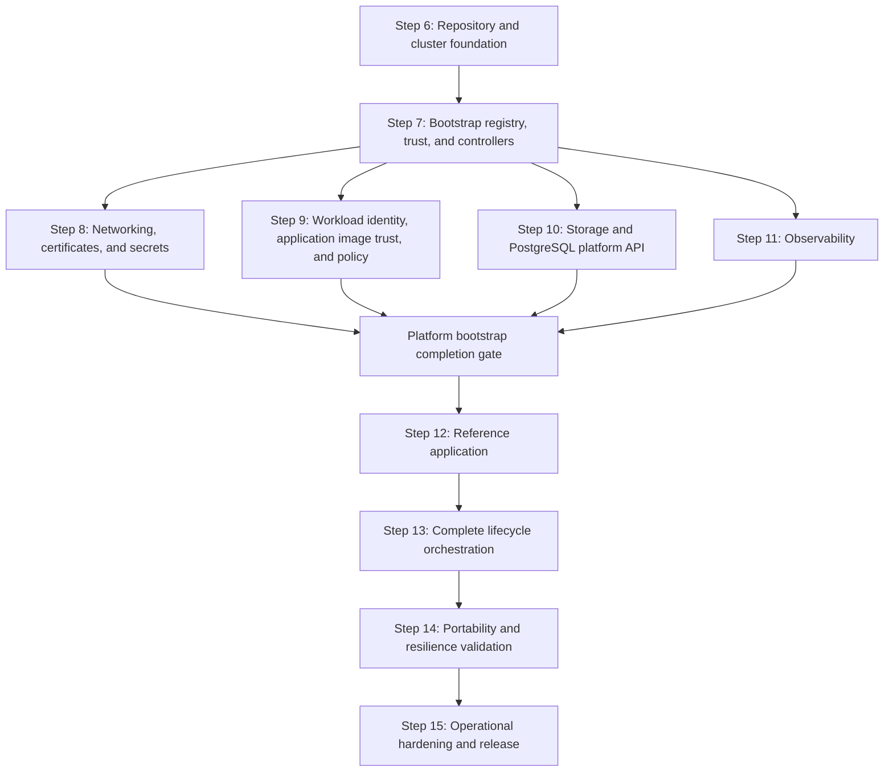

# Local Kubernetes Platform Implementation Plan

## Purpose

This plan implements the architecture and tool decisions in
[`1-initialize.md`](./1-initialize.md). It begins after the architecture, lifecycle,
capability, tool-selection, and repository-topology decisions completed in Steps 1
through 5.

Work proceeds one step at a time. A step is complete only after its deliverables
exist, its exit criteria pass, and the results are recorded in this plan. A later
step may refine an earlier decision, but must record the reason and update the
affected acceptance criteria.

## Delivery Principles

- Preserve one desired-state owner for every resource.
- Keep applications independent of Minikube and cloud-provider implementation
  details.
- Prefer small commands that compose through explicit inputs, outputs, and exit
  codes.
- Pin every tool, chart, image, provider, and policy-bundle version.
- Make every reconciliation idempotent and safe to resume after partial failure.
- Introduce policy in audit mode before enforcing it.
- Treat the internal OCI registry and image-signature verifier as bootstrap
  dependencies, and do not report bootstrap complete until the seed trust loop is
  closed and fail-closed admission is active.
- Permit only protected release automation identities to sign trusted images;
  developers and untrusted pipeline contexts may build candidates but cannot sign
  or promote them.
- Keep application admission closed throughout all internal bootstrap phases and
  open it only after every required infrastructure tool and capability passes its
  current-generation readiness checks.
- Validate destructive behavior with retained data before exposing destructive
  commands.
- Do not present `kore platform up` as complete until it converges the full MVP
  platform.

## Implementation Sequence



Steps 8 through 11 may be implemented in parallel only after Step 7 is complete.
Each must pass independently before Step 12 begins.

## Step 6: Repository and Local Cluster Foundation

### Objective

Create the repository skeleton, pinned developer toolchain, safe command entry
point, and deterministic Minikube lifecycle without installing platform
controllers.

### Work

- [x] Record an architectural decision for the initial `kore` implementation
      language and packaging model
      ([ADR 0001](../../docs/decisions/0001-kore-typescript-cli.md)).
- [x] Create the planned `apps`, `infra`, and `tools` directory structure without
      placeholder files that have no declared purpose.
- [x] Define and validate the schemas for `infra/catalog/components.yaml`,
      `infra/catalog/versions.yaml`, and environment definitions.
- [x] Add repository-local `mise` configuration with pinned versions of the tools
      needed by this step.
- [x] Implement `kore doctor` with checks for tool versions, container runtime,
      CPU, memory, disk, credentials, and conflicting Minikube profiles.
- [x] Define the `local` environment, deterministic Minikube profile name,
      Kubernetes version, driver, container runtime, resource allocation, and expected
      kubeconfig context.
- [x] Implement focused cluster operations for create, status, stop, and guarded
      destroy.
- [x] Ensure commands address the explicit profile and context rather than the
      user's current `kubectl` context.
- [x] Add unit tests for configuration loading, version resolution, command
      construction, context validation, and destructive guards.
- [x] Add an integration test that creates, inspects, stops, and resumes a local
      cluster when a compatible container runtime is available.

### Initial Command Surface

```text
kore doctor
kore cluster up --environment local
kore cluster status --environment local
kore cluster stop --environment local
kore cluster destroy --environment local
```

These cluster commands are focused implementation building blocks. They do not
claim that the platform is ready.

### Exit Criteria

- [x] A fresh checkout can install all pinned Step 6 tools through one documented
      operation.
- [x] Catalog and environment files fail fast with useful schema errors.
- [x] `kore doctor` distinguishes required failures from optional warnings.
- [ ] Repeating cluster creation produces no unintended change.
- [x] Cluster commands refuse to operate on an unexpected context or profile.
- [x] Stopping and resuming the profile preserves its Kubernetes state
      (2026-11-08: PV UIDs, database rows, and registry contents unchanged).
- [x] Destroy requires explicit confirmation and has a tested retained-data guard.
- [x] Tests that do not require a live cluster run without one.
- [x] No infrastructure controller or application is installed by this step.

## Step 7: Bootstrap Registry, Image Trust, Controllers, and CRD Ownership

### Objective

Install the internal OCI registry, Sigstore Policy Controller, and every controller
required by the MVP in dependency order. Establish the application admission gate
in its closed state, close the foundation seed trust loop, and enable fail-closed
image admission while preserving explicit CRD ownership. This is an internal
bootstrap phase and cannot publish overall platform readiness before Steps 8
through 11 also converge.

### Work

- [x] Populate the component and version catalogs with pinned upstream chart and
      image references.
- [x] Record a compatibility matrix covering Kubernetes, Helm, Gateway API,
      cert-manager, Gatekeeper, Istio, Crossplane, External Secrets Operator,
      CloudNativePG, and OpenTelemetry Operator.
- [x] Select and pin the OCI Distribution-compatible registry, Cosign, and Sigstore
      Policy Controller; add them to the compatibility matrix, component catalog,
      version catalog, release graph, and readiness model.
      The registry, Policy Controller webhook, and its `leasescleanup` kubectl
      images are pinned by index digest (`config/image-pins.spec.ts`), and Cosign
      3.1.4 has a compatibility row. The kubectl image's upstream tag is the
      floating `latest-dev`, so only its digest pins it.
- [x] Give every logical release a namespace, CRD owner, dependencies, timeout,
      and readiness checks. The schema requires at least one readiness check;
      StorageClass, ClusterRole, ClusterRoleBinding, and ConfigMap entries are
      proven by existence
      ([ADR 0016](../../docs/decisions/0016-release-readiness-checks-drive-wait-and-status.md)).
- [x] Implement topological sorting and cycle detection for the release graph.
- [x] Add a render and validation operation that does not mutate a cluster.
- [x] Install Gateway API CRDs before Istio resources that consume them.
- [x] Install cert-manager and wait for its deployments and webhook.
- [x] Install OPA Gatekeeper without enforcing Kore constraints.
- [ ] Install a persistent `oci-registry` infrastructure release and verify push,
      pull, restart, storage retention, authentication, authorization, and bounded
      readiness behavior.
      _Partial: the `oci-registry` release has a `kore-standard` PVC labelled
      `platform.kore.dev/retention=Delete`, because its contents are rebuildable
      cache rather than retained data, and a `/v2/` readiness probe. It has no
      authentication or authorization and is exposed as an unauthenticated NodePort
      (clients fall back from HTTPS to plain HTTP)._
- [ ] Install Sigstore Policy Controller and its CRDs/webhook from an explicitly
      allowlisted, digest-pinned seed artifact without enabling enforcement yet.
      _Partial: declared in the catalog with no `ClusterImagePolicy` and no opted-in
      namespace; it installed and became ready in the 2026-11-08 live bootstrap
      (tag-pinned then). Its images are now digest-pinned but not allowlisted as
      seeds. The chart (app 0.13.1) lags the 0.15.1 application release._
- [x] Install Istio base, `istiod`, Istio CNI, and `ztunnel` for ambient mode.
- [x] Install Crossplane and the required composition functions. The
      `kore-crossplane-functions` release installs both Functions after Crossplane
      and before `kore-postgresql-api`, and waits for `Installed` and `Healthy`
      ([ADR 0023](../../docs/decisions/0023-crossplane-functions-own-release-and-readiness.md)).
      Live-verified 2026-11-08.
- [x] Install External Secrets Operator.
- [x] Install CloudNativePG.
- [x] Install OpenTelemetry Operator after its prerequisites are ready.
- [x] Define the minimal digest-pinned seed manifest required to start the registry,
      verifier, and their prerequisites; reject unrecorded seed artifacts and record
      the reason and upstream verification evidence for every seed.
      `infra/catalog/seeds.yaml` records three seeds: the registry, Policy Controller,
      and its lease-cleanup kubectl image. `kore validate` rejects a seed with no
      digest, reason, or evidence, and any digest-pinned image a seed component uses
      that is not recorded
      ([ADR 0026](../../docs/decisions/0026-seed-manifest.md)). The registry image
      has no upstream signature; its only evidence is the Docker Hub digest, so the
      signing step must establish its trust (2026-11-08).
- [ ] Implement protected release automation that mirrors approved platform images
      into the internal registry, verifies recorded upstream digests and provenance,
      signs internal digests with Cosign, verifies each signature, and emits an
      immutable image lock manifest.
      _Partial (local analogue only): `kore local up` builds, publishes, and signs
      the reference image with a local key into `.kore/state/local-images.lock.json`.
      There is no mirroring, upstream digest or provenance check, or release
      workflow; `.github/workflows/check.yml` has no publish or sign job._
- [ ] Bind the accepted Cosign authority to an exact protected automation identity
      or KMS/HSM key. Grant developers, pull-request workflows, ordinary build jobs,
      cluster workloads, and registry administrators no signing permission.
      _Not started: the only signer is `local-kore-key`, which now lives in the
      `kore-system/kore-local-signing-key` Secret for the cluster's lifetime
      (ADR 0015)._
- [ ] Roll every managed platform workload, including the registry and verifier,
      from its seed or external reference to the signed internal digest recorded in
      the image lock manifest.
- [ ] Install `ClusterImagePolicy` resources covering containers, init containers,
      and ephemeral containers; reject unmatched images and fail closed on signature,
      registry, or verifier errors.
- [ ] Enroll all managed platform namespaces, then inventory running workloads and
      fail bootstrap if a seed, external, tag-only, unsigned, or unauthorized image
      remains. Seed exceptions must be empty before success.
- [ ] Create the generation-specific application admission gate in its closed state;
      grant only bootstrap automation permission to update it or application namespace
      activation metadata.
- [x] Make controller bootstrap independently runnable and complete it before
      shared configuration readiness checks; OpenTelemetry Operator must not be
      blocked by a Gateway waiting for its certificate or external address.
- [x] Keep controller configuration instances out of controller releases.
- [ ] Add controller health, CRD establishment, webhook, and idempotency tests.
      _Partial: CRD establishment retries and the deployed-release skip are tested.
      Webhooks are checked only through their Deployment rollout._

### Note

CRD ownership is decided in
[ADR 0011: Declare releases, ownership, and versions in the catalog](../../docs/decisions/0011-catalog-owned-releases-and-versions.md).

### Exit Criteria

- [ ] Every controller and CRD has exactly one catalog owner.
      _Partial: duplicate owners are rejected, but nothing checks that every CRD a
      chart installs is declared (for example, CloudNativePG CRDs beyond `clusters`)._
- [x] The release graph is acyclic and produces a deterministic order.
- [ ] All CRDs are established before their custom resources are submitted.
- [ ] All controller deployments, daemon sets, and webhooks report ready.
- [x] The registry persists images and signatures across platform stop and resume
      (2026-11-08).
- [ ] Every managed foundation workload installed in this step uses an internal
      digest-qualified image with a valid signature from the authorized release
      automation identity; later platform releases must satisfy the same condition
      before installation.
- [ ] Unsigned images and images signed by developer, pull-request, build-job, or
      other unauthorized identities are rejected.
- [ ] Registry or signature-verifier unavailability denies new managed workloads
      and is reported as degraded without weakening policy.
- [ ] The internal foundation phase finishes with no active seed exception or
      external image reference and leaves the application admission gate closed.
- [ ] A second reconciliation produces no unintended release changes.
- [x] Failure identifies the component and readiness condition that timed out
      (`component <c> failed to become ready: <resource> not ready (<condition>)
within <timeout>: <reason>`).
- [ ] No shared issuer, gateway, composition, secret store, or unrelated enforcing
      Gatekeeper/runtime policy is installed yet; image signature enforcement is the
      required bootstrap exception because it closes the image trust boundary.
      _Conflict: `kore platform bootstrap` runs the `core` phase, which installs the
      shared `kore-postgresql-api` XRD and Composition and the OPA authorizer. Either
      move them to the configuration phase or revise this criterion with an ADR._

## Step 8: Networking, Certificates, and Secrets

### Objective

Provide a stable HTTPS endpoint and Secret reference contract using Istio Gateway
API, cert-manager, SOPS with age, and External Secrets Operator.

### Work

- [x] Create the infrastructure-owned Gateway API `Gateway` and environment-owned
      parent-reference contract used by application `HTTPRoute` resources.
- [x] Automate the lifecycle of the Minikube tunnel as local adapter behavior,
      including status, cleanup, and stale-process detection
      (`kore tunnel start|stop|status`, `tools/kore/src/tunnel/tunnel.ts`).
- [x] Establish the local CA with mkcert through an explicit trust-changing
      operation.
- [x] Configure the cert-manager local issuer without committing private key
      material.
- [ ] Issue a test certificate and verify its readiness, renewal metadata, and host
      trust.
- [x] Define a stable `platform-secrets` store name for application resource
      charts.
- [ ] Add SOPS and age configuration for encrypted local source secrets.
      _Partial: `.sops.yaml` has a creation rule, but its age recipient is the
      placeholder `AGE-RECIPIENT-MUST-BE-CONFIGURED` and no `*.enc.yaml` source
      exists, so the encrypted path has never run._
- [x] Automate decryption directly into a protected source namespace without
      writing plaintext files into the repository or build artifacts.
- [x] Configure External Secrets Operator to materialize application-scoped
      Kubernetes Secrets from the local source.
- [x] Define redaction rules so rendered output, dry runs, errors, and CI logs do
      not reveal secret values. `kore platform render` redacts Secret `data` and
      `stringData` and sensitive keys with the journal marker
      ([ADR 0021](../../docs/decisions/0021-render-redaction-and-portability-rendering.md)).
- [ ] Add readiness and end-to-end tests for Gateway, TLS, and Secret materialization.
      _Partial: certificate-before-Gateway ordering is unit-tested. No offline test
      covers Secret materialization, and the opt-in integration test is not specific
      to the Gateway or TLS._

### Gateway Bootstrap Repair

The 2026-09-13 clean-cluster failure (`AddressNotAssigned`,
`InvalidCertificateRef`) and the certificate-first ordering are recorded in
[ADR 0013: Issue the local TLS certificate before installing the Gateway](../../docs/decisions/0013-local-tls-before-gateway.md).
The Istio CNI AppArmor deprecation warning did not cause this failure.

- [ ] Order local bootstrap explicitly: ready controllers, local CA/issuer setup,
      Certificate creation, TLS Secret readiness, Gateway creation, and external
      address/route readiness. Split configuration releases where a Helm wait would
      otherwise block the commands needed to satisfy its own prerequisites.
      _Partial: everything through Gateway creation is ordered and `kore-local-tls`
      is a separate release. The external address and route readiness waits remain._
- [x] Use the explicit `kore trust install --environment local` operation to
      establish host trust and install the issuer prerequisites. Verify the
      ClusterIssuer is Ready before waiting for certificate issuance; report a
      missing trust setup with an actionable command.
      Before waiting on a Certificate, Kore checks the ClusterIssuer and its CA
      Secret and fails immediately with `Run: kore trust install --environment
<env>`.
- [x] Create and wait for the Certificate that produces
      `kore-system/kore-local-tls`; check the expected TLS Secret keys without
      printing their contents before installing the HTTPS Gateway. The certificate
      now has a separate release, waits for `Certificate Ready`, then checks for a
      TLS Secret containing both `tls.crt` and `tls.key` before the Gateway release.
- [ ] Start and supervise the local Minikube tunnel so the Gateway LoadBalancer
      Service receives an address; handle required host privileges, tunnel exit,
      stale processes, and stop/destroy cleanup explicitly.
      _Partial: start, stale replacement, and stop/destroy cleanup are implemented.
      The local Gateway listens on 8443, which avoids host privileges rather than
      handling them. Nothing restarts the tunnel when it exits._
- [x] Wait with bounded timeouts for the Service address, Gateway `Accepted` and
      `Programmed`, and listener `ResolvedRefs`; include condition reasons such as
      `AddressNotAssigned` and `InvalidCertificateRef` in failure output
      (`platform/readiness-gateway.ts`).
- [ ] Add regression tests for missing issuer/TLS Secret, unavailable tunnel,
      and configuration ordering. Run a fresh-cluster end-to-end check through a
      trusted HTTPS route, including cleanup and retry after an injected failure.
      _Partial: ordering, unreachable-tunnel, missing-issuer, missing-CA-Secret,
      and missing-TLS-Secret tests exist; the fresh-cluster run is pending._

### Exit Criteria

- [ ] A test `HTTPRoute` receives a stable local HTTPS endpoint.
- [ ] The endpoint certificate is trusted by the opted-in development host.
- [ ] The Gateway and certificate report ready through Kubernetes conditions.
- [ ] An `ExternalSecret` produces the expected target Secret schema.
- [ ] No plaintext secret is committed, stored in Helm values, or printed in logs.
- [ ] Reconciliation and certificate or Secret rotation do not require manual
      cluster changes.
- [ ] Application manifests contain no Minikube-specific values.

## Step 9: Workload Identity, Application Image Trust, and Policy

### Objective

Establish dedicated workload identities, ambient mutual TLS, application image
trust, admission policy, and OPA-backed contextual authorization without turning
OPA into an identity issuer or a signature verifier.

### Work

- [x] Define the namespace enrollment contract for Istio ambient mode.
      `kore app up` is the only owner of an application namespace: it applies the
      namespace with `istio.io/dataplane-mode: ambient`, and Helm no longer
      creates it. The Gatekeeper mesh-enrollment constraint audits the label
      ([ADR 0025](../../docs/decisions/0025-application-namespace-ambient-enrollment.md)).
      Live-verified 2026-11-08 (mesh-enrollment audit 0). _`kore app down` still
      leaves the namespace._
- [x] Require every workload to use a dedicated Kubernetes ServiceAccount.
- [ ] Verify Istio produces the expected SPIFFE principal from namespace and
      ServiceAccount identity.
- [x] Enable strict mutual TLS for participating workloads.
- [x] Establish native Istio default-deny and explicit-allow authorization patterns.
- [x] Create Gatekeeper constraint templates and tests for identity, RBAC,
      privilege, resource, health-probe, Secret, mesh-enrollment, and retention rules.
      `mise run test-gatekeeper` runs the suites with pinned gator, locally and in CI
      ([ADR 0017](../../docs/decisions/0017-gatekeeper-policy-families-audit-first.md)).
- [x] Deploy constraints in audit mode and define minimal explicit system namespace
      exemptions. The `kore-policy-templates` and `kore-policy-constraints`
      configuration releases install them in `dryrun`.
      _The two known audit findings (the unlabelled `oci-registry` PVC and the
      unlabelled application namespace) are fixed offline; recheck the audit
      counts live._
- [ ] Define the application namespace enrollment contract for Sigstore Policy
      Controller and make enrollment mandatory before an application workload release.
      _Blocked on selecting Sigstore Policy Controller in Step 7._
- [ ] Define environment-specific trusted release automation identities and ensure
      local identities are never trusted by managed environments.
      _Partial: authorized signers are per lock file. `kore app up` uses the local
      public key only for Minikube with `local-kore-key`; no per-environment
      trusted-identity list exists._
- [ ] Verify that registry membership alone grants no trust: admission must validate
      the Cosign signature and exact authorized signer for the deployed digest.
- [x] Package and deploy the platform-operated OPA-Envoy external authorization
      service.
- [x] Deliver tested Rego as versioned OPA bundles. The chart carries the
      `bundles/v1` files and a spec fails if they drift; the dead `bundle.url` value
      is gone ([ADR 0018](../../docs/decisions/0018-opa-bundle-chart-single-source.md)).
- [x] Configure OPA as an Istio external authorization provider without manual
      ConfigMap editing.
- [x] Route one Layer 7 policy through an ambient waypoint and Istio `CUSTOM`
      authorization policy.
- [ ] Verify the OPA decision receives authenticated source and destination workload
      principals.
- [ ] Test allow, deny, authorizer-unavailable, stale-bundle, and invalid-bundle
      behavior.
      _Partial: allow, deny, and missing-input Rego tests exist, and a spec asserts
      the ext-authz provider is `failOpen: false`. Live unavailability and stale- or
      invalid-bundle behavior are untested._
- [ ] Promote constraints individually from audit to enforcement only after the
      platform complies.

### Exit Criteria

- [ ] Workloads using the namespace default ServiceAccount are rejected.
- [ ] Workload principals follow the documented SPIFFE identity format.
- [ ] Service-to-service traffic is mutually authenticated.
- [ ] Native Istio authorization denies undeclared service relationships.
- [ ] OPA makes a contextual decision using the authenticated workload principal.
- [ ] Protected routes fail closed when the OPA authorizer is unavailable.
- [ ] Policy decisions and denials are observable without leaking credentials.
- [ ] Bootstrap and system controllers remain operational under enforcing policy.
- [ ] Every application namespace is enrolled in fail-closed image admission.
- [ ] Every container, init container, and ephemeral container is rejected unless
      its digest is signed by the environment-authorized release automation identity.

## Step 10: Storage and PostgreSQL Platform API

### Objective

Provide explicit disposable and retained storage profiles plus a portable
PostgreSQL claim backed locally by CloudNativePG.

### Work

- [x] Define `kore-standard` and `kore-retained` StorageClasses with documented
      reclaim and expansion behavior. The README documents both, and
      `platform.storage.spec.ts` asserts `Delete`, `Retain`, and expansion.
- [x] Verify Minikube storage paths survive profile stop and resume (2026-11-08).
- [x] Define the namespaced
      `PostgreSQLInstance.platform.kore.dev` Crossplane XRD.
- [x] Limit the API to portable inputs: service class, storage size, PostgreSQL
      compatibility version, connection Secret name, and retention policy.
- [x] Create the local Crossplane composition that produces a CloudNativePG cluster
      and connection Secret.
- [ ] Grant Crossplane only the RBAC required to compose CloudNativePG and related
      Kubernetes resources.
      _Partial: Secret `update` is dropped and `clusters/status` is read-only; the
      chart's `namespaces` value binds the role per namespace, but its default is
      still cluster-wide ([ADR 0020](../../docs/decisions/0020-postgresql-api-scoped-rbac-status-and-retention.md))._
- [x] Normalize connection data into the documented Secret schema.
- [x] Propagate readiness, failure, and useful status conditions to the claim.
      A `project-status` step copies CloudNativePG phase, reason, and endpoint and
      sets `DatabaseHealthy`. _Unverified live._
- [x] Keep the claim in the application resources release and the composed database
      outside Helm ownership.
- [ ] Implement retained-data discovery used by application and cluster lifecycle
      guards.
      _Partial: `cluster destroy` and `app down` use it and it fails closed; the
      composition labels CloudNativePG PVCs through `inheritedMetadata`, and purge
      no longer waits on a claim a pod still mounts. Export and restore remain._
- [x] Define and test an explicit purge path.
- [ ] Implement a local export and restore proof before treating platform destroy as
      recoverable.
      _Not started: no export or restore code exists._

### Exit Criteria

- [ ] Disposable and retained claims bind to the intended storage profiles.
- [ ] A PostgreSQL claim becomes ready without application knowledge of
      CloudNativePG.
- [ ] The normalized connection Secret is created with the documented keys.
- [ ] Deleting the workload release does not delete the database claim or data.
- [ ] Deleting a retained claim does not silently delete its backing data.
- [ ] Cluster destroy is blocked while retained data lacks an explicit purge or
      verified export.
- [ ] Exported local data can be restored into a fresh local platform.

## Step 11: Observability

### Objective

Provide one OpenTelemetry ingestion contract for application, platform, mesh, and
policy telemetry with correlated local metrics, logs, and traces.

### Work

- [x] Install resource-bounded local configurations for Prometheus, Loki, Tempo,
      and Grafana.
- [x] Deploy the OpenTelemetry Collector with OTLP gRPC and HTTP receivers.
- [x] Define separate pipelines for application telemetry, Kubernetes logs and
      metrics, Istio telemetry, and policy decision telemetry where appropriate.
      An `otel-agent` DaemonSet reads pod logs and kubelet stats, Istio traces go to
      the Collector through a mesh `Telemetry` resource, and OPA writes masked
      console decision logs ([ADR 0019](../../docs/decisions/0019-telemetry-pipeline-wiring.md)).
- [x] Enrich signals with cluster, environment, namespace, application,
      ServiceAccount, and workload identity attributes. Cluster and environment
      come from environment overlays.
- [x] Establish attribute and label cardinality limits before ingesting pod-level
      data (a metric attribute allowlist).
- [x] Export metrics to Prometheus, logs to Loki, and traces to Tempo. Prometheus
      scrapes the Collector exporter (8889) and its own metrics (8888).
- [x] Provision Grafana data sources and initial dashboards as desired state.
      The `kore-observability-config` release owns the dashboard ConfigMap.
- [x] Add health, queue, dropped-data, and exporter-failure monitoring for the
      Collector. Prometheus loads the rule files from a ConfigMap; `mise run
test-promtool` unit-tests them. Alertmanager stays disabled locally.
- [x] Define local retention and storage limits for every backend.
- [ ] Add synthetic telemetry tests for all three signals and their correlation.
      _Partial: `apps/reference/src/server.test.ts` checks trace/log/metric
      correlation against a fake collector. Nothing tests the path through the
      Collector to the backends._

### Exit Criteria

- [ ] Applications use only the documented OTLP endpoint and standard environment
      variables.
      _Fixed: environments and reference charts pointed at
      `otel-collector-opentelemetry-collector`, a Service that does not exist; a
      spec now pins them to the Collector's `otel-collector` Service._
- [ ] A synthetic request produces a correlated metric, log, and trace.
- [ ] Istio traffic exposes source and destination workload identity attributes.
- [ ] OPA authorization decisions can be correlated with request traces where
      supported.
- [ ] Collector or backend failure is visible through platform status.
      _Partial: `platformStatus` now evaluates every catalog readiness entry with a
      3s bound and reports the failing component and condition. Live check pending._
- [x] Local telemetry storage has explicit retention and resource bounds.
- [ ] No application sends telemetry directly to a storage backend.

## Platform Bootstrap Completion Gate

### Objective

Make the transition from infrastructure convergence to application admission an
explicit, fail-closed operation. No application claim or workload may be deployed,
applied, or admitted until all infrastructure required by the application contract
is installed, configured, healthy, and enforcing for the current bootstrap
generation.

### Work

- [ ] Define one versioned readiness manifest listing every required controller,
      registry, trust policy, shared configuration release, platform API, endpoint, and
      health condition from Steps 7 through 11.
- [ ] Make bootstrap automation evaluate the manifest with bounded checks and write
      platform-owned, generation-specific readiness state only after every check passes.
- [ ] Keep application namespaces absent or inactive until readiness is published;
      activate them with platform-owned metadata that enrolls all required admission
      policies, including fail-closed Sigstore verification.
- [ ] Add cluster-side RBAC and admission policy that reject application claims,
      PodSpec-bearing resources, and direct Helm or Kubernetes API mutations when the
      readiness state is missing, closed, stale, or for another environment generation.
- [ ] Prevent developer, build, pull-request, and ordinary deployment identities
      from modifying readiness state, namespace activation, admission configuration, or
      bootstrap-owned RBAC. Only protected bootstrap automation may open the gate.
- [ ] Make any required platform capability becoming unhealthy close the gate for
      new application mutations without disrupting already-running healthy workloads;
      status must identify the failed prerequisite.
- [ ] Test early `kore app up`, Helm, and direct Kubernetes API attempts and prove
      each is rejected before readiness and accepted only after the gate opens.
- [ ] Ensure interrupted or failed bootstrap leaves the gate closed and that a
      successful idempotent retry opens it only after revalidating every prerequisite.

### Exit Criteria

- [ ] Every infrastructure tool required by the declared application contracts is
      installed, configured, healthy, and reported by the current readiness generation.
- [ ] The registry contains every managed platform image and its authorized Cosign
      signature; all platform workloads use internal digest-qualified references.
- [ ] Gatekeeper, Sigstore Policy Controller, workload identity, secrets, storage,
      database APIs, networking, certificates, and telemetry prerequisites are ready
      and enforcing their application-facing contracts.
- [ ] No application resource can be applied through `kore`, Helm, or the Kubernetes
      API while the gate is closed or stale under supported non-administrator identities.
- [ ] Only protected bootstrap automation can open the gate, and opening it produces
      auditable evidence covering every prerequisite.
- [ ] `kore platform up` and bootstrap status cannot report success before the gate
      is open.

## Step 12: Reference Application

### Objective

After the application admission gate opens, prove the complete platform contract
with a small application that exercises every MVP capability and includes positive
and negative tests.

### Work

- [x] Implement at least two communicating workloads so workload-to-workload
      identity and authorization can be demonstrated.
- [x] Give each workload a dedicated ServiceAccount.
- [x] Create `charts/resources` for the PostgreSQL claim and any external Secrets.
- [x] Create `charts/workload` for Deployments, Services, health probes,
      `HTTPRoute`, telemetry configuration, and authorization policy references.
- [x] Build an OCI-compatible candidate image without embedding local behavior in
      either chart.
- [ ] Publish the candidate to the platform registry, promote and Cosign-sign its
      digest only through protected release automation, verify the signature, and pass
      only the resulting digest-qualified internal reference to Helm.
      _Partial: the digest is published to the local registry, verified with
      `cosign verify`, and passed to Helm, but it is signed by `local-kore-key`, not
      by protected release automation._
- [x] Read the PostgreSQL connection only from the normalized Secret contract.
      The password comes from a `secretKeyRef` to the Secret the contract's
      `passwordSecretRef` names, and readiness authenticates with SCRAM-SHA-256 and
      runs `SELECT 1` through a std-lib client
      ([ADR 0024](../../docs/decisions/0024-reference-app-database-access.md)).
      Live-verified 2026-11-08.
- [x] Emit OpenTelemetry logs, metrics, and traces with stable service attributes.
- [x] Add a route protected by native Istio policy and a route protected by OPA.
- [x] Add database schema initialization or migration as an explicit, repeatable
      operation. A `pre-install,pre-upgrade` hook Job applies an append-only list
      in one transaction under an advisory lock (ADR 0024). Live-verified on
      install and on the resume upgrade, which applied nothing new.
- [ ] Add smoke tests for HTTPS, persistence, Secret use, health, telemetry, mTLS,
      native authorization, and OPA authorization.
- [ ] Add negative tests proving that policy rejects an invalid workload and an
      unauthorized caller.
      _Partial: the unauthorized-caller case has a Rego test and a live 403 check.
      The invalid-workload case exists only in the unexecuted Gatekeeper
      `tests/cases.yaml`._
- [ ] Add image-admission tests proving that a correctly automation-signed digest is
      admitted while an unsigned image, a tag-only reference, a modified digest, and an
      image signed by a developer or untrusted pipeline identity are rejected.

### Exit Criteria

- [x] The resources release becomes ready before the workload release begins
      (`app.spec.ts` asserts the release order and the claim and Secret waits).
- [ ] The application starts without provider-specific templates or source changes.
- [ ] HTTPS, database access, Secret injection, and persistence work locally.
- [ ] Allowed identity paths succeed and undeclared identity paths fail.
- [ ] The OPA-protected operation makes the expected contextual decision.
- [ ] Logs, metrics, and traces are queryable and correlated.
- [ ] Removing and reinstalling the workload preserves retained application data.
- [ ] All Gatekeeper constraints intended for the MVP are enforcing.
- [ ] All application images are pulled from the platform registry by digest and
      verified at admission against the authorized release automation identity.
      _Partial: images are deployed by digest and verified client-side by `kore app
up`, not at admission, and the signer is the local key._

## Step 13: Complete Lifecycle Orchestration

### Objective

Expose the stable developer-facing workflow only after all internal operations can
converge and validate the complete platform.

### Work

- [x] Implement `kore platform up`, `status`, `stop`, and guarded `destroy` by
      composing the focused operations from earlier steps.
- [ ] Make `kore platform up` own the complete bootstrap generation and open the
      application admission gate only after Steps 7 through 11 and trust closure pass.
- [x] Implement `kore app up`, `status`, and `down` with separate resource and
      workload release phases.
- [ ] Make `kore app up` accept only a release-automation-produced image lock entry,
      independently verify its digest and signer, and refuse local developer-produced
      signatures before invoking Helm.
- [x] Require an explicit environment for every mutating command.
- [x] Add bounded readiness waits and actionable component-level failures.
- [ ] Resume from partial failure without reinstalling healthy dependencies.
      _Partial: bootstrap skips deployed releases; configuration releases and both
      app releases are always upgraded._
- [ ] Clean up failed or canceled releases and their attempt-owned resources
      before another `up`; verify cleanup has completed and preserve healthy
      dependencies and retained data. Full profile deletion is an explicit reset.
- [x] Make guarded cleanup tolerate CRDs that were never installed. Cover the
      observed missing `postgresqlinstances.platform.kore.dev` resource type during
      partial-bootstrap destroy without bypassing retained-data checks.
- [x] Prevent concurrent mutation of the same environment.
      A lock left by a dead owner on this host is recovered; live, other-host, and
      legacy locks are refused with removal guidance.
- [x] Produce concise human output and stable machine-readable output.
- [x] Ensure diagnostic output is read-only and redacts sensitive data.
- [x] Implement non-interactive confirmation behavior for CI.
- [ ] Add a clean-machine end-to-end test from tool installation through reference
      application verification.

### Public Command Surface

```text
kore doctor
kore platform up --environment <name>
kore platform status --environment <name>
kore platform stop --environment local
kore platform destroy --environment <name>
kore app up <name> --environment <name>
kore app status <name> --environment <name>
kore app down <name> --environment <name>
```

Implemented local and supporting commands outside this surface:

```text
kore local up|down [--prune]
kore trust install --environment local
kore tunnel start|stop|status --environment local
kore secrets sync --environment local
kore platform render|bootstrap --environment <name>
kore journal [--json]
kore validate --environment <name>
```

`kore local` composes the public commands for the local quick start. Decide
whether it joins the public surface before Step 15 documentation.

### Exit Criteria

- [ ] One command creates and validates the complete local platform.
- [ ] A partial or degraded bootstrap cannot report success or allow application
      claims or workloads to be applied.
- [x] Platform creation does not install applications.
- [ ] One command installs and validates the reference application.
- [ ] Status reports the deployed digest, verified signer identity, registry, and
      namespace image-enforcement state without exposing credentials.
- [ ] Repeating platform and application reconciliation is idempotent.
- [ ] Interrupted operations resume safely.
- [x] Status commands make no changes (`cli-dispatch.spec.ts` "read-only commands
      never open a journal entry").
- [x] Unexpected profile, context, or environment combinations fail before mutation.
      _Note: for the managed provider, the check only confirms `kube-system`
      exists._
- [x] No documented success path requires manual `kubectl patch`, `edit`, or
      imperative resource creation.
- [ ] Destructive operations preserve or explicitly account for retained data.
      _Open: export and restore do not exist yet (Step 10), and live evidence is
      pending. Discovery now fails closed and `local down` needs `--purge-data` to
      purge._

## Step 14: Portability and Resilience Validation

### Objective

Prove that the contracts are genuinely replaceable and that common component
failures have automated detection and recovery paths.

### Work

- [x] Render every application chart against common configuration without loading a
      local overlay. Portability validation runs `helm template` with chart defaults
      and rejects provider-specific output.
- [x] Add a second non-local environment schema and select its provider through an
      architectural decision
      ([ADR 0012](../../docs/decisions/0012-environment-overlays-hold-provider-specifics.md)).
- [ ] Define the provider OpenTofu stack for networking, identity, registry,
      Kubernetes, and other pre-cluster dependencies.
- [ ] Preserve the platform registry contract when a provider-managed OCI registry
      substitutes the in-cluster local implementation.
- [ ] Prove with provider IAM that only the protected release workload can invoke
      the signing key or obtain an accepted keyless identity; developer and
      pull-request identities must fail both signing authorization and admission.
- [ ] Define a managed PostgreSQL Crossplane composition that preserves the
      `PostgreSQLInstance` API and connection Secret schema.
- [x] Replace the local secret store, certificate issuer, storage classes, gateway
      exposure, and image delivery through environment configuration only.
- [x] Keep live cloud provisioning opt-in because it requires credentials, external
      changes, and cost.
- [ ] Add offline render, schema, composition, and policy tests that run without
      cloud credentials.
      _Partial: schema, portability, render validation, and OPA tests run offline.
      The composition contract (`infra/apis/postgresql/tests/contract.md`) is prose,
      and Gatekeeper `tests/cases.yaml` is not run._
- [ ] Run an authorized live portability test before claiming support for a
      provider.
- [ ] Test controller restart, OPA outage, telemetry backend outage, interrupted
      Helm upgrade, and partial platform reconciliation.
- [ ] Test registry outage, signature-verifier outage, signer rotation, interrupted
      image promotion, and recovery from a partially closed bootstrap trust loop.
- [ ] Verify status reports degraded capabilities without corrupting healthy state.

### Exit Criteria

- [ ] Application source and charts are identical between local and provider
      environments.
- [ ] Environment selection changes implementations without changing application
      contracts.
- [ ] The managed PostgreSQL composition produces the same readiness and Secret
      interface as the local composition.
- [ ] Offline provider validation runs in ordinary CI.
      `mise run validate` now checks `local` and `managed-example` in CI.
- [ ] Provider support is documented only after an authorized live test passes.
- [ ] Recoverable failures converge without manual cluster patching.

## Step 15: Operational Hardening and Release

### Objective

Turn the validated vertical slice into a maintainable platform release while
keeping production-only scale and availability work explicitly scoped.

### Work

- [ ] Document support windows and upgrade order for Kubernetes, CRDs, controllers,
      charts, policy bundles, and the `kore` command.
- [ ] Add upgrade tests from the previously supported version catalog.
- [ ] Add backup schedules, restore tests, and recovery objectives for stateful
      platform and application data.
- [ ] Validate CRD conversion and rollback behavior before controller upgrades.
- [ ] Add artifact integrity checks, dependency inventory, and automated
      vulnerability reporting.
- [ ] Document registry backup, restore, garbage collection, signature retention,
      immutable-tag or digest policy, and disaster recovery.
- [ ] Document signing identity and key rotation, revocation, compromise response,
      protected-pipeline controls, and time-bounded audited break-glass recovery.
- [ ] Document trust roots, certificate rotation, secret rotation, and workload
      identity incident response.
- [ ] Document policy change review, audit-to-enforce promotion, rollback, and
      emergency exemption procedures.
- [ ] Define resource budgets and capacity warnings for the local profile.
- [ ] Publish operator, contributor, troubleshooting, and application-onboarding
      documentation generated from the implemented command behavior.
- [ ] Tag the first versioned local-platform release only after a fresh-install and
      upgrade test pass.

### Exit Criteria

- [ ] A supported upgrade path passes without application contract changes.
- [ ] Backup and restore tests meet the documented recovery expectations.
- [ ] Policy and identity changes have tested rollback procedures.
- [ ] Tool and component provenance is reviewable from the repository.
- [ ] Documentation contains no hidden manual remediation required for normal
      operation.
- [ ] The first local-platform release is reproducible from a clean checkout.

Production high availability, multi-cluster operation, and organization-specific
cloud controls remain separate initiatives. They are not implied by completion of
the local-platform MVP.

## Refinement Record

### 2026-11-07 code audit

Every checklist item was compared with the code (read-only; no cluster was used).
Boxes now mean "implemented in the repository", and live-only exit criteria stay
open until live evidence is recorded. Items marked _Partial_, _Gap_, or _Conflict_
explain what is missing. Changes:

- Unchecked work that the code does not support: SOPS/age configuration
  (placeholder recipient), Gatekeeper templates and audit deployment (rule families
  missing, nothing installs them), versioned OPA bundles (the deployed policy is an
  untested inline copy), the ambient enrollment contract, release readiness checks,
  StorageClass documentation, retained-data discovery, five Step 11 pipeline items,
  and offline composition and Gatekeeper tests.
- Checked work that the code supports: catalog-declared controller installs with
  recorded live rollout (Step 7), tunnel lifecycle (Step 8), local telemetry bounds
  (Step 11), resource-before-workload ordering (Step 12), and four Step 13 exit
  criteria.
- Safety defects found, all fixed test-first in PR #9 (see follow-up work):
  1. `retainedResources` swallows every kubectl error, so an unreachable cluster
     reports no retained data and the destroy guard fails open.
  2. `kore local down --prune` grants both destroy consent and data purge from one
     flag, which merges the two consent gates.
  3. A killed mutation leaves a stale environment lock with no recovery path.
  4. The local Cosign private key is generated with an empty password. It is
     gitignored, but it is still plaintext key material at rest. Decision: keep it
     in a cluster Secret through Cosign's `k8s://` reference (ADR 0015).
- Conflict to resolve: Step 7's "no shared composition installed" exit criterion
  conflicts with the `core` phase installing `kore-postgresql-api` and the OPA
  authorizer during bootstrap.

### 2026-11-07 follow-up work

Tracked in [PR #9](https://github.com/corekraft/kore/pull/9). Each item is written
test-first, on its own worktree branch, and merged back after review.

- [x] Make retained-data discovery fail closed: treat only "resource type not
      installed" as empty, and fail the destroy on any other kubectl error.
- [x] Split `kore local down --prune` so purging retained data needs its own
      opt-in, separate from destroy consent.
- [x] Detect and recover a stale environment lock left by a killed run, without
      ever breaking a lock held by a live process.
- [x] Keep the local Cosign private key off disk in plaintext, and record the
      decision in ADR 0015.
- [x] Select and pin the latest Sigstore Policy Controller; add it to the
      component catalog, version catalog, compatibility matrix, and release graph
      as a bootstrap release with no `ClusterImagePolicy` enforcement yet.
- [x] Upgrade every pinned platform dependency (Kubernetes, controllers, charts,
      images, composition functions, base images) to its latest release, and record
      compatibility evidence in `infra/catalog/compatibility.md`.
- [x] Upgrade every pinned toolchain dependency (`.mise.toml` tools, CLI npm
      devDependencies, GitHub Action SHAs) to its latest release.
- [x] After the upgrades, rerun the live bootstrap on a fresh profile before the
      Step 7 rows claim the new versions are live-validated (2026-11-08).

Upgrade notes: Istio 1.31 charts now come from `blob.istio.io` because the
Google-hosted repository is being retired. Gatekeeper stays on 3.23.1 because
3.24.0 is beta. The trailing-comma problem in `mise run format` is fixed by a
`.prettierrc.json` override with a regression spec (2026-11-08).

Observability claims are labelled `platform.kore.dev/retention: Delete` on
`kore-standard`: Grafana (`extraPvcLabels`), Prometheus
(`server.persistentVolume.labels`), and Loki (`singleBinary.persistence.labels`).
The final Tempo chart (1.24.4, deprecated) cannot label its
`volumeClaimTemplates`, so Tempo now mounts a labelled `tempo-storage` claim owned
by `kore-observability-config`. Rendered offline with the pinned charts and
asserted in `platform.storage.spec.ts`. Claim templates are immutable and bootstrap
skips deployed releases, so only fresh profiles pick this up; an existing profile
keeps its unlabelled Loki and Tempo claims until it is recreated (2026-11-08).

Next: confirm a clean retention audit on a fresh profile, then
enable `ClusterImagePolicy` enforcement (Step 7), which unblocks Step 9
enrollment and the bootstrap gate.

### 2026-11-08 decisions

The user decided four open questions:

1. **Bootstrap scope (Step 7 conflict):** move `kore-postgresql-api` and the OPA
   authorizer out of the `core` phase into the configuration phase, so bootstrap
   installs only controllers and image trust. The Step 7 exit criterion stands.
2. **Signing authority (Step 7):** internal images are signed with keyless Cosign
   bound to an exact protected GitHub Actions workflow identity (OIDC issuer
   `https://token.actions.githubusercontent.com`, an exact release workflow on
   protected tags). Local keeps the local key as an environment-specific exception
   (ADR 0015).
3. **SOPS recipients (Step 8):** local gets its own age recipient, separate from
   managed environments. The user generates the key and supplies only the public
   recipient.
4. **Export and restore (Step 10):** a local proof first: export the CloudNativePG
   database and retained volumes, then restore into a fresh profile. Scheduled
   backups and recovery objectives wait for the managed environment.

### 2026-11-08 parallel offline implementation

Six parallel sessions closed offline items in Steps 7 through 11 and 14 (branch
`feat/plan-open-items`, ADRs 0016 through 0021). No cluster was used, so every
live exit criterion stays open. Merging them found two defects, both fixed
test-first: the telemetry config release had no readiness check, which the new
mandatory-readiness rule rejected; and every OTLP endpoint named a Collector
Service that does not exist.

Still open and needing a decision or a cluster: the release-automation signing
identity and Sigstore enforcement (Step 7), export and restore (Step 10), the SOPS
age recipient (Step 8), the reference app's database password and authenticated
readiness (Step 12), the `oci-registry` PVC retention label (it would make
`cluster destroy` require `--purge-data` for registry images), and the Step 7
conflict over installing `kore-postgresql-api` and the OPA authorizer at
bootstrap.

### 2026-11-08 fresh-profile live bootstrap

`kore local up --environment local` converged on a fresh `kore-local` profile
against the upgraded pins after two fixes found live, both test-first on
`fix/prometheus-scrape-config`: Prometheus `extraScrapeConfigs` must be
block-sequence YAML (the JSON flow list crash-looped the server), and the node
agent DaemonSet is named `otel-agent-agent`. Evidence:

- `kore platform status` reported every component ready through the catalog
  readiness checks; the Gateway, `kore-local-tls`, Gatekeeper policy, and
  observability config releases passed their new checks.
- All six constraints installed in `dryrun`. Audit violations: container
  security 25, workload identity 13, retention 8, mesh enrollment 5, Secrets 5,
  RBAC 0. Review these before promoting any constraint.
- The `reference-db` claim was `Ready` with `DatabaseHealthy`, phase, and
  endpoint `reference-db-rw:5432` copied from CloudNativePG. Its PVC carried
  `platform.kore.dev/retention=Retain`; the `oci-registry` PVC did not.
- The reference image digest was signed and verified with the local key. Over
  trusted HTTPS, `/api` returned 200 with `database: true`, and
  `/api/protected` returned 403 without auth and with a forged `x-kore-role`.
- The opt-in README integration test reran `local up` on the converged cluster
  (it succeeded) and passed the reference smoke, then failed its persistence
  check on CloudNativePG's removed `role` label (now `cnpg.io/instanceRole`). Its
  cleanup destroyed the profile with data purge, so persistence and stop/resume
  were not observed.
- The Collector chart warns that `otlp`, `otlphttp`, `filelog`, and
  `k8sattributes` are renamed (done in the next entry).

### 2026-11-08 second parallel offline implementation

Seven parallel sessions closed offline items (branch `feat/plan-open-items-2`,
ADRs 0023 through 0025). No cluster was used. Changes: Collector component
renames (the `otlp` receiver keeps its name) and OpenTelemetry Operator resource
bounds; `cosign.pub` no longer lands in the caller's directory; `kore trust
install` skips `mkcert -install` on macOS when `security verify-cert` already
trusts the mkcert CA, and runs it in every other case; digest pins for the
registry and Policy Controller in every environment; the Crossplane Functions
release; authenticated reference database access with a migration Job; and
ambient namespace enrollment owned by `kore app up`. `mise run test` now also
runs the reference application's suite, which CI had never run.

A principles review of the merge found three defects, fixed before commit:

- Labelling the registry PVC `Retain` made every `cluster destroy` need
  `--purge-data`, and the purge then hung on the still-mounted claim. The claim
  moved to `kore-standard` with `retention=Delete`, and purge deletes PVCs without
  waiting. An existing cluster keeps the old class until the claim is recreated,
  because `storageClassName` is immutable.
- The ambient namespace label enrolled the CloudNativePG pods under a
  namespace-wide `STRICT` `PeerAuthentication`, which the out-of-mesh operator
  could not reach. The composition labels database pods
  `istio.io/dataplane-mode: none`, and `STRICT` is scoped to the app (ADR 0025).
- The frontend received the database password; now only the API does.

### 2026-11-08 second fresh-profile live bootstrap

`kore local up --environment local` converged on a new `kore-local` profile on
the first attempt, from `feat/plan-open-items-2` (PR #13). Evidence:

- Both Crossplane Functions reported `Installed=True` and `Healthy=True`, and
  every component reported ready in `kore platform status`.
- The `reference` namespace carried `istio.io/dataplane-mode: ambient`. The
  `reference-db-1` pod carried `none`, and CloudNativePG reported `Cluster in
healthy state`. `PeerAuthentication/strict` selected
  `app.kubernetes.io/part-of: reference`.
- The migration hook Job completed and recorded `0001-reference-events` in
  `schema_migrations`. Neither the Job nor its ServiceAccount remained.
  `/readyz` returned 200 through the authenticating client. Over HTTPS, `/api`
  returned `database: true`, and `/api/protected` returned 403 without auth and
  with a forged `x-kore-role`. The frontend had no `PG*` environment.
- The `oci-registry` PVC was on `kore-standard` with `retention=Delete`, and
  `reference-db-1` was on `kore-retained` with `Retain`.
- Audit violations: mesh enrollment 5 → 0, retention 8 → 6, container
  security 24, workload identity 13, Secrets 5, RBAC 0. The six remaining
  retention findings are the unlabelled Grafana, Prometheus, Loki, and Tempo
  claims, including the Loki and Tempo StatefulSet templates.
- `kore cluster stop` followed by `kore local up` preserved all six PV UIDs, the
  migration record and its timestamp, and the registry's image and signature
  tags. HTTPS kept returning `database: true`. The resume skipped every
  bootstrap release and upgraded only the four configuration and app releases.
- The claim reports `Responsive=False` (`WatchCircuitOpen`: too many watch events
  from the CloudNativePG Cluster). Crossplane throttles the watch; readiness was
  unaffected.

Not observed: `cluster destroy` without `--purge-data`. The retained reference
database still requires it, so this needs a run without the app.

## Progress Record

Update this table when a step begins or completes. Link implementation commits,
test evidence, and architectural decisions from the evidence column.

| Step                                                               | Status                                                                                                                                           | Evidence                                                                                                                                                                                                                                                                                                                                                                                                                                                                                                                                                                                                                                                                                                                                                                                              |
| ------------------------------------------------------------------ | ------------------------------------------------------------------------------------------------------------------------------------------------ | ----------------------------------------------------------------------------------------------------------------------------------------------------------------------------------------------------------------------------------------------------------------------------------------------------------------------------------------------------------------------------------------------------------------------------------------------------------------------------------------------------------------------------------------------------------------------------------------------------------------------------------------------------------------------------------------------------------------------------------------------------------------------------------------------------- |
| 6. Repository and local cluster foundation                         | Complete; live lifecycle validated                                                                                                               | `tools/kore` TypeScript CLI, updated catalogs and local environment, 37 unit tests, catalog/OPA validation, direct `kore validate` and `cluster status`, and live Minikube create/inspect/stop/resume integration on Kubernetes 1.37.0                                                                                                                                                                                                                                                                                                                                                                                                                                                                                                                                                                |
| 7. Bootstrap registry, image trust, controllers, and CRD ownership | Controllers live-validated on the previous pins; upgraded pins and Sigstore Policy Controller validated offline only; trust closure remains open | Live rollout was recorded on Gateway API 1.6.2, cert-manager 1.21.2, Crossplane 2.4.0, Gatekeeper 3.23.1, Istio 1.30.4, External Secrets 2.10.0, and CloudNativePG chart 0.29.0. PR #9 upgraded them (see `infra/catalog/compatibility.md`) and added Sigstore Policy Controller 0.10.8 with no enforcement; the fresh-profile live bootstrap is pending. The local signing key now lives in a cluster Secret ([ADR 0015](../../docs/decisions/0015-local-signed-image-delivery.md)). Release automation authority, Sigstore admission, and seed-closure evidence remain open.                                                                                                                                                                                                                        |
| 8. Networking, certificates, and secrets                           | TLS, Gateway listener, and local HTTPS forwarding live-validated on the existing profile; fresh-cluster validation pending                       | `platform up` completed after migrating the existing Certificate out of the old Helm release ([ADR 0013](../../docs/decisions/0013-local-tls-before-gateway.md)). Certificate readiness and renewal metadata were verified; the managed Gateway returns HTTPS responses through the interactive Minikube tunnel. A chart-managed Istio ALLOW policy now exempts only the named Gateway on its HTTPS listener port (8443 locally, 443 in the base chart) from the `kore-system` default deny. `/api` returns 200 with database readiness; `/` returns the reference API's expected 404. Repeat on a fresh profile and validate managed detached tunnel privilege handling.                                                                                                                             |
| 9. Workload identity, application image trust, and policy          | Local ambient authorization and signed workload live-validated; admission and external signing remain open                                       | `reference-api` Service waypoint and `targetRefs` policies report `WaypointAccepted`; Istio L4 policy requires waypoint identity, and Istio L7 ALLOW checks the frontend principal. OPA requires `x-kore-authenticated-role`; live HTTPS tests return 403 for unauthenticated and caller-forged `x-kore-role` requests, and 200 for the valid app Bearer token. Direct Pod-IP bypass is rejected. Captured Istio 1.30 ambient ExtAuthz input omits source/destination principals, so identity is enforced natively before OPA ([ADR 0014](../../docs/decisions/0014-native-identity-before-opa.md)). The deployed digest was verified with the local Cosign public key; its local signing config has no Rekor service. OPA principal context, Sigstore admission, and release automation remain open. |
| 10. Storage and PostgreSQL platform API                            | Partly implemented; live validation pending                                                                                                      | StorageClasses, immediate Minikube binding, `PostgreSQLInstance` XRD/composition, and the `cluster destroy` retention guard. Open: Secret-scoped Crossplane RBAC, claim status propagation, fail-closed retained-data discovery, and export/restore (not started).                                                                                                                                                                                                                                                                                                                                                                                                                                                                                                                                    |
| 11. Observability                                                  | Backends installed and live-validated; pipeline wiring incomplete                                                                                | Prometheus, Loki, Tempo, Grafana, and OTLP Collector ready on `kore-local`. 2026-11-07 code review found the Collector metrics export unscraped, the dashboard and alert rules not installed, no Kubernetes, Istio, or OPA telemetry sources, and status blind to workload health. Synthetic correlation is tested only at the app level.                                                                                                                                                                                                                                                                                                                                                                                                                                                             |
| Platform bootstrap completion gate                                 | Not started                                                                                                                                      | Readiness manifest, protected gate ownership, cluster-side pre-bootstrap rejection, and complete prerequisite evidence remain open                                                                                                                                                                                                                                                                                                                                                                                                                                                                                                                                                                                                                                                                    |
| 12. Reference application                                          | Local workload and authorization flow live-validated                                                                                             | Two Node workloads, resource/workload charts, Dockerfile, and policy paths; live HTTPS `/api/protected` returns 403 without authentication or with a forged `x-kore-role`, and 200 with the valid app Bearer token. The API waypoint denies direct Pod-IP bypass. The root path remains unimplemented and returns 404. Kore now pulls the exact immutable digest into Minikube before deploying with `imagePullPolicy: Never`.                                                                                                                                                                                                                                                                                                                                                                        |
| 13. Complete lifecycle orchestration                               | Commands implemented; trust and resume gaps open; live validation pending                                                                        | Platform/app command phases, environment lock, journal with interrupted-operation detection, explicit contexts and confirmations. Open: admission gate ownership, release-automation image lock, stale-lock recovery, failed-attempt cleanup, and the clean-machine end-to-end test.                                                                                                                                                                                                                                                                                                                                                                                                                                                                                                                  |
| 14. Portability and resilience validation                          | Offline portability checks only                                                                                                                  | `kore validate --environment managed-example`, environment-selected overlays, application overlay rejection, `tools/kore/src/diagnostics/portability.spec.ts`, `tools/kore/src/config/config.spec.ts`. Missing: chart rendering against common values, CI validation of `managed-example`, OpenTofu stack, managed PostgreSQL composition, provider IAM, and every live and resilience test.                                                                                                                                                                                                                                                                                                                                                                                                          |
| 15. Operational hardening and release                              | Not started                                                                                                                                      |                                                                                                                                                                                                                                                                                                                                                                                                                                                                                                                                                                                                                                                                                                                                                                                                       |
