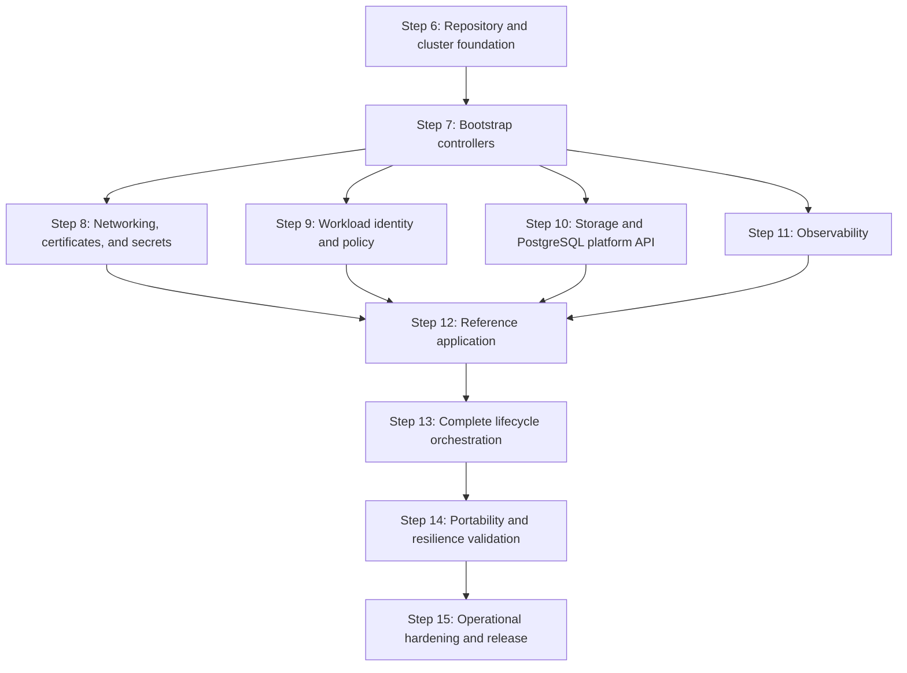

# Local Kubernetes Platform Implementation Plan

## Purpose

This plan implements the architecture and tool decisions in
[`initialize.md`](./initialize.md). It begins after the architecture, lifecycle,
capability, tool-selection, and repository-topology decisions completed in Steps 1
through 5.

Work proceeds one step at a time. A step is complete only after its deliverables
exist, its exit criteria pass, and the results are recorded in this plan. A later
step may refine an earlier decision, but must record the reason and update the
affected acceptance criteria.

## Delivery Principles

- Preserve one desired-state owner for every resource.
- Keep applications independent of Minikube and cloud-provider implementation
  details.
- Prefer small commands that compose through explicit inputs, outputs, and exit
  codes.
- Pin every tool, chart, image, provider, and policy-bundle version.
- Make every reconciliation idempotent and safe to resume after partial failure.
- Introduce policy in audit mode before enforcing it.
- Validate destructive behavior with retained data before exposing destructive
  commands.
- Do not present `kore platform up` as complete until it converges the full MVP
  platform.

## Implementation Sequence



Steps 8 through 11 may be implemented in parallel only after Step 7 is complete.
Each must pass independently before Step 12 begins.

## Step 6: Repository and Local Cluster Foundation

### Objective

Create the repository skeleton, pinned developer toolchain, safe command entry
point, and deterministic Minikube lifecycle without installing platform
controllers.

### Work

- [x] Record an architectural decision for the initial `kore` implementation
  language and packaging model. Prefer a testable, cross-platform executable over
  accumulating orchestration logic in shell scripts.
- [x] Create the planned `apps`, `infra`, and `tools` directory structure without
  placeholder files that have no declared purpose.
- [x] Define and validate the schemas for `infra/catalog/components.yaml`,
  `infra/catalog/versions.yaml`, and environment definitions.
- [x] Add repository-local `mise` configuration with pinned versions of the tools
  needed by this step.
- [x] Implement `kore doctor` with checks for tool versions, container runtime,
  CPU, memory, disk, credentials, and conflicting Minikube profiles.
- [x] Define the `local` environment, deterministic Minikube profile name,
  Kubernetes version, driver, container runtime, resource allocation, and expected
  kubeconfig context.
- [x] Implement focused cluster operations for create, status, stop, and guarded
  destroy.
- [x] Ensure commands address the explicit profile and context rather than the
  user's current `kubectl` context.
- [x] Add unit tests for configuration loading, version resolution, command
  construction, context validation, and destructive guards.
- [x] Add an integration test that creates, inspects, stops, and resumes a local
  cluster when a compatible container runtime is available.

### Initial Command Surface

```text
kore doctor
kore cluster up --environment local
kore cluster status --environment local
kore cluster stop --environment local
kore cluster destroy --environment local
```

These cluster commands are focused implementation building blocks. They do not
claim that the platform is ready.

### Exit Criteria

- [ ] A fresh checkout can install all pinned Step 6 tools through one documented
  operation.
- [x] Catalog and environment files fail fast with useful schema errors.
- [x] `kore doctor` distinguishes required failures from optional warnings.
- [ ] Repeating cluster creation produces no unintended change.
- [x] Cluster commands refuse to operate on an unexpected context or profile.
- [ ] Stopping and resuming the profile preserves its Kubernetes state.
- [x] Destroy requires explicit confirmation and has a tested retained-data guard.
- [x] Tests that do not require a live cluster run without one.
- [x] No infrastructure controller or application is installed by this step.

## Step 7: Bootstrap Controllers and CRD Ownership

### Objective

Install every controller required by the MVP in dependency order while preserving
explicit CRD ownership and leaving shared configuration and enforcement for later
steps.

### Work

- [x] Populate the component and version catalogs with pinned upstream chart and
  image references.
- [x] Record a compatibility matrix covering Kubernetes, Helm, Gateway API,
  cert-manager, Gatekeeper, Istio, Crossplane, External Secrets Operator,
  CloudNativePG, and OpenTelemetry Operator.
- [x] Give every logical release a namespace, CRD owner, dependencies, timeout,
  and readiness checks.
- [x] Implement topological sorting and cycle detection for the release graph.
- [x] Add a render and validation operation that does not mutate a cluster.
- [ ] Install Gateway API CRDs before Istio resources that consume them.
- [ ] Install cert-manager and wait for its deployments and webhook.
- [ ] Install OPA Gatekeeper without enforcing Kore constraints.
- [ ] Install Istio base, `istiod`, Istio CNI, and `ztunnel` for ambient mode.
- [ ] Install Crossplane and the required composition functions.
- [ ] Install External Secrets Operator.
- [ ] Install CloudNativePG.
- [ ] Install OpenTelemetry Operator after its prerequisites are ready.
- [x] Keep controller configuration instances out of controller releases.
- [ ] Add controller health, CRD establishment, webhook, and idempotency tests.

### Note

An upstream chart may manage its own CRDs only when its documented upgrade model is
compatible with Kore's lifecycle. Otherwise, the catalog declares a separate CRD
release. Ordinary component removal never deletes CRDs implicitly.

### Exit Criteria

- [ ] Every controller and CRD has exactly one catalog owner.
- [ ] The release graph is acyclic and produces a deterministic order.
- [ ] All CRDs are established before their custom resources are submitted.
- [ ] All controller deployments, daemon sets, and webhooks report ready.
- [ ] A second reconciliation produces no unintended release changes.
- [ ] Failure identifies the component and readiness condition that timed out.
- [ ] No shared issuer, gateway, composition, secret store, or enforcing policy is
  installed yet.

## Step 8: Networking, Certificates, and Secrets

### Objective

Provide a stable HTTPS endpoint and Secret reference contract using Istio Gateway
API, cert-manager, SOPS with age, and External Secrets Operator.

### Work

- [ ] Create the infrastructure-owned Gateway API `Gateway` and environment-owned
  parent-reference contract used by application `HTTPRoute` resources.
- [ ] Automate the lifecycle of the Minikube tunnel as local adapter behavior,
  including status, cleanup, and stale-process detection.
- [ ] Establish the local CA with mkcert through an explicit trust-changing
  operation.
- [ ] Configure the cert-manager local issuer without committing private key
  material.
- [ ] Issue a test certificate and verify its readiness, renewal metadata, and host
  trust.
- [ ] Define a stable `platform-secrets` store name for application resource
  charts.
- [ ] Add SOPS and age configuration for encrypted local source secrets.
- [ ] Automate decryption directly into a protected source namespace without
  writing plaintext files into the repository or build artifacts.
- [ ] Configure External Secrets Operator to materialize application-scoped
  Kubernetes Secrets from the local source.
- [ ] Define redaction rules so rendered output, dry runs, errors, and CI logs do
  not reveal secret values.
- [ ] Add readiness and end-to-end tests for Gateway, TLS, and Secret materialization.

### Exit Criteria

- [ ] A test `HTTPRoute` receives a stable local HTTPS endpoint.
- [ ] The endpoint certificate is trusted by the opted-in development host.
- [ ] The Gateway and certificate report ready through Kubernetes conditions.
- [ ] An `ExternalSecret` produces the expected target Secret schema.
- [ ] No plaintext secret is committed, stored in Helm values, or printed in logs.
- [ ] Reconciliation and certificate or Secret rotation do not require manual
  cluster changes.
- [ ] Application manifests contain no Minikube-specific values.

## Step 9: Workload Identity and Policy

### Objective

Establish dedicated workload identities, ambient mutual TLS, admission policy, and
OPA-backed contextual authorization without turning OPA into an identity issuer.

### Work

- [ ] Define the namespace enrollment contract for Istio ambient mode.
- [ ] Require every workload to use a dedicated Kubernetes ServiceAccount.
- [ ] Verify Istio produces the expected SPIFFE principal from namespace and
  ServiceAccount identity.
- [ ] Enable strict mutual TLS for participating workloads.
- [ ] Establish native Istio default-deny and explicit-allow authorization patterns.
- [ ] Create Gatekeeper constraint templates and tests for identity, RBAC,
  privilege, resource, health-probe, Secret, mesh-enrollment, and retention rules.
- [ ] Deploy constraints in audit mode and define minimal explicit system namespace
  exemptions.
- [ ] Package and deploy the platform-operated OPA-Envoy external authorization
  service.
- [ ] Deliver tested Rego as versioned OPA bundles.
- [ ] Configure OPA as an Istio external authorization provider without manual
  ConfigMap editing.
- [ ] Route one Layer 7 policy through an ambient waypoint and Istio `CUSTOM`
  authorization policy.
- [ ] Verify the OPA decision receives authenticated source and destination workload
  principals.
- [ ] Test allow, deny, authorizer-unavailable, stale-bundle, and invalid-bundle
  behavior.
- [ ] Promote constraints individually from audit to enforcement only after the
  platform complies.

### Exit Criteria

- [ ] Workloads using the namespace default ServiceAccount are rejected.
- [ ] Workload principals follow the documented SPIFFE identity format.
- [ ] Service-to-service traffic is mutually authenticated.
- [ ] Native Istio authorization denies undeclared service relationships.
- [ ] OPA makes a contextual decision using the authenticated workload principal.
- [ ] Protected routes fail closed when the OPA authorizer is unavailable.
- [ ] Policy decisions and denials are observable without leaking credentials.
- [ ] Bootstrap and system controllers remain operational under enforcing policy.

## Step 10: Storage and PostgreSQL Platform API

### Objective

Provide explicit disposable and retained storage profiles plus a portable
PostgreSQL claim backed locally by CloudNativePG.

### Work

- [ ] Define `kore-standard` and `kore-retained` StorageClasses with documented
  reclaim and expansion behavior.
- [ ] Verify Minikube storage paths survive profile stop and resume.
- [ ] Define the namespaced
  `PostgreSQLInstance.platform.kore.dev` Crossplane XRD.
- [ ] Limit the API to portable inputs: service class, storage size, PostgreSQL
  compatibility version, connection Secret name, and retention policy.
- [ ] Create the local Crossplane composition that produces a CloudNativePG cluster
  and connection Secret.
- [ ] Grant Crossplane only the RBAC required to compose CloudNativePG and related
  Kubernetes resources.
- [ ] Normalize connection data into the documented Secret schema.
- [ ] Propagate readiness, failure, and useful status conditions to the claim.
- [ ] Keep the claim in the application resources release and the composed database
  outside Helm ownership.
- [ ] Implement retained-data discovery used by application and cluster lifecycle
  guards.
- [ ] Define and test an explicit purge path.
- [ ] Implement a local export and restore proof before treating platform destroy as
  recoverable.

### Exit Criteria

- [ ] Disposable and retained claims bind to the intended storage profiles.
- [ ] A PostgreSQL claim becomes ready without application knowledge of
  CloudNativePG.
- [ ] The normalized connection Secret is created with the documented keys.
- [ ] Deleting the workload release does not delete the database claim or data.
- [ ] Deleting a retained claim does not silently delete its backing data.
- [ ] Cluster destroy is blocked while retained data lacks an explicit purge or
  verified export.
- [ ] Exported local data can be restored into a fresh local platform.

## Step 11: Observability

### Objective

Provide one OpenTelemetry ingestion contract for application, platform, mesh, and
policy telemetry with correlated local metrics, logs, and traces.

### Work

- [ ] Install resource-bounded local configurations for Prometheus, Loki, Tempo,
  and Grafana.
- [ ] Deploy the OpenTelemetry Collector with OTLP gRPC and HTTP receivers.
- [ ] Define separate pipelines for application telemetry, Kubernetes logs and
  metrics, Istio telemetry, and policy decision telemetry where appropriate.
- [ ] Enrich signals with cluster, environment, namespace, application,
  ServiceAccount, and workload identity attributes.
- [ ] Establish attribute and label cardinality limits before ingesting pod-level
  data.
- [ ] Export metrics to Prometheus, logs to Loki, and traces to Tempo.
- [ ] Provision Grafana data sources and initial dashboards as desired state.
- [ ] Add health, queue, dropped-data, and exporter-failure monitoring for the
  Collector.
- [ ] Define local retention and storage limits for every backend.
- [ ] Add synthetic telemetry tests for all three signals and their correlation.

### Exit Criteria

- [ ] Applications use only the documented OTLP endpoint and standard environment
  variables.
- [ ] A synthetic request produces a correlated metric, log, and trace.
- [ ] Istio traffic exposes source and destination workload identity attributes.
- [ ] OPA authorization decisions can be correlated with request traces where
  supported.
- [ ] Collector or backend failure is visible through platform status.
- [ ] Local telemetry storage has explicit retention and resource bounds.
- [ ] No application sends telemetry directly to a storage backend.

## Step 12: Reference Application

### Objective

Prove the complete platform contract with a small application that exercises every
MVP capability and includes positive and negative tests.

### Work

- [ ] Implement at least two communicating workloads so workload-to-workload
  identity and authorization can be demonstrated.
- [ ] Give each workload a dedicated ServiceAccount.
- [ ] Create `charts/resources` for the PostgreSQL claim and any external Secrets.
- [ ] Create `charts/workload` for Deployments, Services, health probes,
  `HTTPRoute`, telemetry configuration, and authorization policy references.
- [ ] Build an OCI-compatible image and automate its Minikube delivery without
  embedding local behavior in either chart.
- [ ] Read the PostgreSQL connection only from the normalized Secret contract.
- [ ] Emit OpenTelemetry logs, metrics, and traces with stable service attributes.
- [ ] Add a route protected by native Istio policy and a route protected by OPA.
- [ ] Add database schema initialization or migration as an explicit, repeatable
  operation.
- [ ] Add smoke tests for HTTPS, persistence, Secret use, health, telemetry, mTLS,
  native authorization, and OPA authorization.
- [ ] Add negative tests proving that policy rejects an invalid workload and an
  unauthorized caller.

### Exit Criteria

- [ ] The resources release becomes ready before the workload release begins.
- [ ] The application starts without provider-specific templates or source changes.
- [ ] HTTPS, database access, Secret injection, and persistence work locally.
- [ ] Allowed identity paths succeed and undeclared identity paths fail.
- [ ] The OPA-protected operation makes the expected contextual decision.
- [ ] Logs, metrics, and traces are queryable and correlated.
- [ ] Removing and reinstalling the workload preserves retained application data.
- [ ] All Gatekeeper constraints intended for the MVP are enforcing.

## Step 13: Complete Lifecycle Orchestration

### Objective

Expose the stable developer-facing workflow only after all internal operations can
converge and validate the complete platform.

### Work

- [x] Implement `kore platform up`, `status`, `stop`, and guarded `destroy` by
  composing the focused operations from earlier steps.
- [x] Implement `kore app up`, `status`, and `down` with separate resource and
  workload release phases.
- [x] Require an explicit environment for every mutating command.
- [x] Add bounded readiness waits and actionable component-level failures.
- [ ] Resume from partial failure without reinstalling healthy dependencies.
- [x] Prevent concurrent mutation of the same environment.
- [x] Produce concise human output and stable machine-readable output.
- [x] Ensure diagnostic output is read-only and redacts sensitive data.
- [x] Implement non-interactive confirmation behavior for CI.
- [ ] Add a clean-machine end-to-end test from tool installation through reference
  application verification.

### Public Command Surface

```text
kore doctor
kore platform up --environment <name>
kore platform status --environment <name>
kore platform stop --environment local
kore platform destroy --environment <name>
kore app up <name> --environment <name>
kore app status <name> --environment <name>
kore app down <name> --environment <name>
```

### Exit Criteria

- [ ] One command creates and validates the complete local platform.
- [ ] Platform creation does not install applications.
- [ ] One command installs and validates the reference application.
- [ ] Repeating platform and application reconciliation is idempotent.
- [ ] Interrupted operations resume safely.
- [ ] Status commands make no changes.
- [ ] Unexpected profile, context, or environment combinations fail before mutation.
- [ ] No documented success path requires manual `kubectl patch`, `edit`, or
  imperative resource creation.
- [ ] Destructive operations preserve or explicitly account for retained data.

## Step 14: Portability and Resilience Validation

### Objective

Prove that the contracts are genuinely replaceable and that common component
failures have automated detection and recovery paths.

### Work

- [ ] Render every application chart against common configuration without loading a
  local overlay.
- [x] Add a second non-local environment schema and select its provider through an
  architectural decision.
- [ ] Define the provider OpenTofu stack for networking, identity, registry,
  Kubernetes, and other pre-cluster dependencies.
- [ ] Define a managed PostgreSQL Crossplane composition that preserves the
  `PostgreSQLInstance` API and connection Secret schema.
- [ ] Replace the local secret store, certificate issuer, storage classes, gateway
  exposure, and image delivery through environment configuration only.
- [x] Keep live cloud provisioning opt-in because it requires credentials, external
  changes, and cost.
- [x] Add offline render, schema, composition, and policy tests that run without
  cloud credentials.
- [ ] Run an authorized live portability test before claiming support for a
  provider.
- [ ] Test controller restart, OPA outage, telemetry backend outage, interrupted
  Helm upgrade, and partial platform reconciliation.
- [ ] Verify status reports degraded capabilities without corrupting healthy state.

### Exit Criteria

- [ ] Application source and charts are identical between local and provider
  environments.
- [ ] Environment selection changes implementations without changing application
  contracts.
- [ ] The managed PostgreSQL composition produces the same readiness and Secret
  interface as the local composition.
- [ ] Offline provider validation runs in ordinary CI.
- [ ] Provider support is documented only after an authorized live test passes.
- [ ] Recoverable failures converge without manual cluster patching.

## Step 15: Operational Hardening and Release

### Objective

Turn the validated vertical slice into a maintainable platform release while
keeping production-only scale and availability work explicitly scoped.

### Work

- [ ] Document support windows and upgrade order for Kubernetes, CRDs, controllers,
  charts, policy bundles, and the `kore` command.
- [ ] Add upgrade tests from the previously supported version catalog.
- [ ] Add backup schedules, restore tests, and recovery objectives for stateful
  platform and application data.
- [ ] Validate CRD conversion and rollback behavior before controller upgrades.
- [ ] Add artifact integrity checks, dependency inventory, and automated
  vulnerability reporting.
- [ ] Document trust roots, certificate rotation, secret rotation, and workload
  identity incident response.
- [ ] Document policy change review, audit-to-enforce promotion, rollback, and
  emergency exemption procedures.
- [ ] Define resource budgets and capacity warnings for the local profile.
- [ ] Publish operator, contributor, troubleshooting, and application-onboarding
  documentation generated from the implemented command behavior.
- [ ] Tag the first versioned local-platform release only after a fresh-install and
  upgrade test pass.

### Exit Criteria

- [ ] A supported upgrade path passes without application contract changes.
- [ ] Backup and restore tests meet the documented recovery expectations.
- [ ] Policy and identity changes have tested rollback procedures.
- [ ] Tool and component provenance is reviewable from the repository.
- [ ] Documentation contains no hidden manual remediation required for normal
  operation.
- [ ] The first local-platform release is reproducible from a clean checkout.

Production high availability, multi-cluster operation, and organization-specific
cloud controls remain separate initiatives. They are not implied by completion of
the local-platform MVP.

## Progress Record

Update this table when a step begins or completes. Link implementation commits,
test evidence, and architectural decisions from the evidence column.

| Step | Status | Evidence |
| --- | --- | --- |
| 6. Repository and local cluster foundation | Complete (offline) | `tools/kore` TypeScript CLI, catalogs, local environment, `npm test` |
| 7. Bootstrap controllers and CRD ownership | Implemented; live validation pending | release catalog, compatibility matrix, dependency/CRD checks |
| 8. Networking, certificates, and secrets | Implemented; live validation pending | platform-config chart, SOPS sync command, Gateway/Certificate contract |
| 9. Workload identity and policy | Implemented; live validation pending | ambient values, Gatekeeper templates/constraints, OPA bundle/chart |
| 10. Storage and PostgreSQL platform API | Implemented; live validation pending | StorageClasses, `PostgreSQLInstance` XRD/composition, retention guards |
| 11. Observability | Implemented; live validation pending | Collector values, bounded backends, dashboard and alert assets |
| 12. Reference application | Implemented; live validation pending | two Node workloads, resource/workload charts, Dockerfile, policy paths |
| 13. Complete lifecycle orchestration | Implemented; live validation pending | platform/app command phases, lock, explicit contexts and confirmations |
| 14. Portability and resilience validation | Complete (offline validation) | `kore validate --environment managed-example`, environment-selected overlays, application overlay rejection, `tools/kore/{portability,config}.spec.ts`; live/provider resilience tests pending |
| 15. Operational hardening and release | Not started | |
