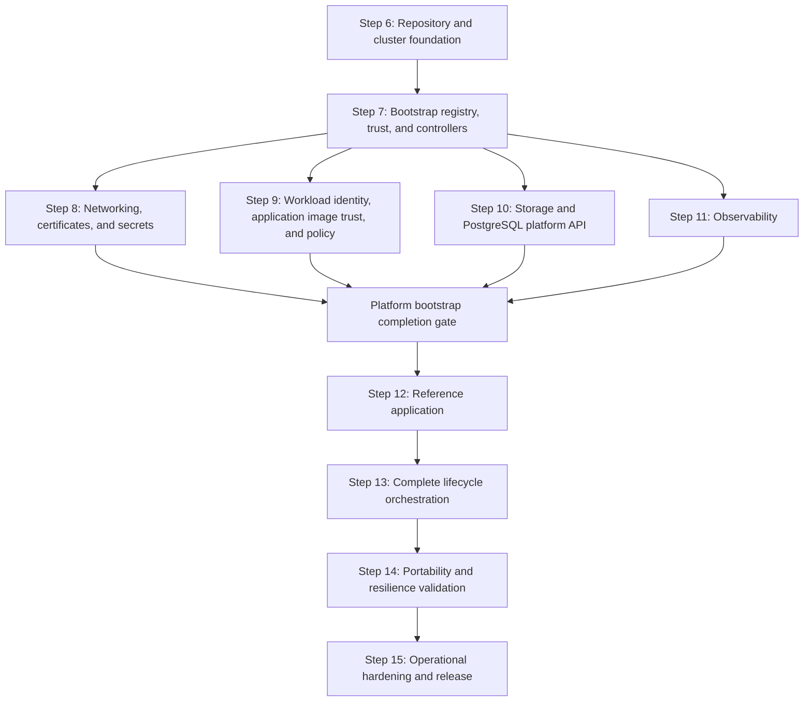

# Local Kubernetes Platform Implementation Plan

## Purpose

This plan implements the architecture and tool decisions in
[`initialize.md`](./initialize.md). It begins after the architecture, lifecycle,
capability, tool-selection, and repository-topology decisions completed in Steps 1
through 5.

Work proceeds one step at a time. A step is complete only after its deliverables
exist, its exit criteria pass, and the results are recorded in this plan. A later
step may refine an earlier decision, but must record the reason and update the
affected acceptance criteria.

## Delivery Principles

- Preserve one desired-state owner for every resource.
- Keep applications independent of Minikube and cloud-provider implementation
  details.
- Prefer small commands that compose through explicit inputs, outputs, and exit
  codes.
- Pin every tool, chart, image, provider, and policy-bundle version.
- Make every reconciliation idempotent and safe to resume after partial failure.
- Introduce policy in audit mode before enforcing it.
- Treat the internal OCI registry and image-signature verifier as bootstrap
  dependencies, and do not report bootstrap complete until the seed trust loop is
  closed and fail-closed admission is active.
- Permit only protected release automation identities to sign trusted images;
  developers and untrusted pipeline contexts may build candidates but cannot sign
  or promote them.
- Keep application admission closed throughout all internal bootstrap phases and
  open it only after every required infrastructure tool and capability passes its
  current-generation readiness checks.
- Validate destructive behavior with retained data before exposing destructive
  commands.
- Do not present `kore platform up` as complete until it converges the full MVP
  platform.

## Implementation Sequence



Steps 8 through 11 may be implemented in parallel only after Step 7 is complete.
Each must pass independently before Step 12 begins.

## Step 6: Repository and Local Cluster Foundation

### Objective

Create the repository skeleton, pinned developer toolchain, safe command entry
point, and deterministic Minikube lifecycle without installing platform
controllers.

### Work

- [x] Record an architectural decision for the initial `kore` implementation
      language and packaging model. Prefer a testable, cross-platform executable over
      accumulating orchestration logic in shell scripts.
- [x] Create the planned `apps`, `infra`, and `tools` directory structure without
      placeholder files that have no declared purpose.
- [x] Define and validate the schemas for `infra/catalog/components.yaml`,
      `infra/catalog/versions.yaml`, and environment definitions.
- [x] Add repository-local `mise` configuration with pinned versions of the tools
      needed by this step.
- [x] Implement `kore doctor` with checks for tool versions, container runtime,
      CPU, memory, disk, credentials, and conflicting Minikube profiles.
- [x] Define the `local` environment, deterministic Minikube profile name,
      Kubernetes version, driver, container runtime, resource allocation, and expected
      kubeconfig context.
- [x] Implement focused cluster operations for create, status, stop, and guarded
      destroy.
- [x] Ensure commands address the explicit profile and context rather than the
      user's current `kubectl` context.
- [x] Add unit tests for configuration loading, version resolution, command
      construction, context validation, and destructive guards.
- [x] Add an integration test that creates, inspects, stops, and resumes a local
      cluster when a compatible container runtime is available.

### Initial Command Surface

```text
kore doctor
kore cluster up --environment local
kore cluster status --environment local
kore cluster stop --environment local
kore cluster destroy --environment local
```

These cluster commands are focused implementation building blocks. They do not
claim that the platform is ready.

### Exit Criteria

- [x] A fresh checkout can install all pinned Step 6 tools through one documented
      operation.
- [x] Catalog and environment files fail fast with useful schema errors.
- [x] `kore doctor` distinguishes required failures from optional warnings.
- [ ] Repeating cluster creation produces no unintended change.
- [x] Cluster commands refuse to operate on an unexpected context or profile.
- [ ] Stopping and resuming the profile preserves its Kubernetes state.
- [x] Destroy requires explicit confirmation and has a tested retained-data guard.
- [x] Tests that do not require a live cluster run without one.
- [x] No infrastructure controller or application is installed by this step.

## Step 7: Bootstrap Registry, Image Trust, Controllers, and CRD Ownership

### Objective

Install the internal OCI registry, Sigstore Policy Controller, and every controller
required by the MVP in dependency order. Establish the application admission gate
in its closed state, close the foundation seed trust loop, and enable fail-closed
image admission while preserving explicit CRD ownership. This is an internal
bootstrap phase and cannot publish overall platform readiness before Steps 8
through 11 also converge.

### Work

- [x] Populate the component and version catalogs with pinned upstream chart and
      image references.
- [x] Record a compatibility matrix covering Kubernetes, Helm, Gateway API,
      cert-manager, Gatekeeper, Istio, Crossplane, External Secrets Operator,
      CloudNativePG, and OpenTelemetry Operator.
- [ ] Select and pin the OCI Distribution-compatible registry, Cosign, and Sigstore
      Policy Controller; add them to the compatibility matrix, component catalog,
      version catalog, release graph, and readiness model.
- [x] Give every logical release a namespace, CRD owner, dependencies, timeout,
      and readiness checks.
- [x] Implement topological sorting and cycle detection for the release graph.
- [x] Add a render and validation operation that does not mutate a cluster.
- [ ] Install Gateway API CRDs before Istio resources that consume them.
- [ ] Install cert-manager and wait for its deployments and webhook.
- [ ] Install OPA Gatekeeper without enforcing Kore constraints.
- [ ] Install a persistent `oci-registry` infrastructure release and verify push,
      pull, restart, storage retention, authentication, authorization, and bounded
      readiness behavior.
- [ ] Install Sigstore Policy Controller and its CRDs/webhook from an explicitly
      allowlisted, digest-pinned seed artifact without enabling enforcement yet.
- [ ] Install Istio base, `istiod`, Istio CNI, and `ztunnel` for ambient mode.
- [ ] Install Crossplane and the required composition functions.
- [ ] Install External Secrets Operator.
- [ ] Install CloudNativePG.
- [ ] Install OpenTelemetry Operator after its prerequisites are ready.
- [ ] Define the minimal digest-pinned seed manifest required to start the registry,
      verifier, and their prerequisites; reject unrecorded seed artifacts and record
      the reason and upstream verification evidence for every seed.
- [ ] Implement protected release automation that mirrors approved platform images
      into the internal registry, verifies recorded upstream digests and provenance,
      signs internal digests with Cosign, verifies each signature, and emits an
      immutable image lock manifest.
- [ ] Bind the accepted Cosign authority to an exact protected automation identity
      or KMS/HSM key. Grant developers, pull-request workflows, ordinary build jobs,
      cluster workloads, and registry administrators no signing permission.
- [ ] Roll every managed platform workload, including the registry and verifier,
      from its seed or external reference to the signed internal digest recorded in
      the image lock manifest.
- [ ] Install `ClusterImagePolicy` resources covering containers, init containers,
      and ephemeral containers; reject unmatched images and fail closed on signature,
      registry, or verifier errors.
- [ ] Enroll all managed platform namespaces, then inventory running workloads and
      fail bootstrap if a seed, external, tag-only, unsigned, or unauthorized image
      remains. Seed exceptions must be empty before success.
- [ ] Create the generation-specific application admission gate in its closed state;
      grant only bootstrap automation permission to update it or application namespace
      activation metadata.
- [x] Make controller bootstrap independently runnable and complete it before
      shared configuration readiness checks; OpenTelemetry Operator must not be
      blocked by a Gateway waiting for its certificate or external address.
- [x] Keep controller configuration instances out of controller releases.
- [ ] Add controller health, CRD establishment, webhook, and idempotency tests.

### Note

An upstream chart may manage its own CRDs only when its documented upgrade model is
compatible with Kore's lifecycle. Otherwise, the catalog declares a separate CRD
release. Ordinary component removal never deletes CRDs implicitly.

### Exit Criteria

- [ ] Every controller and CRD has exactly one catalog owner.
- [ ] The release graph is acyclic and produces a deterministic order.
- [ ] All CRDs are established before their custom resources are submitted.
- [ ] All controller deployments, daemon sets, and webhooks report ready.
- [ ] The registry persists images and signatures across platform stop and resume.
- [ ] Every managed foundation workload installed in this step uses an internal
      digest-qualified image with a valid signature from the authorized release
      automation identity; later platform releases must satisfy the same condition
      before installation.
- [ ] Unsigned images and images signed by developer, pull-request, build-job, or
      other unauthorized identities are rejected.
- [ ] Registry or signature-verifier unavailability denies new managed workloads
      and is reported as degraded without weakening policy.
- [ ] The internal foundation phase finishes with no active seed exception or
      external image reference and leaves the application admission gate closed.
- [ ] A second reconciliation produces no unintended release changes.
- [ ] Failure identifies the component and readiness condition that timed out.
- [ ] No shared issuer, gateway, composition, secret store, or unrelated enforcing
      Gatekeeper/runtime policy is installed yet; image signature enforcement is the
      required bootstrap exception because it closes the image trust boundary.

## Step 8: Networking, Certificates, and Secrets

### Objective

Provide a stable HTTPS endpoint and Secret reference contract using Istio Gateway
API, cert-manager, SOPS with age, and External Secrets Operator.

### Work

- [x] Create the infrastructure-owned Gateway API `Gateway` and environment-owned
      parent-reference contract used by application `HTTPRoute` resources.
- [ ] Automate the lifecycle of the Minikube tunnel as local adapter behavior,
      including status, cleanup, and stale-process detection.
- [x] Establish the local CA with mkcert through an explicit trust-changing
      operation.
- [x] Configure the cert-manager local issuer without committing private key
      material.
- [ ] Issue a test certificate and verify its readiness, renewal metadata, and host
      trust.
- [x] Define a stable `platform-secrets` store name for application resource
      charts.
- [x] Add SOPS and age configuration for encrypted local source secrets.
- [x] Automate decryption directly into a protected source namespace without
      writing plaintext files into the repository or build artifacts.
- [x] Configure External Secrets Operator to materialize application-scoped
      Kubernetes Secrets from the local source.
- [ ] Define redaction rules so rendered output, dry runs, errors, and CI logs do
      not reveal secret values.
- [ ] Add readiness and end-to-end tests for Gateway, TLS, and Secret materialization.

### Gateway Bootstrap Repair

The clean-cluster run on 2026-09-13 reached `kore-platform-config` but could not
complete: `kore-gateway` reported `AddressNotAssigned`, and its HTTPS listener
reported `InvalidCertificateRef` because `kore-system/kore-local-tls` did not
exist. The installation was canceled and the configuration release removed.
The Istio CNI AppArmor deprecation warning did not cause this failure.

- [ ] Order local bootstrap explicitly: ready controllers, local CA/issuer setup,
      Certificate creation, TLS Secret readiness, Gateway creation, and external
      address/route readiness. Split configuration releases where a Helm wait would
      otherwise block the commands needed to satisfy its own prerequisites.
- [x] Use the explicit `kore trust install --environment local` operation to
      establish host trust and install the issuer prerequisites. Verify the
      ClusterIssuer is Ready before waiting for certificate issuance; report a
      missing trust setup with an actionable command.
- [x] Create and wait for the Certificate that produces
      `kore-system/kore-local-tls`; check the expected TLS Secret keys without
      printing their contents before installing the HTTPS Gateway. The certificate
      now has a separate release, waits for `Certificate Ready`, then checks for a
      TLS Secret containing both `tls.crt` and `tls.key` before the Gateway release.
- [ ] Start and supervise the local Minikube tunnel so the Gateway LoadBalancer
      Service receives an address; handle required host privileges, tunnel exit,
      stale processes, and stop/destroy cleanup explicitly.
- [ ] Wait with bounded timeouts for the Service address, Gateway `Accepted` and
      `Programmed`, and listener `ResolvedRefs`; include condition reasons such as
      `AddressNotAssigned` and `InvalidCertificateRef` in failure output.
- [ ] Add regression tests for missing issuer/TLS Secret, unavailable tunnel,
      and configuration ordering. Run a fresh-cluster end-to-end check through a
      trusted HTTPS route, including cleanup and retry after an injected failure.

### Exit Criteria

- [ ] A test `HTTPRoute` receives a stable local HTTPS endpoint.
- [ ] The endpoint certificate is trusted by the opted-in development host.
- [ ] The Gateway and certificate report ready through Kubernetes conditions.
- [ ] An `ExternalSecret` produces the expected target Secret schema.
- [ ] No plaintext secret is committed, stored in Helm values, or printed in logs.
- [ ] Reconciliation and certificate or Secret rotation do not require manual
      cluster changes.
- [ ] Application manifests contain no Minikube-specific values.

## Step 9: Workload Identity, Application Image Trust, and Policy

### Objective

Establish dedicated workload identities, ambient mutual TLS, application image
trust, admission policy, and OPA-backed contextual authorization without turning
OPA into an identity issuer or a signature verifier.

### Work

- [x] Define the namespace enrollment contract for Istio ambient mode.
- [x] Require every workload to use a dedicated Kubernetes ServiceAccount.
- [ ] Verify Istio produces the expected SPIFFE principal from namespace and
      ServiceAccount identity.
- [x] Enable strict mutual TLS for participating workloads.
- [x] Establish native Istio default-deny and explicit-allow authorization patterns.
- [x] Create Gatekeeper constraint templates and tests for identity, RBAC,
      privilege, resource, health-probe, Secret, mesh-enrollment, and retention rules.
- [x] Deploy constraints in audit mode and define minimal explicit system namespace
      exemptions.
- [ ] Define the application namespace enrollment contract for Sigstore Policy
      Controller and make enrollment mandatory before an application workload release.
- [ ] Define environment-specific trusted release automation identities and ensure
      local identities are never trusted by managed environments.
- [ ] Verify that registry membership alone grants no trust: admission must validate
      the Cosign signature and exact authorized signer for the deployed digest.
- [x] Package and deploy the platform-operated OPA-Envoy external authorization
      service.
- [x] Deliver tested Rego as versioned OPA bundles.
- [x] Configure OPA as an Istio external authorization provider without manual
      ConfigMap editing.
- [x] Route one Layer 7 policy through an ambient waypoint and Istio `CUSTOM`
      authorization policy.
- [ ] Verify the OPA decision receives authenticated source and destination workload
      principals.
- [ ] Test allow, deny, authorizer-unavailable, stale-bundle, and invalid-bundle
      behavior.
- [ ] Promote constraints individually from audit to enforcement only after the
      platform complies.

### Exit Criteria

- [ ] Workloads using the namespace default ServiceAccount are rejected.
- [ ] Workload principals follow the documented SPIFFE identity format.
- [ ] Service-to-service traffic is mutually authenticated.
- [ ] Native Istio authorization denies undeclared service relationships.
- [ ] OPA makes a contextual decision using the authenticated workload principal.
- [ ] Protected routes fail closed when the OPA authorizer is unavailable.
- [ ] Policy decisions and denials are observable without leaking credentials.
- [ ] Bootstrap and system controllers remain operational under enforcing policy.
- [ ] Every application namespace is enrolled in fail-closed image admission.
- [ ] Every container, init container, and ephemeral container is rejected unless
      its digest is signed by the environment-authorized release automation identity.

## Step 10: Storage and PostgreSQL Platform API

### Objective

Provide explicit disposable and retained storage profiles plus a portable
PostgreSQL claim backed locally by CloudNativePG.

### Work

- [x] Define `kore-standard` and `kore-retained` StorageClasses with documented
      reclaim and expansion behavior.
- [ ] Verify Minikube storage paths survive profile stop and resume.
- [x] Define the namespaced
      `PostgreSQLInstance.platform.kore.dev` Crossplane XRD.
- [x] Limit the API to portable inputs: service class, storage size, PostgreSQL
      compatibility version, connection Secret name, and retention policy.
- [x] Create the local Crossplane composition that produces a CloudNativePG cluster
      and connection Secret.
- [ ] Grant Crossplane only the RBAC required to compose CloudNativePG and related
      Kubernetes resources.
- [x] Normalize connection data into the documented Secret schema.
- [ ] Propagate readiness, failure, and useful status conditions to the claim.
- [x] Keep the claim in the application resources release and the composed database
      outside Helm ownership.
- [x] Implement retained-data discovery used by application and cluster lifecycle
      guards.
- [x] Define and test an explicit purge path.
- [ ] Implement a local export and restore proof before treating platform destroy as
      recoverable.

### Exit Criteria

- [ ] Disposable and retained claims bind to the intended storage profiles.
- [ ] A PostgreSQL claim becomes ready without application knowledge of
      CloudNativePG.
- [ ] The normalized connection Secret is created with the documented keys.
- [ ] Deleting the workload release does not delete the database claim or data.
- [ ] Deleting a retained claim does not silently delete its backing data.
- [ ] Cluster destroy is blocked while retained data lacks an explicit purge or
      verified export.
- [ ] Exported local data can be restored into a fresh local platform.

## Step 11: Observability

### Objective

Provide one OpenTelemetry ingestion contract for application, platform, mesh, and
policy telemetry with correlated local metrics, logs, and traces.

### Work

- [x] Install resource-bounded local configurations for Prometheus, Loki, Tempo,
      and Grafana.
- [x] Deploy the OpenTelemetry Collector with OTLP gRPC and HTTP receivers.
- [x] Define separate pipelines for application telemetry, Kubernetes logs and
      metrics, Istio telemetry, and policy decision telemetry where appropriate.
- [x] Enrich signals with cluster, environment, namespace, application,
      ServiceAccount, and workload identity attributes.
- [x] Establish attribute and label cardinality limits before ingesting pod-level
      data.
- [x] Export metrics to Prometheus, logs to Loki, and traces to Tempo.
- [x] Provision Grafana data sources and initial dashboards as desired state.
- [x] Add health, queue, dropped-data, and exporter-failure monitoring for the
      Collector.
- [x] Define local retention and storage limits for every backend.
- [x] Add synthetic telemetry tests for all three signals and their correlation.

### Exit Criteria

- [ ] Applications use only the documented OTLP endpoint and standard environment
      variables.
- [ ] A synthetic request produces a correlated metric, log, and trace.
- [ ] Istio traffic exposes source and destination workload identity attributes.
- [ ] OPA authorization decisions can be correlated with request traces where
      supported.
- [ ] Collector or backend failure is visible through platform status.
- [ ] Local telemetry storage has explicit retention and resource bounds.
- [ ] No application sends telemetry directly to a storage backend.

## Platform Bootstrap Completion Gate

### Objective

Make the transition from infrastructure convergence to application admission an
explicit, fail-closed operation. No application claim or workload may be deployed,
applied, or admitted until all infrastructure required by the application contract
is installed, configured, healthy, and enforcing for the current bootstrap
generation.

### Work

- [ ] Define one versioned readiness manifest listing every required controller,
      registry, trust policy, shared configuration release, platform API, endpoint, and
      health condition from Steps 7 through 11.
- [ ] Make bootstrap automation evaluate the manifest with bounded checks and write
      platform-owned, generation-specific readiness state only after every check passes.
- [ ] Keep application namespaces absent or inactive until readiness is published;
      activate them with platform-owned metadata that enrolls all required admission
      policies, including fail-closed Sigstore verification.
- [ ] Add cluster-side RBAC and admission policy that reject application claims,
      PodSpec-bearing resources, and direct Helm or Kubernetes API mutations when the
      readiness state is missing, closed, stale, or for another environment generation.
- [ ] Prevent developer, build, pull-request, and ordinary deployment identities
      from modifying readiness state, namespace activation, admission configuration, or
      bootstrap-owned RBAC. Only protected bootstrap automation may open the gate.
- [ ] Make any required platform capability becoming unhealthy close the gate for
      new application mutations without disrupting already-running healthy workloads;
      status must identify the failed prerequisite.
- [ ] Test early `kore app up`, Helm, and direct Kubernetes API attempts and prove
      each is rejected before readiness and accepted only after the gate opens.
- [ ] Ensure interrupted or failed bootstrap leaves the gate closed and that a
      successful idempotent retry opens it only after revalidating every prerequisite.

### Exit Criteria

- [ ] Every infrastructure tool required by the declared application contracts is
      installed, configured, healthy, and reported by the current readiness generation.
- [ ] The registry contains every managed platform image and its authorized Cosign
      signature; all platform workloads use internal digest-qualified references.
- [ ] Gatekeeper, Sigstore Policy Controller, workload identity, secrets, storage,
      database APIs, networking, certificates, and telemetry prerequisites are ready
      and enforcing their application-facing contracts.
- [ ] No application resource can be applied through `kore`, Helm, or the Kubernetes
      API while the gate is closed or stale under supported non-administrator identities.
- [ ] Only protected bootstrap automation can open the gate, and opening it produces
      auditable evidence covering every prerequisite.
- [ ] `kore platform up` and bootstrap status cannot report success before the gate
      is open.

## Step 12: Reference Application

### Objective

After the application admission gate opens, prove the complete platform contract
with a small application that exercises every MVP capability and includes positive
and negative tests.

### Work

- [x] Implement at least two communicating workloads so workload-to-workload
      identity and authorization can be demonstrated.
- [x] Give each workload a dedicated ServiceAccount.
- [x] Create `charts/resources` for the PostgreSQL claim and any external Secrets.
- [x] Create `charts/workload` for Deployments, Services, health probes,
      `HTTPRoute`, telemetry configuration, and authorization policy references.
- [x] Build an OCI-compatible candidate image without embedding local behavior in
      either chart.
- [ ] Publish the candidate to the platform registry, promote and Cosign-sign its
      digest only through protected release automation, verify the signature, and pass
      only the resulting digest-qualified internal reference to Helm.
- [x] Read the PostgreSQL connection only from the normalized Secret contract.
- [x] Emit OpenTelemetry logs, metrics, and traces with stable service attributes.
- [x] Add a route protected by native Istio policy and a route protected by OPA.
- [ ] Add database schema initialization or migration as an explicit, repeatable
      operation.
- [ ] Add smoke tests for HTTPS, persistence, Secret use, health, telemetry, mTLS,
      native authorization, and OPA authorization.
- [ ] Add negative tests proving that policy rejects an invalid workload and an
      unauthorized caller.
- [ ] Add image-admission tests proving that a correctly automation-signed digest is
      admitted while an unsigned image, a tag-only reference, a modified digest, and an
      image signed by a developer or untrusted pipeline identity are rejected.

### Exit Criteria

- [ ] The resources release becomes ready before the workload release begins.
- [ ] The application starts without provider-specific templates or source changes.
- [ ] HTTPS, database access, Secret injection, and persistence work locally.
- [ ] Allowed identity paths succeed and undeclared identity paths fail.
- [ ] The OPA-protected operation makes the expected contextual decision.
- [ ] Logs, metrics, and traces are queryable and correlated.
- [ ] Removing and reinstalling the workload preserves retained application data.
- [ ] All Gatekeeper constraints intended for the MVP are enforcing.
- [ ] All application images are pulled from the platform registry by digest and
      verified at admission against the authorized release automation identity.

## Step 13: Complete Lifecycle Orchestration

### Objective

Expose the stable developer-facing workflow only after all internal operations can
converge and validate the complete platform.

### Work

- [x] Implement `kore platform up`, `status`, `stop`, and guarded `destroy` by
      composing the focused operations from earlier steps.
- [ ] Make `kore platform up` own the complete bootstrap generation and open the
      application admission gate only after Steps 7 through 11 and trust closure pass.
- [x] Implement `kore app up`, `status`, and `down` with separate resource and
      workload release phases.
- [ ] Make `kore app up` accept only a release-automation-produced image lock entry,
      independently verify its digest and signer, and refuse local developer-produced
      signatures before invoking Helm.
- [x] Require an explicit environment for every mutating command.
- [x] Add bounded readiness waits and actionable component-level failures.
- [ ] Resume from partial failure without reinstalling healthy dependencies.
- [ ] Clean up failed or canceled releases and their attempt-owned resources
      before another `up`; verify cleanup has completed and preserve healthy
      dependencies and retained data. Full profile deletion is an explicit reset.
- [x] Make guarded cleanup tolerate CRDs that were never installed. Cover the
      observed missing `postgresqlinstances.platform.kore.dev` resource type during
      partial-bootstrap destroy without bypassing retained-data checks.
- [x] Prevent concurrent mutation of the same environment.
- [x] Produce concise human output and stable machine-readable output.
- [x] Ensure diagnostic output is read-only and redacts sensitive data.
- [x] Implement non-interactive confirmation behavior for CI.
- [ ] Add a clean-machine end-to-end test from tool installation through reference
      application verification.

### Public Command Surface

```text
kore doctor
kore platform up --environment <name>
kore platform status --environment <name>
kore platform stop --environment local
kore platform destroy --environment <name>
kore app up <name> --environment <name>
kore app status <name> --environment <name>
kore app down <name> --environment <name>
```

### Exit Criteria

- [ ] One command creates and validates the complete local platform.
- [ ] A partial or degraded bootstrap cannot report success or allow application
      claims or workloads to be applied.
- [ ] Platform creation does not install applications.
- [ ] One command installs and validates the reference application.
- [ ] Status reports the deployed digest, verified signer identity, registry, and
      namespace image-enforcement state without exposing credentials.
- [ ] Repeating platform and application reconciliation is idempotent.
- [ ] Interrupted operations resume safely.
- [ ] Status commands make no changes.
- [ ] Unexpected profile, context, or environment combinations fail before mutation.
- [ ] No documented success path requires manual `kubectl patch`, `edit`, or
      imperative resource creation.
- [ ] Destructive operations preserve or explicitly account for retained data.

## Step 14: Portability and Resilience Validation

### Objective

Prove that the contracts are genuinely replaceable and that common component
failures have automated detection and recovery paths.

### Work

- [ ] Render every application chart against common configuration without loading a
      local overlay.
- [x] Add a second non-local environment schema and select its provider through an
      architectural decision.
- [ ] Define the provider OpenTofu stack for networking, identity, registry,
      Kubernetes, and other pre-cluster dependencies.
- [ ] Preserve the platform registry contract when a provider-managed OCI registry
      substitutes the in-cluster local implementation.
- [ ] Prove with provider IAM that only the protected release workload can invoke
      the signing key or obtain an accepted keyless identity; developer and
      pull-request identities must fail both signing authorization and admission.
- [ ] Define a managed PostgreSQL Crossplane composition that preserves the
      `PostgreSQLInstance` API and connection Secret schema.
- [x] Replace the local secret store, certificate issuer, storage classes, gateway
      exposure, and image delivery through environment configuration only.
- [x] Keep live cloud provisioning opt-in because it requires credentials, external
      changes, and cost.
- [x] Add offline render, schema, composition, and policy tests that run without
      cloud credentials.
- [ ] Run an authorized live portability test before claiming support for a
      provider.
- [ ] Test controller restart, OPA outage, telemetry backend outage, interrupted
      Helm upgrade, and partial platform reconciliation.
- [ ] Test registry outage, signature-verifier outage, signer rotation, interrupted
      image promotion, and recovery from a partially closed bootstrap trust loop.
- [ ] Verify status reports degraded capabilities without corrupting healthy state.

### Exit Criteria

- [ ] Application source and charts are identical between local and provider
      environments.
- [ ] Environment selection changes implementations without changing application
      contracts.
- [ ] The managed PostgreSQL composition produces the same readiness and Secret
      interface as the local composition.
- [ ] Offline provider validation runs in ordinary CI.
- [ ] Provider support is documented only after an authorized live test passes.
- [ ] Recoverable failures converge without manual cluster patching.

## Step 15: Operational Hardening and Release

### Objective

Turn the validated vertical slice into a maintainable platform release while
keeping production-only scale and availability work explicitly scoped.

### Work

- [ ] Document support windows and upgrade order for Kubernetes, CRDs, controllers,
      charts, policy bundles, and the `kore` command.
- [ ] Add upgrade tests from the previously supported version catalog.
- [ ] Add backup schedules, restore tests, and recovery objectives for stateful
      platform and application data.
- [ ] Validate CRD conversion and rollback behavior before controller upgrades.
- [ ] Add artifact integrity checks, dependency inventory, and automated
      vulnerability reporting.
- [ ] Document registry backup, restore, garbage collection, signature retention,
      immutable-tag or digest policy, and disaster recovery.
- [ ] Document signing identity and key rotation, revocation, compromise response,
      protected-pipeline controls, and time-bounded audited break-glass recovery.
- [ ] Document trust roots, certificate rotation, secret rotation, and workload
      identity incident response.
- [ ] Document policy change review, audit-to-enforce promotion, rollback, and
      emergency exemption procedures.
- [ ] Define resource budgets and capacity warnings for the local profile.
- [ ] Publish operator, contributor, troubleshooting, and application-onboarding
      documentation generated from the implemented command behavior.
- [ ] Tag the first versioned local-platform release only after a fresh-install and
      upgrade test pass.

### Exit Criteria

- [ ] A supported upgrade path passes without application contract changes.
- [ ] Backup and restore tests meet the documented recovery expectations.
- [ ] Policy and identity changes have tested rollback procedures.
- [ ] Tool and component provenance is reviewable from the repository.
- [ ] Documentation contains no hidden manual remediation required for normal
      operation.
- [ ] The first local-platform release is reproducible from a clean checkout.

Production high availability, multi-cluster operation, and organization-specific
cloud controls remain separate initiatives. They are not implied by completion of
the local-platform MVP.

## Progress Record

Update this table when a step begins or completes. Link implementation commits,
test evidence, and architectural decisions from the evidence column.

| Step                                                               | Status                                                                                                                     | Evidence                                                                                                                                                                                                                                                                                                                                                                                                                                                                                                                                                                                                                                                                                                                        |
| ------------------------------------------------------------------ | -------------------------------------------------------------------------------------------------------------------------- | ------------------------------------------------------------------------------------------------------------------------------------------------------------------------------------------------------------------------------------------------------------------------------------------------------------------------------------------------------------------------------------------------------------------------------------------------------------------------------------------------------------------------------------------------------------------------------------------------------------------------------------------------------------------------------------------------------------------------------- |
| 6. Repository and local cluster foundation                         | Complete; live lifecycle validated                                                                                         | `tools/kore` TypeScript CLI, updated catalogs and local environment, 37 unit tests, catalog/OPA validation, direct `kore validate` and `cluster status`, and live Minikube create/inspect/stop/resume integration on Kubernetes 1.37.0                                                                                                                                                                                                                                                                                                                                                                                                                                                                                          |
| 7. Bootstrap registry, image trust, controllers, and CRD ownership | Existing controllers and one local signed-image rollout live-validated; trust closure remains open                         | Gateway API 1.6.2, cert-manager 1.21.2, Crossplane 2.4.0, Gatekeeper 3.23.1, Istio 1.30.4, External Secrets 2.10.0, CloudNativePG chart 0.29.0, OPA, and ztunnel rolled out. The reference image was verified with the local Cosign key and deployed by digest; this local signature intentionally has no Rekor entry. Release automation authority, Sigstore admission, and seed-closure evidence remain open.                                                                                                                                                                                                                                                                                                                 |
| 8. Networking, certificates, and secrets                           | TLS, Gateway listener, and local HTTPS forwarding live-validated on the existing profile; fresh-cluster validation pending | `platform up` completed after migrating the existing Certificate out of the old Helm release. Certificate readiness and renewal metadata were verified; the managed Gateway returns HTTPS responses through the interactive Minikube tunnel. A chart-managed Istio ALLOW policy now exempts only the named Gateway on port 443 from the `kore-system` default deny. `/api` returns 200 with database readiness; `/` returns the reference API's expected 404. Repeat on a fresh profile and validate managed detached tunnel privilege handling.                                                                                                                                                                                |
| 9. Workload identity, application image trust, and policy          | Local ambient authorization and signed workload live-validated; admission and external signing remain open                 | `reference-api` Service waypoint and `targetRefs` policies report `WaypointAccepted`; Istio L4 policy requires waypoint identity, and Istio L7 ALLOW checks the frontend principal. OPA requires `x-kore-authenticated-role`; live HTTPS tests return 403 for unauthenticated and caller-forged `x-kore-role` requests, and 200 for the valid app Bearer token. Direct Pod-IP bypass is rejected. Captured Istio 1.30 ambient ExtAuthz input omits source/destination principals, so identity is enforced natively before OPA. The deployed digest was verified with the local Cosign public key; its local signing config has no Rekor service. OPA principal context, Sigstore admission, and release automation remain open. |
| 10. Storage and PostgreSQL platform API                            | Implemented; live validation pending                                                                                       | StorageClasses, immediate Minikube binding, `PostgreSQLInstance` XRD/composition, retention guards                                                                                                                                                                                                                                                                                                                                                                                                                                                                                                                                                                                                                              |
| 11. Observability                                                  | Live-validated installation                                                                                                | Prometheus, Loki, Tempo, Grafana, and OTLP Collector ready on `kore-local`; synthetic signal correlation remains pending                                                                                                                                                                                                                                                                                                                                                                                                                                                                                                                                                                                                        |
| Platform bootstrap completion gate                                 | Not started                                                                                                                | Readiness manifest, protected gate ownership, cluster-side pre-bootstrap rejection, and complete prerequisite evidence remain open                                                                                                                                                                                                                                                                                                                                                                                                                                                                                                                                                                                              |
| 12. Reference application                                          | Local workload and authorization flow live-validated                                                                       | Two Node workloads, resource/workload charts, Dockerfile, and policy paths; live HTTPS `/api/protected` returns 403 without authentication or with a forged `x-kore-role`, and 200 with the valid app Bearer token. The API waypoint denies direct Pod-IP bypass. The root path remains unimplemented and returns 404. Kore now pulls the exact immutable digest into Minikube before deploying with `imagePullPolicy: Never`.                                                                                                                                                                                                                                                                                                  |
| 13. Complete lifecycle orchestration                               | Implemented; live validation pending                                                                                       | platform/app command phases, lock, explicit contexts and confirmations                                                                                                                                                                                                                                                                                                                                                                                                                                                                                                                                                                                                                                                          |
| 14. Portability and resilience validation                          | Complete (offline validation)                                                                                              | `kore validate --environment managed-example`, environment-selected overlays, application overlay rejection, `tools/kore/{portability,config}.spec.ts`; live/provider resilience tests pending                                                                                                                                                                                                                                                                                                                                                                                                                                                                                                                                  |
| 15. Operational hardening and release                              | Not started                                                                                                                |                                                                                                                                                                                                                                                                                                                                                                                                                                                                                                                                                                                                                                                                                                                                 |
